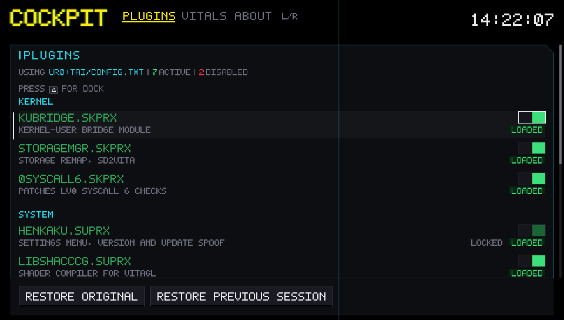
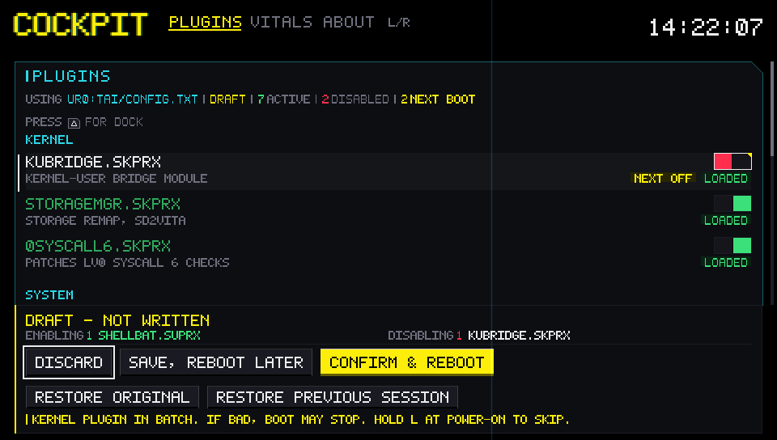
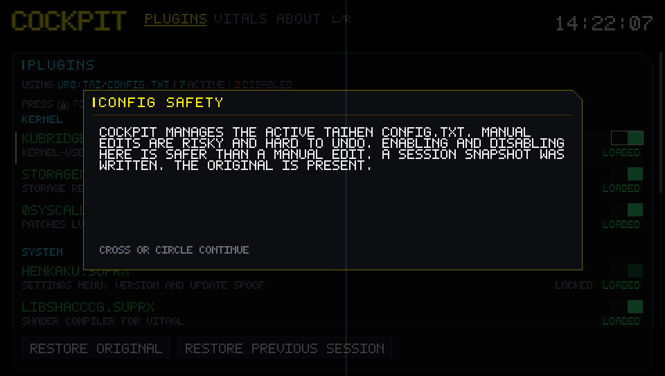
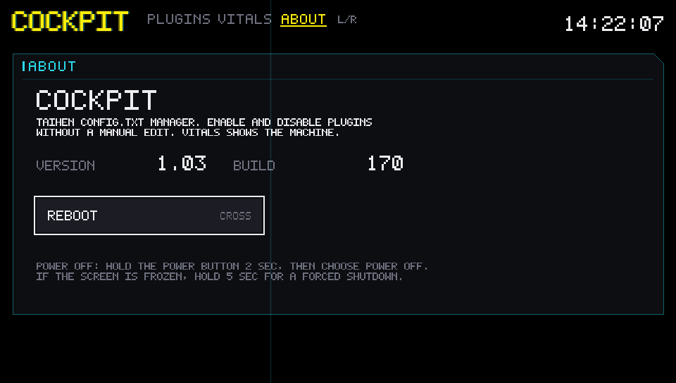
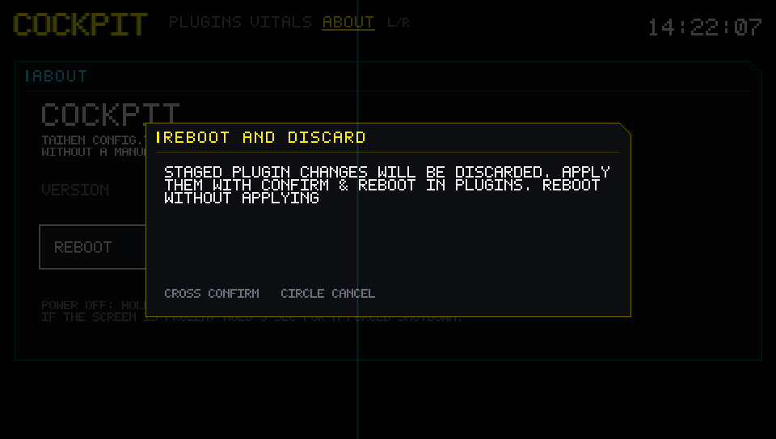
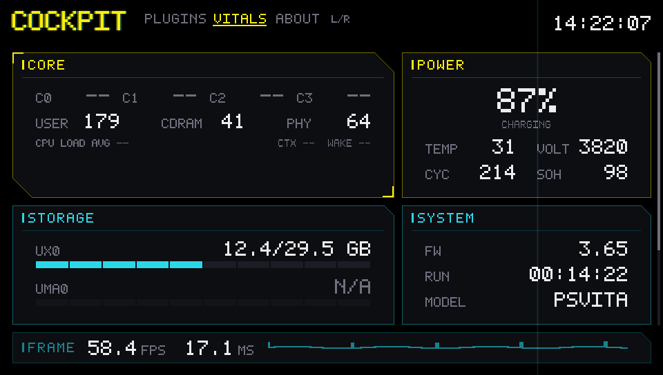

# COCKPIT

**A taiHEN `config.txt` plugin manager for the PS Vita, built to show only
numbers that are real.** COCKPIT opens on the ledger: it lists every plugin in
the active config, shows what is running now and what will run after the next
boot, and stages enables and disables as one reviewed batch. VITALS is the
second tab, ABOUT is the third. Cyberpunk 2077's in-game HUD is the visual
reference: thin rules, one chamfered corner, small tracked labels over large
values. One userland app, no plugins of its own.

[](LICENSE)




It installs nothing outside its own VPK and never adds a COCKPIT line to
`config.txt`. The manager only edits lines that are already there.

## What it shows

**PLUGINS** — the landing screen. Every path in the active config, grouped
KERNEL / SYSTEM / SYSTEM APPS / ALL TITLES, with the current load state and the
next-boot state on every row.

**VITALS** — the machine readout: CORE, POWER, STORAGE, SYSTEM, the plugin
summary, and the pinned FRAME strip.

**ABOUT** — the app title, a short description, the version and build, the
guarded REBOOT, and the console's real power-off path.

## The plugin manager


It resolves the active config the way taiHEN does — `ux0:` first, `ur0:`
fallback — and names the file it used. Every path is listed, active or
commented, grouped KERNEL / SYSTEM / SYSTEM APPS / ALL TITLES, one row per
unique path.

Each row carries two separate facts: what is running now (`LOADED`,
`NOT LOADED`, `MIXED`, `MISSING`, `NOT REACHED`, `BOOT`, `LOCKED`) and what will
run after the next boot (`NEXT ON` / `NEXT OFF`).



Cross stages a row. Nothing is written and no dialog opens. The dock lists the
pending enables and disables and offers `DISCARD`, `SAVE, REBOOT LATER`, and
`CONFIRM & REBOOT`. Confirm writes the batch once and requests a cold reset.

`RESTORE ORIGINAL` and `RESTORE PREVIOUS SESSION` sit on the dock's second row.
A restore shows a plugin-level diff before it writes anything, and
`UNDO LAST WRITE` opens the same preview for the last committed batch.

### Guard rails

- `taihen.skprx`, `henkaku.skprx`, `yamt.skprx`, and `henkaku.suprx` are locked;
  a batch or restore that would drop one is refused and the path is named.
- `boot_config.txt` is never opened, read, copied, or written.
- Reboot is refused below 20 % while discharging, when the power read is
  invalid, or in a repair state (`REPAIR WITH UNDO FIRST` / `RECOVERY FAILED`).
  The save path stays available.
- Writes go through a sibling swap: write `.new`, verify, move the original to
  `.old`, move `.new` into place, read back. A failed step restores the original
  and names the stage.
- Snapshots are `config.txt.original` (once, never overwritten),
  `config.txt.session` (each launch), and `config.txt.undo` (one step).

## First launch



Every launch opens on a safety card that names the active `config.txt`, the
backup this session wrote, and why editing through COCKPIT is safer than a
manual edit. It is a gate, not a nag: Cross or Circle dismisses it, and it
returns next session because the app stores no acknowledgement.

The card reports what actually happened. If the session snapshot could not be
written it says so; if the config is unreadable or too large it says editing is
locked instead of promising a restore point.

## ABOUT



ABOUT identifies the build (`1.03`, build number) and offers the only console
action: REBOOT, behind a confirmation. A staged batch or a restore preview is
discarded only after the confirmation says so; a saved batch is applied at the
next boot. The page also prints the real power-off path, because userland cannot
request a shutdown.



## Every number is real

If the platform cannot report a value, the panel shows `--` or `N/A`. Never a
guess, a stale reading, or a zero.

That is why there is no GPU load row and no applied ARM/GPU/BUS clocks: userland
cannot read them. The ScePower getters return what this process requested, not
what the hardware is running at. The rows are omitted rather than filled with a
number that cannot be defended.

The same rule covers failures. A frozen or regressed cumulative counter renders
`--` for that rate, not `0/S`. A `uma0:` that does not exist reads `N/A`; one
that exists but cannot be read shows its return code.



## Install

Requires a **PS Vita on 3.65 with permanent Enso**. PSTV is not supported.

1. Download `cockpit-v01.03-b170.vpk` from
   [Releases](https://github.com/ghostmeson/vitacockpit/releases/latest).
2. Copy it to `ux0:data`.
3. In VitaShell, select the VPK and press Cross.
4. Launch COCKPIT from LiveArea.

The default build is **UNSAFE** because `uma0:` capacity needs `sceIoDevctl`,
so enable **Unsafe Homebrew** in HENkaku Settings. `./build.sh --safe` builds a
restricted variant; `uma0:` then reads `N/A`.

## Controls

| Input | Action |
|---|---|
| L / R | Switch PLUGINS, VITALS, ABOUT (wraps at either end) |
| Sticks / D-pad | Scroll VITALS or the PLUGINS list |
| D-pad up / down | Move the plugin row selection |
| Cross | Stage a row / activate a dock action / open the ABOUT reboot confirmation |
| Circle | Back out of the dock or a preview / cancel the reboot |
| Triangle | Toggle dock focus |
| Down from the last row | Enter the dock |

## Build from source

Install [VitaSDK](https://vitasdk.org/) 2026.08, then:

```sh
export VITASDK="$HOME/vitasdk"
export PATH="$VITASDK/bin:$PATH"

./build.sh                 # UNSAFE eboot, the default
./build.sh --safe          # restricted eboot, marked -safe
```

`build.sh` increments `BUILD_NUMBER` only when the sources changed and keeps
exactly one VPK in `build/`. The artifact is
`build/cockpit-v<version>-b<build>[-safe].vpk`.

Upload it to a Vita running VitaShell's FTP server:

```sh
./send.sh <vita-ip>
```

## Tests and previews

The policy layer is host-testable, so most of the app runs without a console:

```sh
./tools/test/run.sh        # 1,491 checks: metrics, editor, UI
./tools/preview/run.sh     # 51 PNG scenes in build/preview/
```

The tests link the real `src/core/` against a fake platform port. The preview
renders the shipped composition through a software vita2d shim. Neither proves
device behavior — `sceIoRename`, `sceKernelGetSystemInfo`, and the cold-reset
permission are hardware-only claims.

## Project layout

```text
src/core/         policy: metrics, history, plugins, editor, input
src/platform/     the Vita SDK adapter, the only device sampler
src/app/          app shell, pad adapter
src/panels/       VITALS panels and the PLUGINS ledger
src/ui/           header, tabs, launch card, ABOUT, dock flow, pure formatters
src/gfx/          vita2d renderer adapter
tools/test/       host test suites and the fake platform
tools/preview/    software vita2d shim and scene renderer
docs/             project, architecture, design, decisions, plans, reviews
screenshots/      the curated images used here and in the release post
```

The dependency rule is enforced: `src/core/` includes no `psp2/*` header and no
`vita2d.h`. `src/platform/platform_psp2.c` is the single SDK adapter, `src/main.c`
the composition root, and `src/gfx/draw.c` the only renderer caller. See
[docs/ARCHITECTURE.md](docs/ARCHITECTURE.md).

## Status

Build **b170** (`v01.03`), 147,044 bytes, SHA-256
`fa4a9847dd1e8a4983c763309366c18b6c0e87d89c034c0670f3be71e051e6d0`.
Published as [release v1.03](https://github.com/ghostmeson/vitacockpit/releases/tag/v1.03).

- 1,491 host checks pass; 51 preview scenes render; default and `--safe` builds
  are clean.
- The VPK contains `eboot.bin` and `sce_sys/` only.
- **b166 (`v1.01`) is confirmed on a PS Vita 1000 running 3.65 Enso** (user
  report, 2026-11-10). b170 adds the launcher icon and LiveArea art and packages
  the same app code, so the behavior is the tested one.
- The CORE idle-clock unit remains the one unconfirmed platform claim. If the
  clock turns out to be coarser than microseconds, CORE renders `--` rather than
  a wrong percentage.
- Firmware may read 3.74 on a 3.65 console: the version string is spoofed, and
  the panel shows what the API returns.

The full checklist and the `[V]` / `[C]` status of every platform claim are in
[docs/PROJECT.md §5](docs/PROJECT.md#5-verification-status) and
[docs/ARCHITECTURE.md §7](docs/ARCHITECTURE.md#7-platform-claims-and-their-status).

## Documentation

| Doc | Contents |
|---|---|
| [docs/PROJECT.md](docs/PROJECT.md) | Scope, status, build and deploy, roadmap, hardware handoff |
| [docs/ARCHITECTURE.md](docs/ARCHITECTURE.md) | Layers, the dependency rule, module contracts, how to extend |
| [docs/DESIGN.md](docs/DESIGN.md) | Visual language, palette, typography, layout |
| [docs/DECISIONS.md](docs/DECISIONS.md) | Numbered decision log with context and consequences |
| [docs/threads/](docs/threads/) | Thread records and review history |
| [docs/reviews/](docs/reviews/) | Archived code reviews |
| [docs/plans/](docs/plans/) | Historical feature and hardening plans |
| [docs/examples/](docs/examples/) | Port, adapter, panel, and layout reference copies |
| [docs/gpu-crash-study/](docs/gpu-crash-study/) | The early GPU crash analysis |
| [docs/reddit-post.md](docs/reddit-post.md) | The community announcement draft |

## Contributing

Issues and pull requests are welcome. This is a hobby project built against one
console, so a report that names the firmware, the build, and what the screen
showed is worth more than a general "it crashed". Please do not attach crash
dumps: a `.psp2dmp` is a full copy of console memory.

## License

[MIT](LICENSE) © 2026 ghostmeson.
