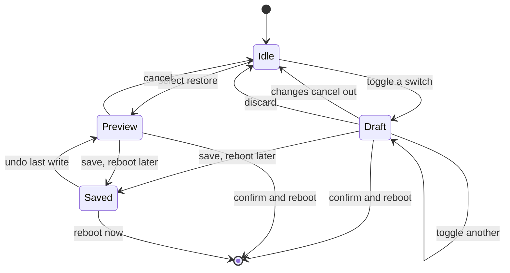
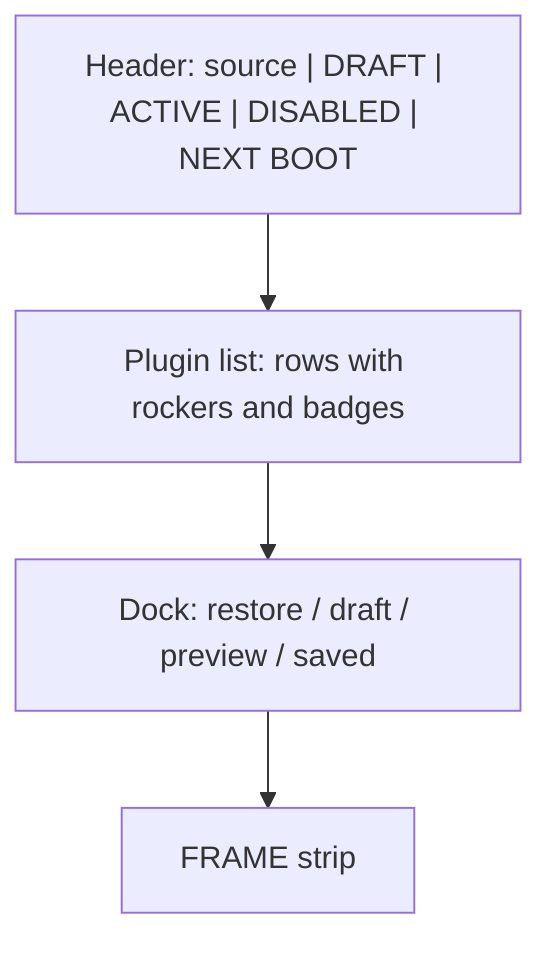
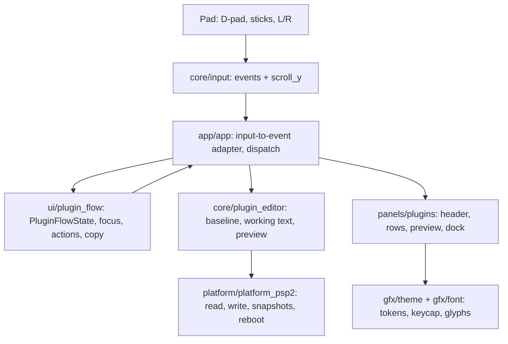
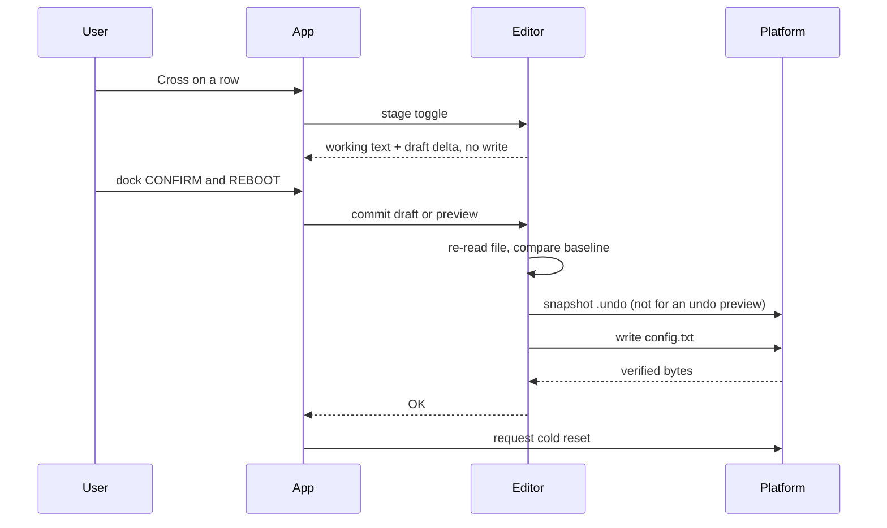
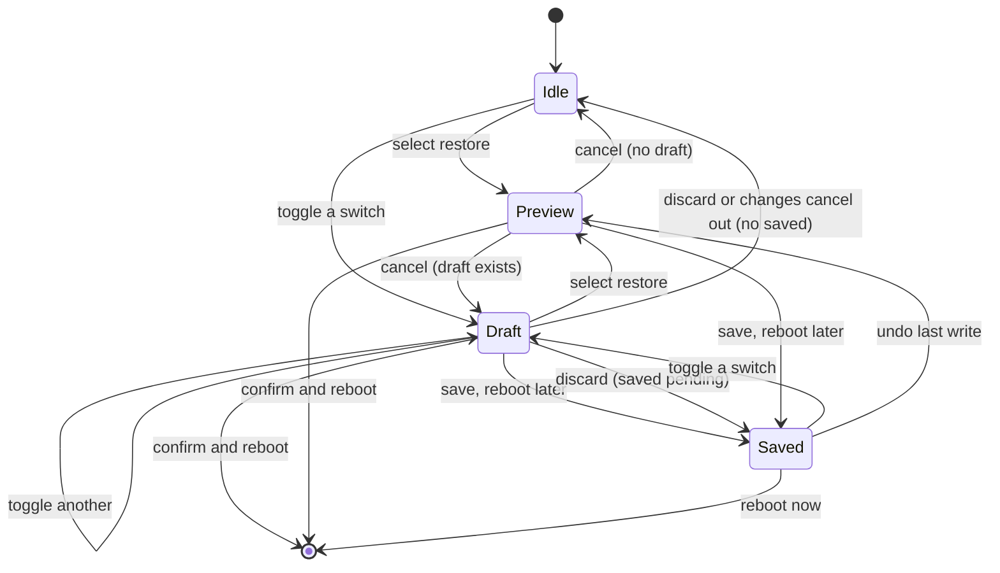

# PLUGINS Transaction Dock - Plan

## Goal Capsule

- **Objective:** Make plugin changes reviewable before they reach boot, with a clear recovery path to a previous configuration.
- **Means:** An in-memory working set, a permanent inline transaction dock, one atomic write per batch, and the existing `.original` / `.session` snapshots as restore sources (KTD1-KTD3, KTD5).
- **Product authority:** The user is the product authority for this redesign. The HOME PLUGINS summary block is not active scope; only the global scroll input changes outside the PLUGINS tab.
- **Open blockers:** The transactional rename, immediate read-back, and cold-reset permission remain `[C]` until tested on the target 3.65 Enso console.

---

## Product Contract

### Summary

Replace immediate per-switch writes with an in-memory draft and a permanent transaction dock. The dock lists pending enables and disables, offers `DISCARD`, `SAVE, REBOOT LATER`, and `CONFIRM & REBOOT`, and adds `RESTORE ORIGINAL` and `RESTORE PREVIOUS SESSION` with a plugin-level diff before confirmation. The analog sticks scroll; the D-pad moves options.

### Problem Frame

The current PLUGINS screen writes `config.txt` on every switch press. A single mistaken press is already committed, every change interrupts with its own confirmation and receipt, and several changes cannot be reviewed as one batch before they reach boot. Recovery is split between a per-change undo and a separate session sheet. Kernel plugins make the risk concrete: one bad entry can prevent the console from booting. The screen lacks a boundary between intent and the write.

### Key Decisions

- KD1. **Draft now, write once.** Staging separates intent from the write, so a mistaken switch is cheap to discard. Governs R1-R6, R33, R39. (session-settled: user-directed — chosen over per-switch writes and per-row confirmation: the user asked for one batch confirmation so a mistaken switch never writes immediately.)
- KD2. **The dock is inline, not a dialog.** Transaction actions stay visible in the screen instead of interrupting the list. Governs R23-R32. (session-settled: user-directed — chosen over the Triangle commit sheet and focusable-footer alternatives: the user explicitly rejected a dialog.)
- KD3. **Three truths stay separate.** Launch, working set, and file each get their own surface so a saved change cannot be mistaken for a running one. Governs R2, R10, R11, R16, R18, R19, R36. (session-settled: user-directed — chosen over a single blended state: the user chose the file-now count and then asked for staging, so the count stays immediate on the working set.)
- KD4. **Two permanent restore points; contextual last-write undo.** First-run and start-of-session recovery stay stable, while the last write gets a temporary undo. Governs R24, R27, R40-R43. (session-settled: user-directed — chosen over a permanent third restore point: the user selected two points and accepted a contextual undo for the post-commit gap.)
- KD5. **Save without reboot is a first-class action.** Advanced users can write now and restart later without pretending the change is live. Governs R34-R37. (session-settled: user-directed — chosen over confirm-and-reboot only: the user asked for an apply-without-reboot path for advanced users.)
- KD6. **State is carried by shape first, color second.** The rocker, badges, and selection wash stay readable without color. Governs R9, R16, R17, R49-R52. (session-settled: user-approved — chosen over bright green titles and unrestricted red: the user selected the dim-title and limited-red variants.)
- KD7. **Sticks scroll; the D-pad chooses.** Continuous scrolling and discrete selection stop fighting each other. Governs R45-R48. (session-settled: user-directed — chosen over the current stick-as-digital-D-pad mapping: the user asked for the separation across the entire app.)
- KD8. **The restore diff is plugin-level.** The preview answers the plugin question without pretending to be a full file diff. Governs R41, R44. (session-settled: user-approved — chosen over a line-level diff: the user accepted the plugin-level diff and the whole-file caveat.)
- KD9. **`OFF` becomes `NOT LOADED`.** The launch badge names the launch set instead of implying the file state. Governs R18, R19, R36. (session-settled: user-approved — chosen over keeping `OFF`: the rename removes the green-rocker/red-OFF contradiction, and the user selected it.)
- KD10. **The session sheet and per-row dialogs retire.** One dock owns transaction actions. Governs R31, R38. (session-settled: user-approved — chosen over keeping the session sheet and per-row dialogs: the user asked for an inline dock and no dialogs.)
- KD11. **The blank header line is the exception slot.** Warnings use reserved space, so the ledger never shifts. Governs R8, R12. (session-settled: user-approved — chosen over a conditional fourth line: the constant-height slot avoids a ledger shift, and the user selected it.)

### Requirements

**Transaction model**

- R1. A switch press stages the change in memory; it must not write `config.txt` or any snapshot.
- R2. The working set is the draft when one exists, otherwise the file. A draft with no difference from the file is empty: no `DRAFT` tag and the dock returns to the saved state when a save is pending, otherwise idle. Header counts, row titles, and rockers describe the working set.
- R3. The draft is memory-only. Leaving COCKPIT discards it and leaves the file untouched. No draft file is written.
- R4. A commit writes the whole working set in one transactional write, takes exactly one `.undo` snapshot before the write, and verifies the result. A failure leaves the file unchanged or recovered, or reports an unrecoverable write and keeps the `DO NOT REBOOT` interrupt; the draft stays.
- R5. A commit or restore refuses if the live file differs from the baseline read at scan. The draft or preview stays, and the user is told to restart COCKPIT.
- R6. One batch is one undo unit. The pre-batch file is restored, not a single row.
- R7. `boot_config.txt` is never read, copied, backed up, renamed, or written.

**Header**

- R8. The header has three 14 px line slots and no fourth line: source, blank-or-exception, prompt.
- R9. Line 1 renders `USING` dim, the path cyan, `DRAFT` yellow when staged, the ACTIVE number green with a dim label, the DISABLED number red with a dim label, dim pipes, and an optional yellow NEXT BOOT segment. Tokens follow R49-R51.
- R10. ACTIVE counts rows with at least one uncommented, reached line in the working set. DISABLED counts every other row. A zero count is dim.
- R11. NEXT BOOT counts working-set rows that differ from the launch set; it appears only when the count is nonzero.
- R12. The blank slot carries the yellow exception line when one exists. Segments are pipe-separated in this order: read-only reason, config warning, backup warning, shadowed path, recovered. The line appends only while it fits the panel inset and truncates the last segment with `..`. The header height does not change.
- R13. The prompt line renders `PRESS` dim, a 14 × 12 keycap with a white triangle, and `FOR SESSION OPTIONS` dim. Triangle focuses the dock.
- R14. The old `ROWS / LOADED / NEXT BOOT`, `CROSS CHANGE`, and undo-status text are removed.

**Rows**

- R15. The left status dot is removed. Names and descriptions start at the panel content inset (14 px).
- R16. The title is `C_GREEN_DIM` when the working set has at least one reached active line; otherwise white.
- R17. The right control is a 46 × 20 split rocker with no text: left half green for on, right half red for off, both halves for mixed, both dim when the row is not actionable.
- R18. The rocker reflects the working set, the status badge reflects the launch set, and `NEXT ON` / `NEXT OFF` reflects the working set versus launch.
- R19. The status badges are `LOADED`, `NOT LOADED`, `MIXED`, `BOOT`, `MISSING`, and `NOT REACHED`. A locked HENKAKU row adds a `LOCKED` badge beside its status. `NEXT ON` / `NEXT OFF` appears only when the working set differs from launch.
- R20. Four px separate the rocker from the badge, and the badge aligns with the description line.
- R21. The selected row uses a 4% white wash, the existing 2 px left bar, and a 1 px white rocker outline. A draft-modified rocker gets a small yellow corner notch.
- R22. Cross stages an actionable row. A non-actionable row does nothing; the badge or exception line names why. There is no per-row confirmation dialog.

**Dock**

- R23. A permanent inline dock sits at the bottom of the PLUGINS panel. It is not a dialog. The list viewport shrinks around it and the dock stays pinned.
- R24. The idle dock offers `RESTORE ORIGINAL` and `RESTORE PREVIOUS SESSION`.
- R25. The draft dock shows `DRAFT - NOT WRITTEN`, `ENABLING n` with green names, `DISABLING n` with white names and a red count, and `+N MORE` when needed. Its primary actions are `DISCARD`, `SAVE, REBOOT LATER`, and `CONFIRM & REBOOT`; a secondary row keeps `RESTORE ORIGINAL` and `RESTORE PREVIOUS SESSION`.
- R26. The restore preview shows `PREVIEW - <snapshot>`, the counts, the read-only diff in the list, and the actions `CANCEL`, `SAVE, REBOOT LATER`, and `CONFIRM & REBOOT`.
- R27. The saved state shows `SAVED - REBOOT TO APPLY` with `UNDO LAST WRITE` and `REBOOT NOW`; when no `.undo` remains it shows `REBOOT NOW` only. After a relaunch it shows `LAST WRITE - UNDO AVAILABLE` with `UNDO LAST WRITE` only. `UNDO LAST WRITE` opens the `.undo` diff preview under the same preview and confirmation rules as a restore.
- R28. The safe action is focused first. The commit is the rightmost yellow primary.
- R29. D-pad Down from the last row enters the dock. Left/Right selects an action, Cross activates, Up returns, Circle backs out, and Triangle is a shortcut.
- R30. `DISCARD` clears the draft, writes nothing, and returns to the saved state when a save is pending; otherwise it returns to idle. It needs no extra confirmation.
- R31. The dock is the session options. The per-row confirmation and receipt dialogs and the old session sheet are retired.
- R32. The dock uses the panel body, a hairline top, and a 2 px yellow left edge when a draft or preview is active.

**Commit and save**

- R33. `CONFIRM & REBOOT` snapshots `.undo`, writes the batch, and requests a cold reset.
- R34. When the battery is below 20% and not charging, or the power read is invalid, `CONFIRM & REBOOT` is unavailable and `SAVE, REBOOT LATER` becomes the primary action. The warning is `REBOOT BLOCKED - CHARGE TO 20%` or `BATTERY LEVEL UNKNOWN - CHARGE BEFORE REBOOTING`.
- R35. `SAVE, REBOOT LATER` writes the batch and leaves the dock in the saved state. Its warning is `SAVE ONLY - NOTHING CHANGES UNTIL THE VITA RESTARTS / THE PLUGINS RUNNING NOW STAY LOADED.`
- R36. After a save, the `DRAFT` tag disappears, the counts become the file, `NEXT BOOT` remains, and the rows keep `NEXT ON` / `NEXT OFF`.
- R37. `REBOOT NOW` in the saved state is battery-gated the same way.
- R38. A failed commit or save reports `WRITE FAILED <stage>` inline. The draft or preview stays and the file is unchanged or recovered. An unrecoverable write keeps the `DO NOT REBOOT` interrupt.
- R39. A commit replaces the previous `.undo`. A completed undo removes the `.undo` snapshot. Undo remains one step.

**Restore**

- R40. `RESTORE ORIGINAL` reads `.original`; `RESTORE PREVIOUS SESSION` reads `.session`. A missing or unreadable snapshot is unavailable.
- R41. Selecting a restore shows a read-only plugin-level diff against the current working set (the draft when one exists): proposed switches, `+` / `-`, `WILL ENABLE` / `WILL DISABLE` / `WILL REMOVE`, and unchanged rows dim.
- R42. If a draft exists, the preview warns that it will be discarded and the confirm label becomes `DISCARD DRAFT & RESTORE`. The warning applies to both confirm and save.
- R43. A restore writes the snapshot bytes, snapshots the current file to `.undo` first, and offers the same confirm, save, and cancel actions.
- R44. The restore diff is plugin-level. The whole file is replaced, including comments and sections. No line-level diff is offered.

**Input**

- R45. Left stick, right stick, or both smooth-scroll the active surface: the HOME canvas, the PLUGINS list, and the restore preview. The dead zone is about 0.18, the speed about 520 px/s, and the range is clamped.
- R46. The D-pad moves the selection and options: PLUGINS rows, then dock actions. HOME keeps its stepped scroll because there is no selection.
- R47. The L/R shoulder buttons remain tab switches. D-pad Left/Right select the dock actions.
- R48. The remaining `DO NOT REBOOT` error modal takes Cross or Circle and ignores the D-pad and stick. The old digital stick-to-up/down mapping is removed.

**Design system and accessibility**

- R49. `C_RED` `#FF2E4D` is limited to the DISABLED number, the dock's DISABLING count, the rocker off half, and the `NOT LOADED` badge. It never colors a label or a title.
- R50. `C_GREEN_DIM` `#2FA85C` colors active titles. `C_GREEN` `#3BE07A` colors the rocker on half, the `LOADED` badge, and the ACTIVE number.
- R51. `C_CYAN` colors the path; `C_YELLOW` colors `DRAFT`, pending, exceptions, and the primary action; `C_WHITE` colors the keycap triangle and the off title; `C_DIM` colors labels, pipes, and secondary actions.
- R52. Color is never the only cue: badge text, rocker half position, and the selected-row wash and bar carry the state. Contrast stays at or above the existing dim floor.
- R53. The old rules “numbers are always white” and “green only means loaded” are superseded for these status counts. Red is introduced as the off-state token.

**Delivery**

- R54. The change updates `vita-cockpit/docs/DESIGN.md`, `PROJECT.md`, `DECISIONS.md`, `ARCHITECTURE.md`, `README.md`, `PROJECTS.md`, `agent-wiki/12-projects.md`, and `agent-wiki/13-fact-check.md` in the same change. New decision entries supersede the old color rules, per-row confirmation, and session sheet.
- R55. Host tests and preview cover the new states. The project remains `built`, not `verified`, until the hardware checks pass.

**Restore safeguard**

- R56. A restore that would remove a BOOT or locked HENKAKU path is refused in the preview and the path is named. The user must edit the file outside COCKPIT.

### Key Flows

- F1. Stage a batch.
  - **Trigger:** Cross on an actionable row.
  - **Steps:** The working set changes; the header counts, title, and rocker update; the `DRAFT` tag appears; the dock shows the summary. No file write.
  - **Outcome:** A draft with N changes and a visible dock.
- F2. Confirm and reboot.
  - **Trigger:** `CONFIRM & REBOOT` in the dock.
  - **Steps:** Re-read the file; refuse if it changed; snapshot `.undo`; write and verify; clear the draft; request cold reset.
  - **Outcome:** The file is written and the console restarts.
- F3. Save without reboot.
  - **Trigger:** `SAVE, REBOOT LATER`.
  - **Steps:** Show the inline warning; write and verify; clear the draft; leave the saved state.
  - **Outcome:** The config is saved; the running plugins stay loaded until restart.
- F4. Discard.
  - **Trigger:** `DISCARD`.
  - **Steps:** Clear the draft; restore the working set to the file; return to the saved state when a save is pending, otherwise idle.
  - **Outcome:** The file is untouched.
- F5. Preview a restore.
  - **Trigger:** `RESTORE ORIGINAL` or `RESTORE PREVIOUS SESSION` from the idle or draft dock.
  - **Steps:** Read the snapshot; build the plugin-level diff; replace the list with the read-only preview; show the counts and actions; warn if a draft exists.
  - **Outcome:** A reviewable diff with no write.
- F6. Confirm a restore or undo.
  - **Trigger:** `CONFIRM & REBOOT` or `SAVE, REBOOT LATER` in the preview.
  - **Steps:** Re-read the file; snapshot `.undo` (except for an undo preview); write the snapshot bytes; verify; clear the preview; reboot or save.
  - **Outcome:** The selected snapshot is written, or the pre-batch file is restored for `UNDO LAST WRITE`. Cancel returns to the draft when one exists, otherwise idle.

Dock state transitions:

Screen regions:

### Acceptance Examples

- AE1. Stage two enables and one disable.
  - **Covers R1, R2, R3, R10, R25.**
  - **Given:** A readable config and an empty dock.
  - **When:** Cross stages two enables and one disable.
  - **Then:** The counts move, the `DRAFT` tag appears, the dock lists the three names under ENABLING and DISABLING, and `config.txt` is unchanged.
- AE2. Discard a draft.
  - **Covers R3, R30.**
  - **Given:** Three staged changes.
  - **When:** `DISCARD` is activated.
  - **Then:** The rockers and counts return to the file state, the dock returns to idle, and no write occurs.
- AE3. Confirm and reboot.
  - **Covers R4, R33, R39.**
  - **Given:** Three staged changes and a battery above 20%.
  - **When:** `CONFIRM & REBOOT` is activated.
  - **Then:** One `.undo` snapshot is written, the batch is written once, the draft clears, and a cold reset is requested.
- AE4. Battery-blocked confirm.
  - **Covers R34, R37.**
  - **Given:** Staged changes and a battery below 20% while not charging.
  - **When:** The dock is focused.
  - **Then:** `CONFIRM & REBOOT` is unavailable, `SAVE, REBOOT LATER` is the primary action, the dock shows `REBOOT BLOCKED - CHARGE TO 20%`, and saving leaves `REBOOT NOW` gated.
- AE5. Save without reboot.
  - **Covers R35, R36.**
  - **Given:** Staged changes and a user who does not want to restart.
  - **When:** `SAVE, REBOOT LATER` is activated.
  - **Then:** The file is written, the dock shows `SAVED - REBOOT TO APPLY`, the `DRAFT` tag disappears, `NEXT BOOT` remains, and the running plugins stay loaded.
- AE6. Preview and cancel a restore.
  - **Covers R40, R41, R44.**
  - **Given:** A readable `.original` and a current file that differs.
  - **When:** `RESTORE ORIGINAL` is activated, then `CANCEL`.
  - **Then:** The list shows the snapshot diff with proposed switches and `+` / `-` markers, no write occurs, and cancel returns to the current list.
- AE7. Restore with a draft.
  - **Covers R42.**
  - **Given:** A two-change draft and a selected restore.
  - **When:** The preview opens.
  - **Then:** It warns that the draft will be discarded and the confirm label reads `DISCARD DRAFT & RESTORE`.
- AE8. Restore failure.
  - **Covers R38, R43.**
  - **Given:** A restore preview and a write failure that leaves the original recoverable.
  - **When:** Confirm is activated.
  - **Then:** The dock reports `WRITE FAILED <stage>`, the preview stays, and the file is unchanged.
- AE9. External file change.
  - **Covers R5.**
  - **Given:** A draft built from the scan baseline.
  - **When:** `config.txt` changes on disk before confirmation.
  - **Then:** The commit refuses with `CONFIG CHANGED ON DISK. RESTART COCKPIT.` and the draft stays.
- AE10. Non-actionable rows.
  - **Covers R17, R19, R22.**
  - **Given:** A BOOT row, a locked HENKAKU row, a NOT REACHED row, and a missing-off row.
  - **When:** Each is focused and Cross is pressed.
  - **Then:** The rocker is dim, nothing is staged, and the badge names the reason. The HENKAKU row shows `LOCKED`; the others show `BOOT`, `NOT REACHED`, or `MISSING`. With a read-only config, every rocker is dim and the header exception line names the reason.
- AE11. Scroll and select are independent.
  - **Covers R45, R46, R47.**
  - **Given:** A PLUGINS list longer than the viewport.
  - **When:** The left or right stick is held while the D-pad moves the selection.
  - **Then:** The view scrolls smoothly, the selection moves row by row, and L/R still switch tabs.
- AE12. Header exception.
  - **Covers R8, R12.**
  - **Given:** A read-only config with a named reason.
  - **When:** The PLUGINS header is drawn.
  - **Then:** The exception replaces the blank line, stays yellow, and the prompt and first row do not move.
- AE13. Undo the last write.
  - **Covers R27, R39, R43.**
  - **Given:** A successful save and an `.undo` snapshot that differs from the live file.
  - **When:** `UNDO LAST WRITE` is activated, then confirmed.
  - **Then:** The `.undo` diff preview opens, confirming restores the pre-batch file in one write, and the `.undo` snapshot is removed.
- AE14. Restore removes a locked path.
  - **Covers R56.**
  - **Given:** A snapshot whose plugin set omits `henkaku.suprx`.
  - **When:** The restore preview opens.
  - **Then:** The path is listed as `WILL REMOVE`, the confirm and save actions are unavailable, and the dock names the locked removal. Nothing is written.
- AE15. No-change restore.
  - **Covers R41, R42.**
  - **Given:** A snapshot whose plugin set matches the current working set.
  - **When:** The restore preview opens.
  - **Then:** The dock shows `NO CHANGES - NOTHING TO RESTORE`, confirm and save are unavailable, and cancel returns.

### Scope Boundaries

- In scope: the PLUGINS header, row controls and badges, the inline dock, staged commits, save without reboot, contextual last-write undo, the two restore points and their plugin-level diff, the global scroll/navigation split, and the project docs.
- Deferred for later: a line-level restore diff, a persistent draft across app restarts, a boot-session-aware post-reboot undo (the one-step `.undo` may remain visible after a relaunch or reboot because the app cannot distinguish them), a rotated `.previous` snapshot, and any dock animation.
- Outside this change: the HOME PLUGINS summary block (only its scroll input changes), `boot_config.txt`, plugin installation or removal, manual editing of comments or sections, and the hardware verification itself.

### Dependencies / Assumptions

- The platform layer can read `.original` and `.session`; it currently only writes them. The transactional write, `.undo` snapshot, and recovery path are reused.
- The editor can hold a separate draft text, parse a snapshot into a diff, and keep the launch baseline for the `LOADED` / `NOT LOADED` badges.
- `.session` is the config read at the start of the current session, which is the previous session’s end state. It is overwritten at each launch. The one-step `.undo` is not overwritten by scan, so the contextual undo may remain visible after a relaunch or reboot; the app cannot distinguish them. A boot-session-aware post-reboot undo is deferred.
- The app cannot prove the launch set after a relaunch without a reboot. The `LOADED` badge is the launch file set for the current COCKPIT session. `SAVE, REBOOT LATER` inherits that documented limitation.
- After a relaunch or reboot, the dock shows `LAST WRITE - UNDO AVAILABLE` rather than `SAVED - REBOOT TO APPLY`; the undo remains available, but the app cannot prove whether the saved config booted.
- A new draft may be staged on top of a saved-but-not-booted file. The dock’s draft state takes priority; discarding the draft returns to the saved state and its contextual undo.
- The restore preview obeys R44: the whole snapshot is written, so no section or comment translation is performed.
- The `SAVE, REBOOT LATER` label is chosen over `APPLY, REBOOT LATER` because nothing applies until restart.
- The exact dock heights and the final token contrast are planning values; the stick feel may be tuned without changing the scroll/selection split.
- Hardware-only risks remain `[C]`: `sceIoRename` and replace semantics, immediate read-back visibility, and `scePowerRequestColdReset` permission on 3.65 Enso.

### Sources / Research

- `vita-cockpit/src/panels/plugins.c` — current header lines, row geometry, status colors, badges, and text controls.
- `vita-cockpit/src/core/plugin_editor.c` and `plugin_editor.h` — line model, toggle, `.undo` refresh, restore, status text, and the current per-change write path.
- `vita-cockpit/src/platform/platform_psp2.c` — transactional write, `.original` / `.session` backups, `.undo`, recovery, and cold reset.
- `vita-cockpit/src/app/app.c` — current input routing, modal handling, session choices, and reboot/undo actions.
- `vita-cockpit/src/core/input.c` and `input.h` — current D-pad repeat and stick-to-direction mapping.
- `vita-cockpit/src/ui/modal.c` — current confirmation, receipt, session, and error panels.
- `vita-cockpit/src/gfx/theme.h` and `vita-cockpit/docs/DESIGN.md` — palette, type scale, spacing tokens, and the existing panel geometry.
- `vita-cockpit/docs/PROJECT.md`, `DECISIONS.md`, and `ARCHITECTURE.md` — scope, prior decisions, and layering rules.
- `agent-wiki/13-fact-check.md` — `[V]` / `[C]` claim status for the hardware-only behavior.
- `2026-11-03-1000-plugins-production-hardening-plan.md` — the prior hardening plan and its test matrix.
- Visual probe: `/tmp/compound-engineering-501/ce-brainstorm-visual/plugins-switches-20261103-01/` — machine-local and best effort; `screens/001-switch-probe.html` and the selected rocker state are supporting context only. A missing probe is not a blocker; the requirements govern.

---

## Planning Contract

**Product Contract preservation:** clarified in place; no product outcome or settled decision changed. R4, R25, R27, R30, R33, R34, R41 now state the write order, the draft-restore path, the saved-state variants, the discard return, the battery-unknown state, and the `WILL REMOVE` diff; R56 adds the locked-path restore safeguard. All stable IDs remain.

### Key Technical Decisions

- KTD1. **A full-text working buffer, not per-line overrides.** `EditorState.text` is the working text; `last_text` remains the file baseline. `file_rows[]` caches each path's presence, working activity, and launch activity; `row_status` and `launch_status` read those caches, so stage, discard, and preview never stat or read the card. A stage rebuilds the working text from itself, parses it once, and adopts it without a platform call; a commit writes it once and adopts it as the new baseline. Cites R1-R6, R18-R19, R39.
- KTD2. **Preview by swapping the working buffer.** A restore saves the current working text, reads the snapshot into the same buffer, parses it with the launch baseline, and records the working-set paths the snapshot lacks in `removed[]`. The diff compares the snapshot to the working set (the draft when one exists), not the file baseline. Cancel restores the saved text; confirm writes the snapshot. An undo preview never overwrites `.undo` from the live file; it keeps the source until the write verifies. Cites R40-R44, R56.
- KTD3. **One derived dock state.** `ui/plugin_flow` owns `PluginFlowState` (`IDLE`, `DRAFT`, `PREVIEW`, `SAVED`, `LAST_WRITE`) and `plugin_flow_state(...)`, derived from the editor and metrics. The panel height, action list, copy, and app dispatch all consume that one state; `UiState` stores only `focus` and `dock_choice`. Cites R23-R32; implements KD2.
- KTD4. **Separate continuous stick scroll from discrete D-pad events.** `InputState` carries a per-frame `scroll_y`; the D-pad keeps its edge and repeat events; D-pad Left/Right become their own events; the L/R shoulder buttons stay tabs. The app applies the stick scroll to the active surface, including the restore preview, and the preview list is read-only. Cites R45-R48; implements KD7.
- KTD5. **One transactional write path, with the undo source protected.** `editor_commit_draft` and `editor_commit_preview` snapshot the current file to `.undo` before a restore write, but an UNDO preview writes the already-read `.undo` bytes without replacing `.undo` first, and a no-live-config undo skips the snapshot. `.undo` is removed only after a verified write. Cites R4, R33, R39, R43, R56.
- KTD6. **Draw from the existing panel vocabulary and the actual font.** The header keeps three 14 px line boxes; the row keeps the existing badge geometry with a 46 × 20 rocker; the dock is a panel strip at the viewport bottom; the preview list uses the same row renderer with diff markers. Add `&` and `,` glyphs to `gfx/font.c`; use ASCII `-` in UI labels and `+`/`-` diff markers; draw the triangle keycap with `draw_line`. Cites R8, R17, R20, R23, R32, R41.
- KTD7. **The fake platform and the pure flow module are the host-test seam.** Add write and stat counters plus snapshot reads to the fake; move the dock focus/action transitions and the action, battery, and saved-state lists into `ui/plugin_flow` (no `psp2` or `vita2d`), and link it into `tools/test/run.sh`. `app.c` is the input-to-event adapter. Cites R54-R55.
- KTD8. **Saved and last-write states follow a truth table.** The dock derives: `next_count > 0` and a differing `.undo` gives `SAVED - REBOOT TO APPLY` with `UNDO LAST WRITE` and `REBOOT NOW`; `next_count > 0` with no `.undo` gives `SAVED - REBOOT TO APPLY` with `REBOOT NOW` only; `next_count == 0` with a differing `.undo` gives `LAST WRITE - UNDO AVAILABLE` with `UNDO LAST WRITE` only; otherwise `IDLE`. The one-step `.undo` may survive a relaunch or reboot, and the app cannot distinguish them, so a boot-session-aware post-reboot undo is not promised. Cites R27, R36, R39.

### High-Level Technical Design

The component shape:

The commit and restore protocol:

The dock states, repeated here as the execution view of the Product Contract's dock diagram:

`Saved` also covers the last-write variant when `next_count` is 0 and `.undo` still differs; the truth table in KTD8 is authoritative for the label and actions.

### Planning Assumptions

- One extra 32 KiB saved-draft buffer fits the editor's `.bss` budget; measure the link map at implementation and reuse a scratch buffer if the margin is tight.
- The D-pad Left/Right are free; the L/R shoulder buttons stay on tab switching.
- The idle dock is about 44 px tall, the draft/preview dock about 88 px (two action rows), and the saved dock about 48 px; the exact values are tuned in the preview.
- The one-step `.undo` is reliable enough to derive the contextual undo; it may survive a relaunch or reboot, and the app cannot distinguish them.
- The fake platform can model snapshot reads, writes, stats, rename stages, and restore failures.
- No `STRATEGY.md`, `CONCEPTS.md`, Compound Pack, or `docs/solutions/` entry exists in this repository, so no pack or learning citation applies.
- The host suite and the preview are the integration points; the app dispatch layer is preview- and hardware-checked.

### Delivery Sequence

1. U1 establishes the draft/commit model, the launch activity map, and the cached file-presence facts.
2. U2 adds snapshot reads, the preview diff, the locked-path safeguard, the no-change state, and the protected undo path.
3. U3 draws the header, rows, preview list, dock, and font glyphs.
4. U4 adds the input split and the pure dock focus model.
5. U5 wires the actions, battery gate, saved truth table, and errors.
6. U6 updates tokens, docs, decisions, and removes the retired paths.
7. U7 finalizes the host suite, preview scenes, build artifact, and the written hardware checklist.

### Risks

- **Bootloop from a bad batch:** the dock warning, the `HOLD L` note, and the pre-write `.undo` are the safeguards; `boot_config.txt` stays untouched.
- **Memory:** the preview adds one 32 KiB saved-draft buffer. Measure the `.bss` and reuse a scratch buffer if the margin is tight.
- **Saved-state ambiguity after relaunch:** the `LAST WRITE - UNDO AVAILABLE` variant avoids claiming a reboot is pending when the app cannot prove it.
- **Input feel:** the stick dead zone and speed are tuned in the preview and on hardware; the D-pad Down at the last row enters the dock, and the orphan section is stick-scrolled.
- **Diff granularity:** the restore preview is plugin-level and the whole file is replaced; comments and sections are not shown.
- **Battery gate scope:** the gate protects the reboot, not the commit. A power loss during the card write relies on the `.old` swap recovery.
- **Hardware `[C]`:** rename/replace semantics, immediate read-back, and cold-reset permission remain unverified until the post-plan checklist runs.

---

## Implementation Units

### U1. Draft model, launch truth, and atomic commit

- **Goal:** The editor holds a working text, stages row toggles without touching the card, discards the draft, and commits the whole batch once with one `.undo`; the launch badge stays on the launch set.
- **Requirements:** R1-R6, R18, R19, R36, R39.
- **Dependencies:** None.
- **Files:**
  - `vita-cockpit/src/core/plugin_editor.h`
  - `vita-cockpit/src/core/plugin_editor.c`
  - `vita-cockpit/tools/fake/fake_platform.c`
  - `vita-cockpit/tools/fake/fake_platform.h`
  - `vita-cockpit/tools/test/test_editor.c`
- **Approach:**
  - Keep `last_text`/`last_len` as the file baseline and `text`/`text_len` as the working text. Add `draft_dirty`, `active_total`, `disabled_total`, `draft_count`, and `file_rows[]` with `path`, `present`, `active_lines`, `reached_lines`, `launch_active`, `launch_reached`, and `launch_present`.
  - `row_status` uses the cached `present` instead of `platform_file_exists`; add `launch_status` from the cached launch facts for the badge, resolved by path rather than line index. `rebuild_rows` must preserve the launch facts across a reparse.
  - `editor_stage_toggle(row, mode, err)` rebuilds the working text from itself, toggles every reached line, reparses, and updates counts. It performs no platform read, stat, or write.
  - `editor_discard_draft()` restores the working text from `last_text`, reparses, and clears `draft_dirty`.
  - `editor_commit_draft(err)` refuses empty/read-only/stale drafts; snapshots `.undo` from the baseline; writes the working text once; on success adopts it as the baseline, clears the draft, and sets `undo_available`.
  - Add `editor_draft_dirty()`, `editor_draft_count()`, and `editor_draft_change(row)`. Do not add `editor_saved_pending()`; the dock state belongs to `ui/plugin_flow` (KTD3/KTD8).
  - Keep a temporary `editor_toggle` wrapper that stages then commits so the current app and preview compile until U5; remove it in U5 and U6.
- **Patterns to follow:** The current `editor_toggle` line-copy and rollback path; `adopt_text`; `rebuild_rows`; the current `.undo` snapshot; the fake's failure setters.
- **Test scenarios:**
  - Stage a disable: the working text gains the `#`, `draft_dirty` is 1, the counts move, the fake write count is 0, and the fake stat count is unchanged.
  - Stage two enables and one disable: `draft_count` is 3 and each row reports its direction.
  - Stage a toggle and its reverse: the draft becomes empty, `draft_dirty` is 0, and no `DRAFT` tag is due.
  - Discard: the working text and counts return to the file state, with no write.
  - Commit: exactly one `.undo` write and one live write; the file matches the working text; the draft clears; `pending_count` remains; `undo_available` is 1.
  - Commit with `.undo` failure: no live write, the draft stays, and the result is `EDITOR_WRITE_FAILED`.
  - Commit with live write failure: the file is unchanged, the draft stays, and the error names the stage.
  - Commit with an unrecovered swap: the result is `EDITOR_WRITE_UNRECOVERED` and the draft stays.
  - Commit after the file changed on disk: `EDITOR_WRITE_REFUSED`, no write, draft intact.
  - Stage on a read-only, locked, NOT REACHED, or missing-off row: refused, with no draft.
  - Stage a row listed in two sections: all reached lines move together and the dock reports one row.
  - A row that was MIXED at launch and is staged fully off still reports `MIXED` on the status badge; the rocker and title show the working set.
  - A restore whose snapshot has a different line layout keeps `LOADED`/`NOT LOADED` on the correct paths.
  - `loaded` and `launch_active` do not move during staging; `NEXT ON`/`NEXT OFF` compares the working set to launch.
- **Verification:** `./tools/test/run.sh` passes; the fake write and stat counters prove no stage/discard side effects; the commit tests prove one write and one `.undo`.

### U2. Restore snapshots, preview diff, locked safeguard, and contextual undo

- **Goal:** Read `.original`, `.session`, and `.undo`; show a read-only plugin-level diff against the working set; refuse a locked-path removal; commit the selected snapshot through the protected transaction; keep the contextual undo.
- **Requirements:** R24, R27, R39-R44, R56.
- **Dependencies:** U1.
- **Files:**
  - `vita-cockpit/src/core/platform.h`
  - `vita-cockpit/src/platform/platform_psp2.c`
  - `vita-cockpit/src/core/plugin_editor.h`
  - `vita-cockpit/src/core/plugin_editor.c`
  - `vita-cockpit/tools/fake/fake_platform.c`
  - `vita-cockpit/tools/fake/fake_platform.h`
  - `vita-cockpit/tools/test/test_editor.c`
- **Approach:**
  - Add `PlatformBackup` (`ORIGINAL`, `SESSION`, `UNDO`) and `platform_read_backup(path, kind, buf, cap, &len)`. Implement it in the adapter with `sibling_path` and `platform_read_config`; mirror it in the fake. Clarify the `.undo` comment: scan may read it to derive availability and must never rewrite it.
  - Add `EditorSnapshot` (`ORIGINAL`, `SESSION`, `UNDO`) and the preview state: `active`, `kind`, `saved_work[EDITOR_TEXT_MAX]`, `saved_work_len`, `saved_dirty`, `removed[]`, and the no-change flag.
  - `editor_preview_restore(kind, err)` saves the working text, reads the snapshot, parses it into the working model with the launch baseline, fills `removed[]` from working-set paths missing in the snapshot, sets the no-change flag when the diff is empty, and sets `preview.active`. No write.
  - `editor_cancel_preview()` restores the saved working text and dirty flag, reparses, and clears the preview.
  - `editor_commit_preview(err)` refuses stale content, refuses to commit a preview that removes a BOOT or locked HENKAKU path (`R56`), snapshots `.undo` for a restore, writes the snapshot working text once, adopts it as the baseline, clears the preview/draft, sets `undo_available` for a restore, clears it for an UNDO, and removes `.undo` only after a verified UNDO write.
  - For an UNDO preview, never overwrite `.undo` from the live file; write the bytes already read. When there is no live config, skip the snapshot and write the `.undo` bytes. A failed UNDO write leaves `.undo` intact for a retry.
  - Diff helpers report `WILL ENABLE`/`WILL DISABLE`/`WILL REMOVE` against the working set; the no-change preview reports `NO CHANGES - NOTHING TO RESTORE`.
  - Cache snapshot availability at scan and after every commit, restore, or undo; the dock and render path must not read files.
  - Keep `editor_undo` as a temporary wrapper until U5/U6.
- **Patterns to follow:** `platform_read_undo`, `platform_snapshot_undo`, `platform_remove_undo`; the scan's line model; `adopt_text` and `parse_text`; the current stale check in `editor_undo`.
- **Test scenarios:**
  - Preview ORIGINAL: proposed rows and `WILL ENABLE`/`WILL DISABLE` markers appear, with no write and no `.undo` change.
  - Preview SESSION where the working set has a path the snapshot lacks: `WILL REMOVE` appears.
  - Preview where the snapshot has a path the working set lacks: `WILL ENABLE`/`+` appears.
  - Preview with a draft: the diff markers reflect the draft, not the file; cancel restores the draft.
  - Cancel with no draft: the file state returns.
  - Confirm restore: one `.undo` write from the pre-restore file and one live write from the snapshot; the preview clears; the file matches; `undo_available` is 1.
  - Restore with a draft: the warning and `DISCARD DRAFT & RESTORE` label appear; confirm discards the draft.
  - Restore write failure: the file is unchanged and the preview stays.
  - Stale file before restore: `EDITOR_WRITE_REFUSED`, preview stays.
  - Missing or unreadable ORIGINAL/SESSION: unavailable, no preview.
  - UNDO preview and confirm: the `.undo` bytes are written, `.undo` is removed, and `undo_available` becomes 0.
  - Failed UNDO write: the original `.undo` bytes survive and a retry succeeds.
  - No live config with an `.undo`: UNDO recovers the file.
  - A snapshot that omits `henkaku.suprx` or a BOOT module: the preview lists `WILL REMOVE`, confirm/save are unavailable, and nothing is written.
  - A no-change snapshot: `NO CHANGES - NOTHING TO RESTORE`, confirm/save unavailable, cancel returns.
  - A restore whose snapshot has a different line layout keeps the launch badge on the correct paths.
  - Two rendered frames with snapshot availability cached perform zero snapshot reads.
- **Verification:** Host tests pass; the preview scenes show the diff; the `.undo`/snapshot bytes match; the read-count test proves no render-path reads.

### U3. Header, rows, preview list, dock, and font

- **Goal:** Draw the new header, rows, preview list, and dock in every state, using only glyphs the 5 × 7 font can render.
- **Requirements:** R8-R32, R41, R49-R52, R56.
- **Dependencies:** U1, U2.
- **Files:**
  - `vita-cockpit/src/gfx/theme.h`
  - `vita-cockpit/src/gfx/font.c`
  - `vita-cockpit/src/panels/plugins.c`
  - `vita-cockpit/src/panels/plugins.h`
  - `vita-cockpit/src/app/screen.c`
  - `vita-cockpit/src/ui/ui_state.h`
  - `vita-cockpit/src/ui/plugin_flow.c`
  - `vita-cockpit/src/ui/plugin_flow.h`
  - `vita-cockpit/tools/preview/preview.c`
- **Approach:**
  - Add `C_RED` `#FF2E4D` and `C_GREEN_DIM` `#2FA85C`; update the comments so green is the on/control color and red is limited to the disabled number, the off half, and `NOT LOADED`.
  - Header: three slots. Source line: `USING` dim, path cyan, `DRAFT`/`PREVIEW` yellow, ACTIVE number green with a dim label, DISABLED number red with a dim label, dim pipes, optional yellow NEXT BOOT. Exception slot: precedence read-only, config warning, backup warning, shadowed path, recovered; append while it fits, truncate the last segment with `..`. Prompt line: `PRESS`, a 14 × 12 chamfered keycap with a white outline triangle, and `FOR SESSION OPTIONS`.
  - Rows: no dot; name at `PANEL_PAD`; title `C_GREEN_DIM`/`C_WHITE`; 46 × 20 rocker; badges below; selection wash/bar; draft notch. The badge uses `launch_status`; the rocker and title use the working status. `status_colour` maps `EDITOR_DISABLED` to `C_RED`, `EDITOR_NOT_REACHED` to `C_DIM`, `EDITOR_LOADED` to `C_GREEN`, `MISSING`/`PARTIAL` to `C_YELLOW`, `BOOT` to `C_CYAN`. Add the `LOCKED` badge. `editor_status_text` returns `NOT LOADED`.
  - Preview list: draw the snapshot rows as read-only; `+`/`-` markers, `WILL ENABLE`/`WILL DISABLE`/`WILL REMOVE`, unchanged rows dim; draw `removed[]` as a `REMOVING` group so removed paths are visible and counted in the list height/scroll.
  - Dock: `plugins_dock_height` reads `PluginFlowState` (idle 44, draft/preview 88, saved/last-write 48); `plugins_max_scroll` subtracts it; clip the list above the dock; draw the dock pinned. The draft dock has the primary action row and the secondary restore row. The dock actions are dim in place and skipped by Left/Right when unavailable; the safe action is first; the commit is the rightmost primary.
  - `ui/plugin_flow` owns the `PluginFlowState`, the action list, labels, summary, warning, battery gate, and the no-change/locked/removal states.
  - Font: add `&` and `,` glyphs; use ASCII `-` in UI labels and `+`/`-` markers; keep the existing `[` `]` `|` `+` `-` glyphs.
- **Patterns to follow:** `theme_panel`, `draw_rect`, `draw_line`, `draw_badge`, the current row/badge geometry, `plugins_content_height`/`plugins_max_scroll`, and the preview scenes.
- **Test scenarios (preview):**
  - Header normal, DRAFT, PREVIEW, and a combined exception (read-only + backup warning + shadowed path) with no first-row shift.
  - Rows: ON, OFF, MIXED, BOOT, LOCKED, MISSING, NOT REACHED; selection wash/bar/outline; draft notch.
  - Preview list: `WILL ENABLE`/`WILL DISABLE`/`WILL REMOVE`, unchanged dim, `REMOVING` group.
  - Dock idle, draft (including the secondary restore row), preview, saved, last-write after relaunch, battery blocked, battery unknown, no changes, locked removal, write failure.
  - Every dock label renders without missing glyphs, including `&`, `,`, and `-`.
- **Verification:** Preview PNGs show every state; the dock does not cover rows; HOME is unchanged except for the stick scroll.

### U4. Input split and pure dock focus

- **Goal:** Sticks scroll smoothly; the D-pad selects rows and dock actions; L/R remain tabs; the dock focus transitions live in a host-testable module.
- **Requirements:** R28, R29, R45-R48.
- **Dependencies:** U3.
- **Files:**
  - `vita-cockpit/src/core/input.h`
  - `vita-cockpit/src/core/input.c`
  - `vita-cockpit/src/app/app.c`
  - `vita-cockpit/src/ui/ui_state.h`
  - `vita-cockpit/src/ui/plugin_flow.c`
  - `vita-cockpit/src/ui/plugin_flow.h`
  - `vita-cockpit/tools/test/test_editor.c`
  - `vita-cockpit/tools/test/run.sh`
- **Approach:**
  - Add `float scroll_y` to `InputState`; pass a normalized `stick_y` and apply the 0.18 dead zone, response curve, and 520 px/s speed. Add `INPUT_LEFT`/`INPUT_RIGHT` for D-pad horizontal; L/R shoulder keep the tab events.
  - `ui/plugin_flow` owns the `UiFocus`/`dock_choice` transitions: Down from the last row enters the dock; Up/Circle returns; Left/Right skips unavailable actions and clamps; a state change resets `dock_choice` to the state's safe action (`DISCARD`, `CANCEL`, or `UNDO`); no action available returns focus to the list.
  - `app.c` is the adapter: read both sticks, pass the larger magnitude, apply `scroll_y` to HOME, the PLUGINS list, or the preview list, and dispatch the `InputEvent`. The preview list is read-only; Cross there does nothing.
  - Remove the stepped PLUGINS scroll at the list ends; the stick reaches the orphan section. HOME keeps the D-pad stepped scroll because it has no selection.
  - Keep `selection_visible` with the reduced viewport; Cross on an off-screen row brings it back before staging.
- **Patterns to follow:** The current `input_update` edge/repeat logic, `read_event`, `handle_event`, `keep_selection_visible`, and `scroll_plugins`.
- **Test scenarios:**
  - Stick inside the dead zone: `scroll_y` 0; outside: the expected sign and magnitude.
  - Both sticks: the larger magnitude wins, with no double speed.
  - Stick scroll clamps to the max, including the reduced dock viewport and the preview list.
  - D-pad up/down repeat unchanged; D-pad left/right emits `INPUT_LEFT`/`INPUT_RIGHT`; L/R shoulder emits the tab events.
  - Down from the last row enters the dock; Up and Circle return; Left/Right skips unavailable actions and clamps; a state change resets the choice to the safe action.
  - Stick scroll while the dock is focused moves the list or preview, not the dock choice.
  - A modal context ignores the stick and keeps the D-pad choices.
  - Down at the last row no longer scrolls the canvas; the stick reaches the orphan section.
  - Cross on a preview row does nothing (the preview is read-only).
- **Verification:** Host input and flow tests pass; the preview shows the list, preview, and dock; hardware confirms the feel.

### U5. Transaction actions, battery gate, saved truth table, and errors

- **Goal:** Wire the dock actions to the editor and platform, add the battery gate and saved truth table, keep errors inline, and retain only the unrecoverable interrupt.
- **Requirements:** R28-R39, R42-R43, R56.
- **Dependencies:** U1-U4.
- **Files:**
  - `vita-cockpit/src/app/app.c`
  - `vita-cockpit/src/ui/plugin_flow.c`
  - `vita-cockpit/src/ui/plugin_flow.h`
  - `vita-cockpit/src/ui/modal.c`
  - `vita-cockpit/src/ui/modal.h`
  - `vita-cockpit/src/ui/ui_state.h`
  - `vita-cockpit/src/core/plugin_editor.c`
  - `vita-cockpit/src/core/plugin_editor.h`
- **Approach:**
  - Map the dock actions to `editor_stage_toggle`, `editor_discard_draft`, `editor_preview_restore`, `editor_cancel_preview`, `editor_commit_draft`, `editor_commit_preview`, `editor_preview_restore(EDITOR_SNAPSHOT_UNDO)`, and `platform_request_reboot`.
  - `CONFIRM & REBOOT` commits and requests cold reset; `SAVE, REBOOT LATER` commits and leaves the saved state; `DISCARD` clears the draft; restore/undo use the same confirm/save/cancel actions; Cross activates the focused dock action.
  - Battery below 20% and not charging, or an invalid power read: confirm unavailable, save primary, `REBOOT NOW` gated; the warning names the reason.
  - Saved truth table per KTD8: `SAVED` with undo + reboot, `SAVED` with reboot only, `LAST WRITE` with undo only, or `IDLE`.
  - A restore that removes a BOOT/locked path has confirm/save unavailable and names the path. A no-change preview has confirm/save unavailable.
  - Inline dock errors cover `WRITE FAILED <stage>`, `CONFIG CHANGED ON DISK. RESTART COCKPIT.`, and `RESTART FAILED. TURN OFF AND ON.` The unrecoverable write keeps the `DO NOT REBOOT` modal.
  - Move the kernel/storage warning copy into the dock summary or warning line. Remove the old per-row `plugin_flow_confirm`/`receipt`/`session`/`restart` functions, the `UI_MODAL_CONFIRM`/`RECEIPT`/`SESSION`/`RESTART` paths, and the temporary `editor_toggle`/`editor_undo` wrappers.
  - After a relaunch show `LAST WRITE - UNDO AVAILABLE` without the `SAVED` banner.
- **Patterns to follow:** The current `do_toggle`, `do_undo`, `do_restart`, `choose_session`, `plugin_flow_restart_blocked`, the typed `EditorWriteResult`, and the existing `DO NOT REBOOT` modal.
- **Test scenarios:**
  - Cross performs the focused dock action; confirm with a good battery commits once and requests reboot once, with no modal.
  - Battery below 20% and battery unknown: confirm unavailable, save primary, no reboot, `REBOOT NOW` gated.
  - Save: one commit, saved dock, no reboot, `DRAFT` tag gone, `NEXT BOOT` remains.
  - Discard: no write; returns to the saved state when a save is pending, otherwise idle.
  - Restore confirm: one `.undo`, one snapshot write, and a reboot request; cancel returns to the draft.
  - Undo confirm: writes `.undo`, removes it, and clears the saved state; a failed undo keeps `.undo` for a retry.
  - Saved truth table: save A, save B, undo B; the dock offers `REBOOT NOW` only after the undo removes `.undo`.
  - Reboot failure: inline message, saved config remains.
  - Unrecoverable write: `DO NOT REBOOT` modal and the draft/preview stays.
  - Kernel row in the batch: the dock shows the `HOLD L` warning.
  - Non-actionable row: no stage and no info modal.
  - Post-relaunch `.undo`: `LAST WRITE - UNDO AVAILABLE`, with no false `SAVED` banner.
  - Locked-path removal and no-change preview: confirm/save unavailable.
- **Verification:** Host flow tests pass; the preview shows battery, error, no-change, locked-removal, and saved states; hardware confirms reboot and undo.

### U6. Tokens, documentation, decisions, and cleanup

- **Goal:** Land the new tokens, update the project documents and decision log, and remove the retired UI paths.
- **Requirements:** R14, R31, R49-R54.
- **Dependencies:** U3, U5.
- **Files:**
  - `vita-cockpit/src/gfx/theme.h`
  - `vita-cockpit/src/ui/ui_state.h`
  - `vita-cockpit/src/ui/modal.c`
  - `vita-cockpit/src/ui/modal.h`
  - `vita-cockpit/src/ui/plugin_flow.c`
  - `vita-cockpit/src/ui/plugin_flow.h`
  - `vita-cockpit/src/app/app.c`
  - `vita-cockpit/docs/DESIGN.md`
  - `vita-cockpit/docs/PROJECT.md`
  - `vita-cockpit/docs/DECISIONS.md`
  - `vita-cockpit/docs/ARCHITECTURE.md`
  - `vita-cockpit/README.md`
  - `PROJECTS.md`
  - `agent-wiki/12-projects.md`
  - `agent-wiki/13-fact-check.md`
- **Approach:**
  - Document `C_RED` and `C_GREEN_DIM`, the limited red rule, the three-truth state language, and the ASCII-only UI labels.
  - Add decisions for the staged transaction, inline dock, two restore points and contextual undo, save without reboot, input split, header layout, and palette. Mark the per-row confirm/receipt, session sheet, and prior color rules superseded rather than rewriting history.
  - Update `DESIGN.md` with the header slots, row rocker/badges, preview list, dock states/copy, input model, and palette table. Update `PROJECT.md`, `README.md`, and `ARCHITECTURE.md` for scope, controls, module boundaries, the editor draft/preview model, the dock state in `ui/plugin_flow`, the platform snapshot reads, and the test seam.
  - Update `PROJECTS.md` and the wiki with the implemented build, test count, preview count, hardware checklist status, and the remaining `[C]` claims.
  - Remove dead modal kinds and fields, the old flow functions, and the temporary wrappers. Fix the `ui_state.h` field formatting. Do not remove the old preview scenes here; U7 replaces them.
- **Test scenarios:** `Test expectation: none -- documentation and dead-code removal; the build and host tests prove no dangling references.`
- **Verification:** The doc link/code-fence check is clean; `git diff --check` is clean; no removed symbol is referenced.

### U7. Verification sweep, preview scenes, and hardware handoff

- **Goal:** Extend the host suite and preview, verify the build and artifact, and write the hardware checklist for the user to run after the plan. Do not run the hardware checklist here.
- **Requirements:** R54-R55.
- **Dependencies:** U1-U6.
- **Files:**
  - `vita-cockpit/tools/test/test_editor.c`
  - `vita-cockpit/tools/fake/fake_platform.c`
  - `vita-cockpit/tools/fake/fake_platform.h`
  - `vita-cockpit/tools/preview/preview.c`
  - `vita-cockpit/tools/preview/run.sh`
  - `vita-cockpit/tools/test/run.sh`
  - `vita-cockpit/CMakeLists.txt` only if a new source file is added.
- **Approach:**
  - Extend the editor/input/flow tests for the draft, commit, restore, undo, locked removal, no-change, saved truth table, focus, and preview scroll. Adapt the tests that assumed immediate writes.
  - Replace the old confirm/receipt/session/restart preview scenes with the header, row, preview-list, and dock scenes. Keep the HOME scenes.
  - Keep the preview draw-call budget at 8,000; measure the busiest scene and reduce draws or raise the budget with a documented reason.
  - Record the actual test count, scene count, build number, VPK size, and SHA-256 in the project docs.
  - Write the hardware checklist as a handoff. Do not mark the project `verified`; the user runs the checklist after the plan.
- **Test scenarios:** `Test expectation: none -- verification unit; the host suite and preview scenes are the scenarios.`
- **Verification:** The full Verification Contract below passes; the hardware checklist is written and handed off.

---

## Verification Contract

| Gate | Command | Proves |
|---|---|---|
| Host tests | `cd vita-cockpit && ./tools/test/run.sh` | Editor, input, plugin flow, metrics, fake platform; 0 failures; draft/restore/undo/focus/no-change/locked-removal checks |
| Preview | `cd vita-cockpit && ./tools/preview/run.sh` | Header, row, preview-list, and dock scenes; busiest scene under the budget |
| Build | `cd vita-cockpit && ./build.sh` | 0 warnings; unique `cockpit-v<version>-b<build>.vpk`; unstripped ELF kept |
| Docs | The `python3` link/code-fence check in `AGENTS.md` | No broken links or odd fences across the workspace |
| Diff | `git diff --check` | No whitespace errors |
| Hardware (post-plan) | The checklist below, run by the user | The `[C]` claims and the end-to-end flow; `verified` only with evidence |

Preview scenes to add or replace: header normal, header DRAFT, header PREVIEW, header combined exception, row states, preview list, dock idle, dock draft (with the restore row), dock preview, dock saved, dock last-write after relaunch, dock battery blocked, dock battery unknown, dock no changes, dock locked removal, dock error. Keep the HOME scenes and the existing config/row coverage.

Hardware checklist (post-plan handoff):

1. Flash the new VPK and launch COCKPIT on the 3.65 Enso console.
2. Confirm the header reads `USING`, the counts, and the prompt; no old `ROWS`/`LOADED`/`CROSS CHANGE` text.
3. Confirm the rows have no dot, the green dim active titles, the split rockers, the badges, and the selection wash.
4. Stage an enable and a disable. Confirm `config.txt` is unchanged and no `.undo` exists yet; the dock shows `DRAFT - NOT WRITTEN` and the names.
5. Discard. Confirm the file is unchanged and the dock returns to idle or the saved state.
6. Stage again and `CONFIRM & REBOOT`. Confirm one `.undo` and one write, the reboot, and that the toggles persist after boot.
7. Stage and `SAVE, REBOOT LATER`. Confirm the file is written, the dock shows `SAVED - REBOOT TO APPLY`, the old plugins still run, and `REBOOT NOW` applies the change.
8. Preview and confirm `RESTORE ORIGINAL` and `RESTORE PREVIOUS SESSION`. Confirm the diff, the write, the reboot, and that `.undo` holds the pre-restore file.
9. Use `UNDO LAST WRITE`. Confirm the pre-batch file is restored and the `.undo` is removed. If the dock still offers it after a reboot, that is the one-step contextual undo; the app cannot distinguish a relaunch from a reboot.
10. Test the battery gate below 20% while not charging and with the power read invalid. Confirm the save path is primary and `REBOOT NOW` is gated.
11. Exercise the sticks and D-pad: sticks scroll the list and the preview, D-pad selects, L/R switch tabs, Down enters the dock, Left/Right skips unavailable actions, Circle returns.
12. Check `config.txt.original`, `config.txt.session`, and `config.txt.undo`; confirm no `.new`/`.old` leftovers and no new `boot_config.txt*` files.
13. Record the exact `WRITE FAILED <stage>` if a write fails, and the cold-reset result. Keep the project `built` until the evidence is complete.

---

## Definition of Done

- All R1-R56 are satisfied, and U1-U7 are complete.
- The host suite reports 0 failures; the preview renders every new scene within the draw-call budget.
- `./build.sh` produces a uniquely named VPK with 0 warnings; the unstripped ELF is kept.
- The docs, decisions, architecture, README, `PROJECTS.md`, and wiki reflect the change; the doc link/fence check and `git diff --check` are clean.
- `boot_config.txt` is never read, copied, backed up, renamed, or written.
- The old per-row confirm/receipt, session sheet, text controls, status dot, and compatibility wrappers are gone; no dead code remains.
- No abandoned experimental code, failed draft buffers, or old preview scenes remain in the diff.
- The project remains `built`; the hardware checklist is written and handed off. Only a user-run hardware pass can promote it to `verified` with evidence in `agent-wiki/13-fact-check.md`.

Per-unit completion:

| Unit | Done when |
|---|---|
| U1 | Stage/discard/commit tests pass; no write or stat on stage/discard; one write and one `.undo` on commit; the launch badge stays on the launch set. |
| U2 | Restore/undo preview and commit tests pass; the diff uses the working set; the locked-path safeguard and no-change state work; `.undo` survives a failed undo; snapshot availability is cached. |
| U3 | Preview scenes show the header, row states, preview list, and every dock state; every label renders; HOME is unchanged apart from the scroll input; the dock does not cover rows. |
| U4 | Host focus/scroll tests pass; the dock choice resets to the safe action; unavailable actions are skipped; the preview scrolls and is read-only. |
| U5 | Cross activation, battery, saved truth table, locked-removal, no-change, error, and post-relaunch tests pass; only the unrecoverable `DO NOT REBOOT` interrupt remains. |
| U6 | Docs and decisions are updated; no dead symbols or old modal/flow paths remain; the doc checks pass. |
| U7 | The full suite, preview, build, artifact record, and written hardware checklist are complete; the project stays `built`. |
