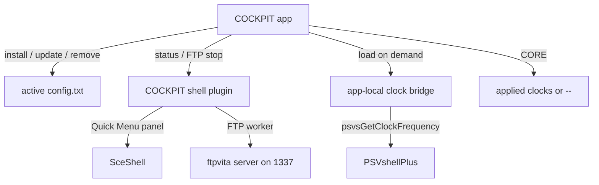
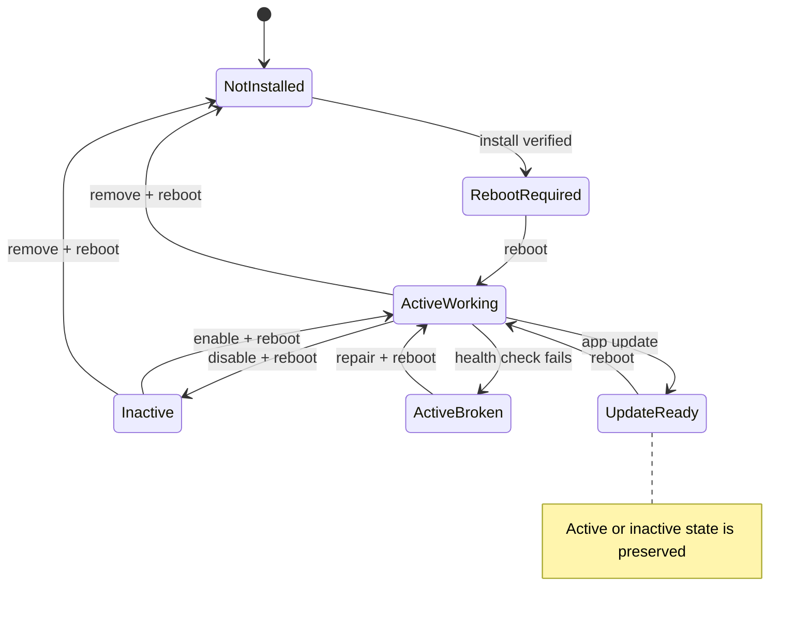
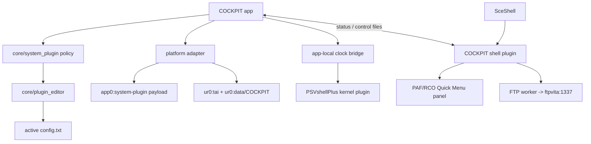
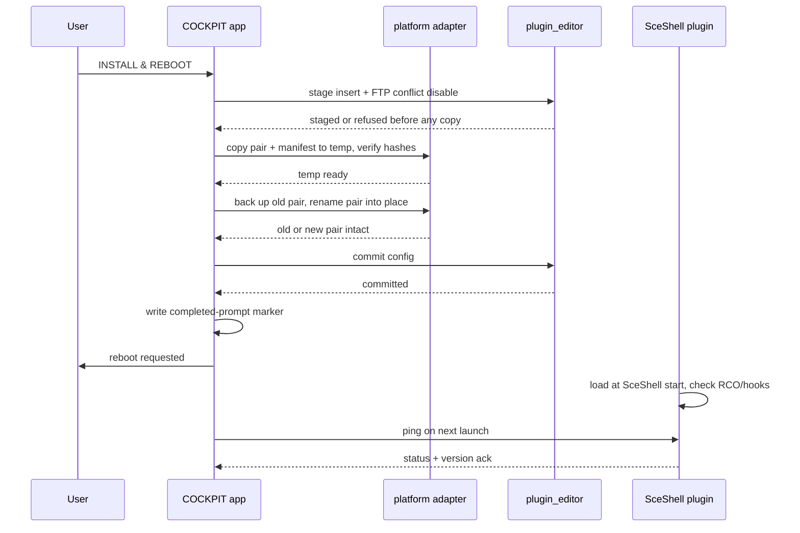
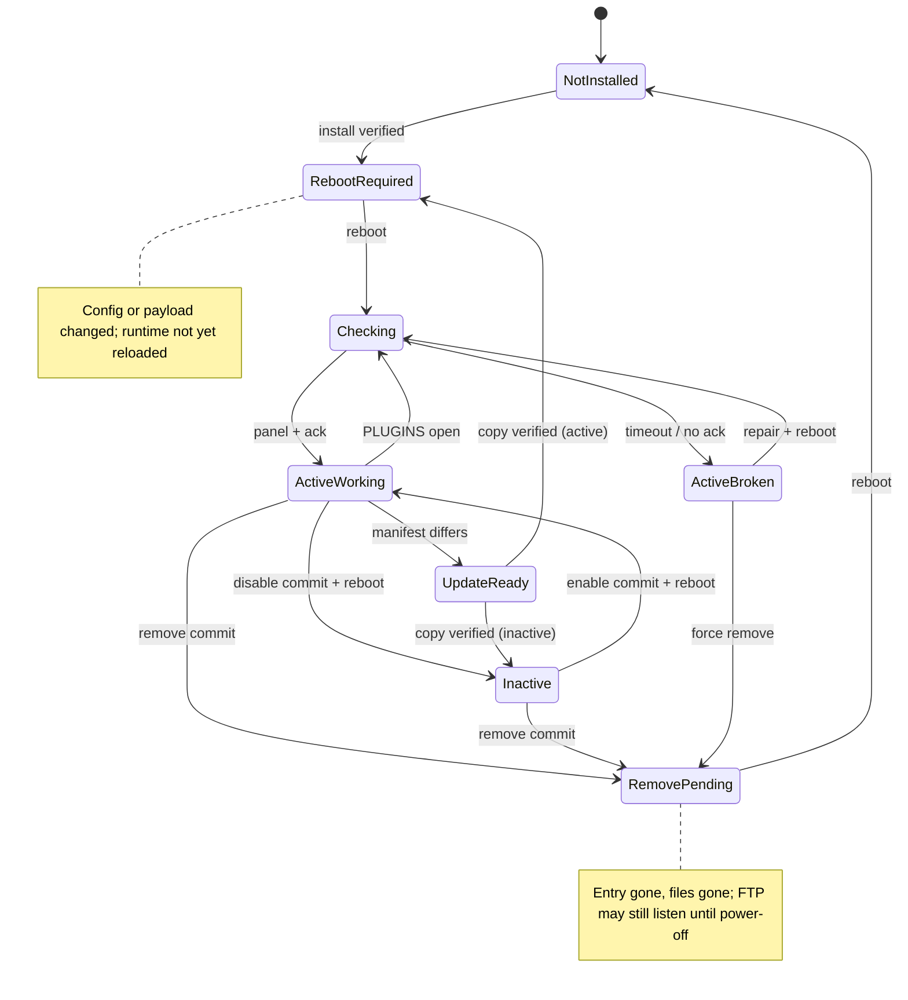

# COCKPIT System Plugin and Quick Menu FTP - Plan

> **Withdrawn 2026-11-05 (D99).** The `*main` route failed on hardware: SceNet is
> not loaded in SceShell, the b141 shell plugin never reached `module_start`, and
> a loader that loaded SceNet then the plugin caused `C1-14738-3`. COCKPIT no
> longer ships a system plugin, FTP server, Quick Menu panel, RCO, manifest, or
> clock bridge. This document is retained as history; do not implement from it.
> See `vita-cockpit/docs/DECISIONS.md` D99 and `agent-wiki/13-fact-check.md`.

## Goal Capsule

- **Objective:** A console owner can install one COCKPIT system plugin on first launch and then control a background FTP server from the Vita Quick Menu, with the console IP visible while it listens. CORE shows applied clocks whenever PSVshellPlus is available, and the plugin can be disabled or removed from COCKPIT without hand-editing config.
- **Means:** Ship one COCKPIT VPK containing hidden components, install the `*main` shell plugin and RCO into `ur0`, keep the clock bridge in `app0:`, and use PSVshellPlus for clocks in the first release.
- **Product authority:** COCKPIT's PLUGINS self-plugin block owns install, update, disable, and remove; the Quick Menu owns the immediate FTP toggle; CORE owns the clock readout.
- **Open blockers:** None for planning. PAF toolchain setup, the PSVshellPlus bridge, and hardware evidence are implementation risks, not planning blockers.
- **Execution profile:** Deep and phased; the app stays on the stock VitaSDK, the shell plugin uses a second PAF-enabled VitaSDK tree, and this release ships no COCKPIT kernel component.
- **Stop conditions:** No `*KERNEL` reader, no `boot_config.txt` writes, no vendored ScePaf-RE or taipool, and no reboot without verified writes; hold-L/Safe Mode is the recovery path.
- **Who finishes:** `ce-work` executes U1-U8; hardware evidence and `ce-doc-review` close the run; the project remains `built` until the checklist is recorded.

---

## Product Contract

### Summary

Build one COCKPIT system-plugin product that adds a background FTP server, a Quick Menu on/off control with IP display, and a managed PLUGINS block. The first release is shell-side and uses PSVshellPlus for applied clocks; COCKPIT's own kernel reader is a later, separately verified stage.

### Problem Frame

COCKPIT's applied-clock work has not produced a trustworthy reading. b74 crashed at launch because a weak import from an on-demand kernel module was bound to address zero. b77 replaced that with taiHEN hooks, and b79 added a diagnostic, but the on-demand loader is shell-gated on this console and the clock row still has no source it can trust. The app needs a boot-time component or a supported external source, not another on-demand import.

The console also lacks a managed background FTP server. FTP Everywhere is an always-on `*main` plugin, but it has no on/off control and no IP display. Users who want FTP for a session must install and configure it separately, and there is no single place to see whether it is running.

PSVshellPlus already runs on this unit with a `*main` shell component and an RCO-backed Quick Menu panel, so the SceShell menu surface is proven on the target. FTP Everywhere runs an always-on server from the same process. Neither is managed from COCKPIT.

### Key Decisions

- **One product, multiple hidden components** — the shell plugin, RCO, app-local clock bridge, and any later kernel component are one COCKPIT system-plugin product. Governs R1-R4. (session-settled: user-directed — chosen over a literal single binary: one binary cannot both read kernel clocks and render a SceShell Quick Menu panel.)
- **Shell and FTP first; kernel reader later** — the first release installs no COCKPIT kernel reader and uses PSVshellPlus for clocks. Governs R2, R35. (session-settled: user-directed — chosen over installing the kernel reader immediately: the workspace rule requires on-demand evidence before `*KERNEL`, and the on-demand path is shell-gated.)
- **Install under `ur0`, remove explicitly** — plugin files live in `ur0:tai/` and `ur0:data/COCKPIT/`, and a REMOVE action cleans them up. Governs R4, R13. (session-settled: user-directed — chosen over app0-only and disable-only: the plugin must survive app use but remain removable because the VPK uninstaller cannot run cleanup.)
- **FTP off every boot, full parity when on except `boot_config.txt`** — the server uses FTP Everywhere's port and partition set but does not start until the user turns it on for the session, and it refuses the one boot-critical file. Governs R16-R17. (session-settled: user-directed — chosen over always-on, user-storage-only, and leaving boot_config writable: full FTP Everywhere behavior is wanted, but a system-wide anonymous server should not start without a per-session choice, and one denied file avoids a boot-breaking write.)
- **The Quick Menu toggle is intent** — it stays ON through network loss and the server restarts automatically on reconnect. Governs R18-R20. (session-settled: user-directed — chosen over snapping off or manual retry: an interrupted transfer should recover without re-toggling.)
- **The Quick Menu panel is FTP-only** — it has one toggle and one status/IP line, not clocks or a dashboard copy. Governs R22-R24. (session-settled: user-directed — chosen over a clocks-plus-status panel: the first release needs the smallest surface that controls FTP.)
- **The self-plugin block uses WORKING and ACTIVE** — WORKING is a live health check, ACTIVE is config enablement, and the toggle stages through the existing transaction dock. Governs R14, R26-R28. (session-settled: user-directed — chosen over immediate unload or an FTP-only toggle: it matches the existing plugin transaction model and keeps the plugin's own state legible.)
- **First-launch prompt only** — a completed-prompt marker is written on decline, install, and remove, never auto-prompted again, and the block becomes the install path. Governs R5-R8. (session-settled: user-directed — chosen over repeated prompting: a declined or removed system install should not nag.)
- **Adaptive clocks through an app-local bridge** — use PSVshellPlus when present; show `--` otherwise; never show the request as applied. Governs R31-R34. (session-settled: user-directed — chosen over a direct weak import or requiring PSVshellPlus: the app must work without it and never present a request as the applied clock.)
- **Existing FTP conflict is detected and disabled, or the install aborts** — do not hook the original FTP Everywhere, which has no control API. Governs R9. (session-settled: user-directed — chosen over hooking the original FTP Everywhere: it exports no control API, so a clean fork plus an explicit conflict disable is the reliable path.)
- **Updates copy files on a version change and prompt for reboot** — the copy is automatic, the reboot is never silent. Governs R10. (session-settled: user-directed — chosen over manual-only updates: app and plugin versions should not drift, but reboots stay explicit.)
- **VitaSDK plus a PAF component for the shell component** — the app stays on the stock VitaSDK; the shell plugin uses a second PAF-enabled VitaSDK tree with the MIT `vitasdk-paf-component` and the GPL-3.0 `psp2cxml-tool`. Governs R41. (session-settled: user-directed — chosen over DolceSDK: DolceSDK has no installable package index, and the open PAF component is the viable build path.)
- **Disable stops FTP first** — a disabled plugin must not leave a live FTP server behind. Governs R12. (session-settled: user-directed — chosen over stage-and-warn: the server must stop before the config change is staged.)
- **A broken plugin gets a confirmed force path that ends in power-off** — after two failed stop attempts or a failed health check, disable or remove may commit without the ack, REMOVE stays available, and the only next step is POWER OFF NOW. Governs R12-R14, R27. (session-settled: user-directed — chosen over manual hold-L recovery and over a battery-gated reboot: the user needs an in-app escape that actually ends the server.)
- **WORKING requires a live check** — file existence alone is not health, and a stop needs a matching ack plus a closed-port probe. Governs R40. (session-settled: user-directed — chosen over file-existence and ack-only: the self-plugin block must mean the shell component is actually alive, and the app must not trust a spoofable status file.)
- **The plugin version is a source-plus-toolchain hash in a manifest** — `system-plugin/` sources and the pinned toolchain produce one version for the shell, the app constant, and the on-disk manifest. Governs R43. (session-settled: user-directed — chosen over the release version or build number: app-only builds must not force a needless plugin copy and reboot.)
- **Restores cannot silently disable the system plugin** — a restore or undo that would remove the COCKPIT entries is flagged and confirmed. Governs R30. (session-settled: user-approved — chosen over silent restore: a config restore must not silently kill the system plugin.)



<!-- ce-section: work-relationships -->
### How This Work Fits Together

This plan covers the first stage: the shell plugin, Quick Menu FTP panel, install/update/disable/remove lifecycle, and the PSVshellPlus clock bridge. The broader breakdown below is the current understanding, not a committed roadmap.

- **Later stage:** COCKPIT's own kernel clock reader, installed to `*KERNEL` only after hardware evidence. Depends on the same installer and self-plugin block; can proceed independently of the FTP/menu work.
- **Later stage:** per-partition FTP permissions, authentication, clocks in the Quick Menu, localization, and NoSleep integration. Shares the shell plugin and menu surface; still to decide.

### Actors

- A1. Console owner: installs, toggles, disables, repairs, and removes the plugin.
- A2. COCKPIT app: first-launch installer, dashboard, self-plugin block, and clock bridge host.
- A3. COCKPIT shell plugin: FTP worker, Quick Menu panel, status/control endpoint.
- A4. PSVshellPlus: optional source of applied clocks through `psvsGetClockFrequency`.
- A5. FTP client: a PC or other device connecting to port 1337.
- A6. SceShell: loads the `*main` plugin and hosts the Quick Menu panel.
- A7. Vita system uninstaller: removes the app and LiveArea bubble, but cannot run COCKPIT cleanup code.

### Requirements

**Product shape**

- R1. COCKPIT ships one system-plugin product whose shell plugin, RCO, app-local clock bridge, and any later kernel component are installed, updated, and removed as one unit.
- R2. The first release ships a `*main` shell plugin, its RCO, and the app-local PSVshellPlus clock bridge; it installs no COCKPIT kernel reader.
- R3. The shell plugin loads into SceShell and provides FTP and the Quick Menu panel while the COCKPIT app is not running.
- R4. The shell plugin and RCO live in `ur0:tai/` and `ur0:data/COCKPIT/`, the clock bridge stays in `app0:`, and every config entry uses the absolute `ur0:` path.

**Install, update, and removal**

- R5. On first launch with no plugin installed and no completed-prompt marker, COCKPIT shows one install modal explaining the install, FTP off by default, that while FTP is on any LAN client can read/write the exported partitions and install persistent boot code, the reboot, and where to read the recovery steps; the actions are INSTALL & REBOOT and NOT NOW, a port-1337 conflict adds a DISABLE & INSTALL / CANCEL confirmation, and a battery-gated reboot lands in REBOOT REQUIRED with the reason instead of failing silently.
- R6. On INSTALL & REBOOT, COCKPIT stages the config insert and conflict disable first, aborts before copying if staging refuses, copies and verifies both payload files and the manifest to temp names, replaces the pair, then commits the config under `*main`, snapshots and reads back the config, and requests reboot only after every step verifies.
- R7. A failed install clears its private batch, leaves the config unchanged or restored and the old payload intact, names the failing stage, and does not reboot; the failed batch never becomes a committable draft.
- R8. On NOT NOW, COCKPIT records a completed-prompt marker outside the plugin payload tree, does not auto-prompt again, and leaves INSTALL available in the self-plugin block; install success and REMOVE also set the marker, so a conflict abort or failed install is not a decline and after REMOVE the block offers INSTALL without the first-launch modal returning.
- R9. When an active FTP Everywhere or other known port-1337 entry exists, the install modal names the conflict and asks DISABLE & INSTALL or CANCEL; accepting stages a `#` disable in the same install batch and records the path and original line outside the payload tree, and REMOVE offers to restore it in the same remove batch. CANCEL aborts without writes and without a decline.
- R10. An app update whose plugin version differs copies and verifies the new payload set, preserves active/inactive state, and prompts for reboot only for an active plugin without a silent reboot; a failed copy is non-blocking, keeps the old set, and surfaces UPDATE FAILED/RETRY, and an inactive update does not require reboot.
- R11. Disabling the plugin comments its config entries with `#` through the existing staged transaction; commit writes the config and asks for reboot.
- R12. Disabling while FTP is active first requests an FTP stop; the stop clears the Quick Menu intent, and the app accepts it only with a matching ack and a local TCP probe showing 1337 closed. Without both, the disable fails visibly and the plugin stays active, and a later discard leaves FTP stopped until the user turns it on again. One disable action makes two sequential stop requests, and the count resets when the app restarts; a failed health check makes FORCE DISABLE available immediately, and a confirmed FORCE DISABLE commits immediately outside the dock, warns that FTP may still listen, and ends in POWER OFF NOW.
- R13. A separate REMOVE action, after explicit confirmation, stops FTP or uses the confirmed force path, collects any conflict-restore choice, removes the plugin's config entries and restores the recorded conflict entry in the same editor batch, verifies the config, requires the `.undo` to be absent before deleting any payload file, deletes the payload and manifest, and ends in reboot or, after a force, POWER OFF NOW; REMOVE remains available in ACTIVE/NOT WORKING.
- R14. The self-plugin block distinguishes CHECKING, NOT INSTALLED, INSTALLED/INACTIVE, ACTIVE/WORKING, ACTIVE/NOT WORKING, UPDATE READY, REBOOT REQUIRED (including UPDATE COPIED), REMOVE PENDING — REBOOT, payload-orphan, and remove-incomplete states, offers only the actions valid for each, and owns the self-plugin REBOOT action; after a force it offers POWER OFF NOW instead.
- R15. COCKPIT's own plugin entries are excluded from the regular PLUGINS list and counts and are managed only through the self-plugin block.

**FTP service**

- R16. The FTP server is an FTP Everywhere fork with parity: port 1337, anonymous access, read/write where the partition allows, and `ux0:`, `ur0:`, `uma0:`, `imc0:`, `app0:`, `savedata0:`, `music0:`, `photo0:`. It refuses list, read, write, rename, and delete for `ur0:tai/boot_config.txt`, after path resolution and case-insensitively; every other exported path keeps parity.
- R17. FTP is off after every boot and is enabled only for the current session from the Quick Menu.
- R18. The Quick Menu toggle represents intent: it stays ON through Wi-Fi loss and port errors, shows WAITING FOR WI-FI or ERROR, and retries the server automatically on a bounded backoff and on a network event. An explicit stop from COCKPIT clears intent and shows OFF; only a user toggle ON restarts it.
- R19. Turning the toggle OFF stops the server immediately and clears the IP display.
- R20. The Quick Menu shows OFF, WAITING FOR WI-FI, STARTING, ON `<ip>:1337`, or ERROR, shows the IP only while the server is listening, and never fabricates one. `FTP UNKNOWN` is reserved for the app's ack-gated block hint and the pre-first-snapshot window; the app trusts FTP/IP only from a status whose ack matches the current request.
- R21. FTP runs in the shell plugin and continues to work when the COCKPIT app is not running.

**Quick Menu**

- R22. The Quick Menu panel is COCKPIT-labelled, FTP-only, and contains one toggle plus the status/IP line.
- R23. The panel is available whenever the plugin is active and does not depend on the COCKPIT app.
- R24. The ERROR state is actionable, names whether the port or the network prevented the server from starting, states that intent remains on for a retry, and offers retry or toggle-off.

**Self-plugin block**

- R25. The self-plugin block is a fixed-height region between the three-line header and the first group, never a fourth header line, and its height does not change with state; Up at row 0 enters an explicit block focus, the safest action is focused first, Left/Right selects actions, Cross activates, and Circle or Down returns to the list while Triangle stays dock-only.
- R26. WORKING means the panel was created and a live health check from the running shell plugin passed; ACTIVE means the plugin's config entries are enabled.
- R27. ACTIVE but not WORKING shows CHECKING while the ack is pending, then NOT WORKING with a reason, REPAIR, REMOVE, and the confirmed FORCE path.
- R28. The block's enable/disable toggle stages through the dock and draws three truths: the working set on the toggle, the launch set on the state line, and a `NEXT ON`/`NEXT OFF` badge for a staged divergence. The dock shows PENDING and the block shows REBOOT REQUIRED after commit. Install, repair, remove, and force execute immediately with confirmations; force bypasses the dock and cannot be discarded. Update is auto-copied and surfaces REBOOT REQUIRED only for an active plugin.
- R29. The block shows the clock source as `PSVSHELLPLUS` or `--` in this release; `COCKPIT KERNEL` is reserved for the later kernel-reader stage, and a loaded bridge with no valid reading shows `--`.
- R30. A restore or undo that would disable or remove the COCKPIT plugin is flagged in the preview and requires explicit confirmation; if the plugin is active and resident it runs the stop/ack/probe or confirmed force gate, otherwise it skips the stop. A restore that adds the entry while the payload is missing is flagged as REPAIR, every restore preview lists added and removed entries by path, and a snapshot that re-enables a port-1337 conflict runs the conflict check.

**Clock source**

- R31. CORE reads applied clocks through an app-local bridge that calls PSVshellPlus's `psvsGetClockFrequency` when PSVshellPlus is present.
- R32. When PSVshellPlus is absent or the bridge cannot load, CORE renders `--` and never falls back to the userland clock request.
- R33. The bridge is app-local and is not installed to `ur0:`; the first release installs no COCKPIT kernel reader.
- R34. The b79 on-demand `cockpit_clocks.skprx`, its XBAR handshake, and its diagnostic log are retired; no weak import returns.
- R35. A later kernel-reader stage may add a `*KERNEL` component only after hardware evidence; it is not part of this release.

**Safety and recovery**

- R36. No install, update, disable, remove, or restore path, and no COCKPIT FTP request, reads, copies, renames, or writes `ur0:tai/boot_config.txt`; the FTP worker refuses that path explicitly.
- R37. The shell plugin fails closed: it exits without starting the menu or FTP if its RCO, manifest version, or required initialization is missing or mismatched, and it never edits config at boot.
- R38. The installer, updater, and remover use the existing single-writer config transaction and snapshots; no second writer edits the active config.
- R39. The README documents hold-L/Safe Mode recovery and the risk of a bad system plugin.
- R40. The app-to-shell status/control channel proves liveness and carries the FTP stop request; the status is advisory, WORKING requires the panel was created and a matching live ack, and FTP/IP fields are untrusted without that ack. A stop is accepted only with a matching ack plus a local TCP probe showing 1337 closed; an inconclusive probe requires the force confirmation.

**Build and packaging**

- R41. The COCKPIT app remains on the stock VitaSDK; the shell plugin is built against a copied PAF-enabled VitaSDK tree (`vitasdk-paf-component` plus `psp2cxml-tool`) and links `libftpvita`. It uses an owned pool and a small C-runtime shim rather than assuming libc or STL in `*main`, uses no weak required import, and the import audit is a build-time gate.
- R42. The default build produces one uniquely named COCKPIT VPK containing the app, shell plugin, RCO, manifest, and clock bridge; the `--safe` build produces its own uniquely named VPK with no system-plugin payload or bridge and does not require the PAF tree. The existing build-number and artifact rules apply.
- R43. The plugin version is a short hash of the `system-plugin/` sources plus the pinned toolchain and flags, carried in a manifest beside the payload; the app compares the on-disk manifest, resident status, and app-expected values, and re-hashes the installed pair at launch so a same-version replacement is REPAIR rather than WORKING. For an active plugin, resident ≠ on-disk is REBOOT REQUIRED, and an absent resident record after a fresh install is REBOOT REQUIRED rather than REPAIR. On-disk newer than the app shows REPAIR with REMOVE or REINSTALL APP and never copies the older payload; an inactive plugin updates without reboot; a missing manifest with payload present is REPAIR.
- R44. MIT attribution for PSVshellPlus, FTP Everywhere, libftpvita, vitasdk-paf-component, and other reused code is included; ScePaf-RE and taipool are not vendored.
- R45. The install modal states whether applied clocks will come from PSVshellPlus or show `--`, and that REMOVE must be used before uninstalling COCKPIT because the VPK uninstaller cannot clean up the plugin.
- R46. The `--safe` build does not install or manage the system plugin; it hides the first-launch install and the self-plugin block, and renders `--` for clocks.
- R47. Partial install, update, or remove states are visible and recoverable without a separate cleanup action: payload-present/no-entry shows REPAIR or REMOVE FILES, config-removed/files-present shows REMOVE INCOMPLETE with RETRY REMOVE, and update-copy-failed shows UPDATE FAILED/RETRY.



### Key Flows

- F1. First-launch install
  - **Trigger:** COCKPIT launches with no installed plugin and no completed-prompt marker.
  - **Actors:** A1, A2, A6.
  - **Steps:** COCKPIT detects the missing plugin and any FTP conflict; shows the install modal; a conflict adds DISABLE & INSTALL / CANCEL; the user accepts; COCKPIT stages the config insert and conflict disable, copies and verifies both payload files and the manifest to temp, replaces the pair, then commits the config; a healthy battery requests reboot, a low/unknown battery lands in REBOOT REQUIRED with the reason; the prompt marker is set; after reboot the shell plugin loads and the block reports ACTIVE/WORKING.
  - **Outcome:** One installed plugin, FTP off, Quick Menu panel available, and the correct clock source.
  - **Covers:** R5-R9, R14, R36-R39, R47.
- F2. Quick Menu FTP enable and reconnect
  - **Trigger:** The user turns the Quick Menu FTP toggle ON.
  - **Actors:** A1, A3, A5, A6.
  - **Steps:** The toggle records intent; if Wi-Fi is absent the panel shows WAITING FOR WI-FI; when connectivity returns the shell plugin starts `ftpvita` and shows the IP; if Wi-Fi drops or the port is busy the toggle stays ON and the panel shows WAITING or ERROR; the worker retries on a bounded backoff/network event; toggling OFF stops it immediately; FTP/IP render only from a matching ack.
  - **Outcome:** The server state and IP display match the toggle, the network, and the live status ack.
  - **Covers:** R16-R21, R24, R40.
- F3. Disable with FTP active
  - **Trigger:** The user turns the self-plugin block's toggle OFF while FTP is active.
  - **Actors:** A1, A2, A3.
  - **Steps:** COCKPIT requests an FTP stop; the stop clears intent, and COCKPIT accepts it only with a matching ack and a local TCP probe showing 1337 closed; COCKPIT stages the `#` entries through the dock; the user commits; the reboot applies the disabled state. One action makes two stop attempts; after both fail or a health check fails, the confirmed FORCE DISABLE commits immediately, warns that FTP may still listen, and ends in POWER OFF NOW; a discarded normal draft leaves FTP off.
  - **Outcome:** No FTP server remains running and the plugin is inactive after reboot or power-off.
  - **Covers:** R11-R12, R28.
- F4. Remove
  - **Trigger:** The user chooses REMOVE and confirms.
  - **Actors:** A1, A2, A3.
  - **Steps:** COCKPIT stops FTP or uses the confirmed force path, collects any conflict-restore choice, removes the plugin's entries and restores the recorded conflict entry in one editor batch, verifies the config, requires `.undo` absent before deleting files, deletes the payload and manifest, and asks for reboot or, after a force, POWER OFF NOW; REMOVE stays available when the plugin is broken.
  - **Outcome:** The plugin is gone; the app still runs; the block reports NOT INSTALLED, REMOVE PENDING — REBOOT, or remove-incomplete with RETRY if a file step failed.
  - **Covers:** R13, R36, R38, R47.
- F5. Update
  - **Trigger:** COCKPIT launches with a different plugin version available.
  - **Actors:** A1, A2, A3.
  - **Steps:** COCKPIT compares the manifest with the app's expected plugin hash, auto-copies and verifies the new pair on launch, and preserves active/inactive state. UPDATE READY is shown only before or during the copy; after a verified copy an active plugin shows REBOOT REQUIRED with `UPDATE COPIED`, while an inactive plugin needs no reboot. A copy failure keeps the old pair and shows UPDATE FAILED/RETRY; after reboot the resident status reports the new version.
  - **Outcome:** App and plugin versions match without a silent reboot; a failed update is non-blocking.
  - **Covers:** R10, R43, R47.
- F6. Active but not working
  - **Trigger:** The block sees ACTIVE but the live health check fails.
  - **Actors:** A1, A2, A3.
  - **Steps:** The block shows CHECKING while the ping is pending, then NOT WORKING with the reason; the user chooses REPAIR, REMOVE, or the confirmed FORCE path; COCKPIT recopies and verifies the pair and entries or removes them; reboot or, after a force, power-off; the health check runs again.
  - **Outcome:** The plugin is repaired, removed, or force-cleaned.
  - **Covers:** R12-R14, R27, R37, R40.
- F7. Restore or undo removes the plugin
  - **Trigger:** The user confirms a restore or undo whose diff removes or comments the COCKPIT entries.
  - **Actors:** A1, A2, A3.
  - **Steps:** The preview flags `WILL DISABLE COCKPIT SYSTEM`, lists every added and removed entry by path, and runs the port-1337 conflict check. If the plugin is active and resident, COCKPIT requests a stop and accepts it only with an ack plus a closed-port probe, or offers the force path; if it is inactive, the stop is skipped. The config commit proceeds; reboot; the block shows INACTIVE or NOT INSTALLED.
  - **Outcome:** The restore or undo does not leave a live FTP server behind a removed plugin entry.
  - **Covers:** R12, R30.

### Acceptance Examples

- AE1. Install accepted
  - **Covers:** R5-R6, R14, R36.
  - **Given:** No plugin is installed and no completed-prompt marker exists.
  - **When:** The user chooses INSTALL & REBOOT and the writes verify.
  - **Then:** The prompt marker is set, the reboot starts the shell plugin, the Quick Menu panel appears, FTP is off, and the block shows ACTIVE/WORKING.
- AE2. Install declined
  - **Covers:** R8.
  - **Given:** The first-launch modal is shown.
  - **When:** The user chooses NOT NOW.
  - **Then:** No plugin payload files or config entries are written; the completed-prompt marker is recorded outside the payload tree, the next launch does not auto-prompt, and the block shows INSTALL.
- AE3. FTP enabled
  - **Covers:** R16-R20.
  - **Given:** The plugin is active, Wi-Fi is connected, and FTP is off.
  - **When:** The user turns the Quick Menu toggle ON.
  - **Then:** The server listens on 1337, the panel shows `ON <ip>:1337`, and a client can list and read/write where the partition allows.
- AE4. Wi-Fi drops and returns
  - **Covers:** R18-R20.
  - **Given:** FTP is ON and listening.
  - **When:** Wi-Fi drops.
  - **Then:** The toggle stays ON and the panel shows WAITING FOR WI-FI; when Wi-Fi returns, the server restarts and the IP updates without another toggle.
- AE5. Disable with FTP active
  - **Covers:** R11-R12.
  - **Given:** FTP is ON and listening.
  - **When:** The user turns the self-plugin toggle OFF.
  - **Then:** COCKPIT requests and receives an FTP stop, stages the `#` entries, and after the committed reboot the block shows INACTIVE and no FTP server is listening.
- AE6. FTP Everywhere conflict
  - **Covers:** R9.
  - **Given:** An active FTP Everywhere entry is present.
  - **When:** The install modal runs.
  - **Then:** It names the conflict and asks DISABLE & INSTALL or CANCEL; accepting stages the `#` disable and records the path and original line; CANCEL aborts with no writes and no decline. A later REMOVE offers to restore the recorded entry in the same batch.
- AE7. Update available
  - **Covers:** R10, R43.
  - **Given:** An older active plugin is installed.
  - **When:** A newer COCKPIT app launches.
  - **Then:** The new pair is copied and verified; an active plugin shows REBOOT REQUIRED with `UPDATE COPIED`, an inactive plugin shows INACTIVE with no reboot, and the reboot is explicit. Active/inactive state is preserved.
- AE8. Remove
  - **Covers:** R13.
  - **Given:** The plugin is installed.
  - **When:** The user chooses REMOVE and confirms.
  - **Then:** FTP stops, the entries are removed, any recorded conflict is restored in the same batch, `.undo` is absent before file deletion, the files are deleted, the reboot completes, and the block shows NOT INSTALLED.
- AE9. Active but broken
  - **Covers:** R14, R26-R27, R37.
  - **Given:** The config is active but the shell health check does not answer.
  - **When:** PLUGINS opens.
  - **Then:** The block shows CHECKING while the ping is pending, then ACTIVE/NOT WORKING with a reason, REPAIR, REMOVE, and the confirmed FORCE path; the app still runs and no FTP server is assumed.
- AE10. PSVshellPlus absent
  - **Covers:** R31-R33.
  - **Given:** PSVshellPlus is not installed and the bridge cannot load.
  - **When:** CORE samples.
  - **Then:** ARM, GPU, and BUS render `--`, and the block shows `CLOCKS --`; no request value is shown as applied.
- AE11. Restore would disable the plugin
  - **Covers:** R30.
  - **Given:** A restore snapshot lacks the COCKPIT plugin entries.
  - **When:** The user previews the restore.
  - **Then:** The preview flags that the system plugin will be disabled, lists the affected entries by path, runs the port-1337 conflict check, and requires explicit confirmation. If the plugin is active and resident it runs the stop/ack/probe or force gate; if inactive it skips the stop.
- AE12. First release without a kernel reader
  - **Covers:** R2, R35.
  - **Given:** The shell plugin is installed and PSVshellPlus is absent.
  - **When:** The user checks the plugin entries and CORE.
  - **Then:** No `*KERNEL` COCKPIT entry exists, FTP and the Quick Menu work, and clocks show `--`.
- AE13. FTP refuses the boot config
  - **Covers:** R16, R36.
  - **Given:** FTP is on and a client is connected.
  - **When:** The client lists, reads, writes, renames, or deletes `ur0:tai/boot_config.txt`.
  - **Then:** Every operation is refused after path resolution and case-folding, while other `ur0:` paths keep parity.
- AE14. Forced remove ends in power-off
  - **Covers:** R12-R14, R24.
  - **Given:** The plugin is ACTIVE/NOT WORKING and the stop cannot be acknowledged.
  - **When:** The user confirms FORCE REMOVE.
  - **Then:** The entries are removed immediately, the block warns `FTP MAY STILL LISTEN`, and the only offered next step is POWER OFF NOW; no battery-gated reboot is offered.

### Success Criteria

- **Install is one flow:** A first-time user can install and reboot without editing config or copying files by hand; a failed write never reboots.
- **Quick Menu works alone:** With COCKPIT closed, the panel turns FTP on and off, shows the IP only while listening, recovers from a Wi-Fi drop, and leaves no listener after reboot.
- **Recovery is documented:** The README carries hold-L/Safe Mode steps, the install modal links to them, and a failed shell plugin does not crash SceShell.
- **Build is reproducible:** One uniquely named VPK contains the app, shell plugin, RCO, and clock bridge, built with the documented stock and PAF-enabled VitaSDK trees.

### Scope Boundaries

**Deferred for later**

- COCKPIT's own kernel clock reader in `*KERNEL`, after separate hardware evidence.
- Per-partition FTP permissions or authentication.
- Clocks or other system data in the Quick Menu panel.
- Localization, NoSleep integration, and PSTV/Ethernet support.
- Automatic plugin removal when the app is uninstalled; the platform uninstaller cannot run cleanup code.

**Outside this product's identity**

- Hooking or controlling the original FTP Everywhere module.
- Replacing PSVshellPlus's overclock controls or profiles.
- A general Quick Menu framework beyond the COCKPIT FTP panel.
- A plugin store, automatic plugin discovery, or third-party plugin installation.
- Running COCKPIT's FTP server on a different port to coexist with FTP Everywhere.

### Dependencies / Assumptions

- A second PAF-enabled VitaSDK tree can be built from `vitasdk-paf-component` (MIT), `psp2cxml-tool` (GPL-3.0 build-time), and a pinned ScePaf-RE header checkout fetched by a setup script; `libftpvita` (MIT) builds against it; `taipool` is replaced with an owned pool and C-runtime shim because it has no license and `*main` cannot assume libc.
- PSVshellPlus is installed with a userland `psvsGetClockFrequency` export that an app-local `.suprx` can link and call on 3.65.
- SceShell loads the `*main` shell plugin and the PAF/RCO panel pattern works on this console; PSVshellPlus running on the same unit is the reference.
- The existing config transaction can insert under `*main`, respect `*!` halts and locked paths, and preserve snapshots and restore behavior.
- The Vita VPK uninstaller removes only the app directory and LiveArea bubble; it cannot edit `ur0:tai/config.txt` or delete `ur0` plugin files.
- `ur0:` is mounted and writable at boot, and the shell plugin can read its RCO from `ur0:data/COCKPIT/`.
- The app can load an app-local `.suprx` from `app0:` with `sceKernelLoadStartModule` and share clock state with it.
- The status/control channel can be implemented without a network service or a second config writer.
- MIT attribution is sufficient for the reused PSVshellPlus and FTP Everywhere code, and no Sony firmware or keys are included.

### Outstanding Questions

**Resolve Before Planning**

None.

**Deferred to Planning**

- The exact app-to-shell status/control mechanism, liveness proof, FTP stop request, and timeout behavior.
- The exact config insertion and removal rules for `*main`, the later `*KERNEL`, `*!` halts, locked paths, duplicates, and the single-writer transaction.
- The exact PAF/RCO panel layout, 3.65 PAF interface version, and SceShell hook points.
- The exact build orchestration for the stock and PAF-enabled VitaSDK trees, including packaging the shell plugin and RCO in the COCKPIT VPK.
- The exact PSVshellPlus stub linkage, bridge ABI, and reliable PSVshellPlus detection.
- The health/version schema and the full update, repair, and remove state transitions.
- The conflict-detection list beyond FTP Everywhere, including other shell-menu plugins and port-1337 servers.
- The exact FTP ERROR mapping and user-facing messages.
- The restore/undo protection behavior and its interaction with the existing `.original`, `.session`, and `.undo` snapshots.
- The hardware test matrix, recovery drill, and evidence required before promoting the project to `verified`.

### Sources / Research

- `AGENTS.md` — workspace safety rules, `boot_config.txt` prohibition, `*KERNEL` testing rule, and documentation contract.
- `vita-cockpit/docs/PROJECT.md`, `ARCHITECTURE.md`, and `DECISIONS.md` (D82, D84) — current clock path, config transaction, plugin manager, and the b74/b77/b79 history.
- `2026-11-03-2251-feat-plugins-transaction-dock-plan.md` and `2026-11-03-1000-plugins-production-hardening-plan.md` — transaction dock, restore, and write-protocol constraints.
- `agent-wiki/05-packaging-install.md`, `06-kernel-plugins.md`, and `10-troubleshooting.md` — VPK install behavior, `*main`/`*KERNEL` rules, and recovery.
- PSVshellPlus: <https://github.com/GrapheneCt/PSVshellPlus> — install layout, shell plugin, RCO, and `psvsGetClockFrequency`.
- FTP Everywhere: <https://github.com/teakhanirons/ftpeverywhere> — `*main` FTP worker, `ftpvita`, and network reconnect behavior.
- `libftpvita`: <https://github.com/xerpi/libftpvita> — FTP server library (MIT).
- `vitasdk-paf-component`: <https://github.com/Princess-of-Sleeping/vitasdk-paf-component> — MIT PAF headers/stubs for a second VitaSDK tree.
- `psp2cxml-tool`: <https://github.com/Princess-of-Sleeping/psp2cxml-tool> — GPL-3.0 build-time RCO compiler.
- `ScePaf-RE`: <https://github.com/GrapheneCt/ScePaf-RE> — PAF headers/export lists with no license; fetched by setup, never vendored.
- `taipool`: <https://github.com/Rinnegatamante/taipool> — no license; not used or vendored; an owned pool and C-runtime shim replace it.
- Current clock-path correction: b77 removed the weak syscall import and uses taiHEN hooks; b79 is the diagnostic build. The tracker labels b77 as the fix and b79 as the diagnostic.

---

## Planning Contract

**Product Contract preservation:** changed in planning dialogue: R12 was clarified so a discarded staged disable leaves FTP stopped; R12/R13 and a Key Decision added the confirmed force path, now ending in POWER OFF NOW; R16 and a Key Decision added the `ur0:tai/boot_config.txt` FTP exception; R41/R44 and the shell-toolchain Key Decision replaced DolceSDK with a copied PAF-enabled VitaSDK tree because DolceSDK is not installable; R43 and a Key Decision added the source-plus-toolchain manifest; R46 added the `--safe` behavior; R47 added partial-state overlays. All other requirements, actors, flows, acceptance examples, and success criteria are preserved.

### Key Technical Decisions

- KTD1. **The editor owns staged insert and remove through private batches** — install, remove, repair, and the FTP Everywhere conflict are editor batches, not a second writer. The new APIs insert inside `*main`'s path run before the next header, never across `*!`, and do not rescan after commit. A pre-existing user draft refuses install, remove, repair, and conflict restore; a system batch is never shown in the dock and is cleared on every failure path. Cites R4, R6-R13, R38.
- KTD2. **Status and control use two small files with a nonce/ack protocol plus a local probe** — `ur0:data/COCKPIT/status.txt` and `control.txt`; the shell polls control about every 250 ms and writes status only on state or command; the app pings on PLUGINS open and before actions and waits about 1.5 s. A stop is accepted only with a matching ack and a TCP connect to 127.0.0.1:1337 that fails; an inconclusive probe requires the force confirmation. No heartbeat, no blocking read, atomic temp-and-rename. Cites R12, R26-R28, R40.
- KTD3. **The clock bridge is an app-local `.suprx` with a generated PSVshellPlus stub and process lifetime** — the app owns one static state block; `platform_init` loads the bridge once; the bridge lives and dies with the app process, and its `module_stop` only stops what it owns. The ABI header lives with the bridge and is versioned. Only the bridge links `psvsGetClockFrequency`; a failed load is the absent path. It is read-only and does not call `psvsSetClockingPid`, so it reports the kernel applied values for the default clocking pid and 500 MHz may read 444 per R31-R32. No weak import. Cites R31-R34.
- KTD4. **System-plugin policy is SDK-free in `core`** — state derivation, install/update/remove plans, version and conflict checks, status parsing, and marker rules live in a host-testable module; the platform adapter performs every file, module, and status I/O. The completed-prompt marker and conflict record live under `ux0:data/COCKPIT/`, outside the payload tree and outside REMOVE's deletion. Cites R6-R15, R26-R30, R38, R43.
- KTD5. **The shell plugin forks FTP Everywhere with a worker-owned state machine** — the worker owns `want_on`, Wi-Fi state, `ftpvita_init`/`fini`, IP, and errors; the UI only sets intent. The fork moves `sceNetSocket`/`bind`/`listen` into `ftpvita_init` so the real result is returned, starts the accept thread only after a successful listen, cleans up a half-init, and refuses `ur0:tai/boot_config.txt` after path resolution. Cites R16-R21, R24, R36.
- KTD6. **The shell component uses a copied PAF-enabled VitaSDK tree, an owned runtime, and no weak imports** — `setup-paf.sh` copies the workspace SDK to a sibling `vitasdk-paf/` outside the repo, runs MIT `vitasdk-paf-component` and GPL-3.0 `psp2cxml-tool` against the copy, fixes macOS host-tool assumptions, and documents the Linux-container fallback. The shell links `libftpvita`, uses an owned pool and C-runtime shim, compiles `shell/core` as C99 with no STL/`new`, and enforces a build-time import audit; `module_start` checks only the RCO and hook results. Cites R37, R40-R44.
- KTD7. **Install, update, and remove have fixed transaction order and payload-set atomicity** — stage the editor batch first; if staging refuses, abort before copying. Copy the `.suprx`, RCO, and manifest to temp names, verify hashes, back up the old pair, then rename the pair into place; a failed second rename restores the old pair. Commit the config only after the payload is in place. On remove, commit the config and `.undo` removal, require `.undo` absent, then delete files. One editor batch and one verified write. Cites R6-R13, R38, R43.
- KTD8. **COCKPIT's own rows stay real editor rows but are hidden from the ledger** — exact path identity `ur0:tai/cockpit_system.suprx`; the ledger, selection walk, counts, HOME summary, and scroll math exclude it. The block is a fixed-height region between the header and the list, with an explicit focus/action cursor, a state→action table, and three truths: working set on the toggle, launch set on the state line, `NEXT ON`/`NEXT OFF` for a staged divergence. The block owns the self-plugin reboot; a self-only dock batch suppresses `REBOOT NOW`. Cites R14-R15, R25, R28.
- KTD9. **The on-demand clock path is retired** — delete the kernel module, diagnostic, handshake, weak import, and build target; this release installs no COCKPIT kernel component. Cites R34-R35.
- KTD10. **The safe build is read-only and independent of the PAF tree** — no install, update, disable, or remove; the first-launch modal and the block are hidden, clocks render `--`, and `--safe` succeeds with `VITASDK_PAF` unset. Cites R46.
- KTD11. **Install and remove reuse the existing battery gate before reboot, except after a forced action** — a normal REBOOT action is gated when the battery is below 20 % and not charging, or the power read is invalid, and the block carries the reason. After a confirmed FORCE DISABLE/REMOVE, no writes remain, so the only offered step is POWER OFF NOW, which bypasses the gate and names the low-battery risk. Cites R5-R7, R13-R14.
- KTD12. **Restore and undo use a conditional self-removal gate** — the COCKPIT path is not added to the existing locked-path hard refusal; the preview flags `WILL DISABLE COCKPIT SYSTEM`, lists added and removed entries by path, and runs the port-1337 conflict check. If the plugin is active and resident, every commit whose diff removes or comments the self entry runs the stop/ack/probe or confirmed force gate; if it is inactive, the stop is skipped. The self-check also runs for undo and for a restore that adds the entry while payload is missing. Cites R30.
- KTD13. **FTP stop clears intent; DISCARD does not restart it** — stopping the server is a runtime safety action, so `stop` clears `want_on` and shows OFF. A later discard leaves FTP off until the Quick Menu turns it on. Cites R12, R18. (session-settled: user-directed — chosen over restarting FTP on discard: stopping the server is a runtime safety action, not part of the config draft.)
- KTD14. **The top-level build hashes and invokes the plugin tree conditionally** — `build.sh` includes `system-plugin/` in the source hash, builds the shell subproject only for a default build, hard-fails a default build without its artifacts, passes app0-relative payload paths, and leaves `--safe` independent of the PAF tree. Cites R41-R44.
- KTD15. **A confirmed force path exists for a broken plugin and ends in power-off** — after two failed stop attempts or a failed health check, FORCE DISABLE/FORCE REMOVE is offered behind a confirmation that FTP may still listen; it commits immediately outside the dock, cannot be discarded, and offers POWER OFF NOW instead of a gated reboot. REMOVE is always available in ACTIVE/BROKEN. Cites R12-R14, R27. (session-settled: user-directed — chosen over manual hold-L recovery and over a battery-gated reboot: the user needs an in-app escape that actually ends the server.)
- KTD16. **The plugin version is a source-plus-toolchain hash carried in a manifest, and three values determine the state** — on-disk manifest, resident status, and app-expected. For an active plugin, resident ≠ on-disk is REBOOT REQUIRED; an absent resident record after a fresh install is REBOOT REQUIRED, not REPAIR. On-disk newer than the app shows REPAIR with REMOVE or REINSTALL APP and never copies the older payload; an inactive update needs no reboot; a missing manifest with payload present is REPAIR. Cites R43.
- KTD17. **Status is trusted only by a matching ack plus a closed-port probe; ERROR keeps intent** — FTP/IP render only from a matching ack; otherwise FTP UNKNOWN/`--`. An ERROR keeps `want_on`, retries on a bounded backoff and a network event, and shows the reason. Cites R18, R20, R24, R40.
- KTD18. **The shell plugin has a host-testable C core and one status writer** — `shell/core` is C99 with fixed buffers and no STL; `shell/port` owns PAF, ftpvita, netctl, files, and the pool. The control thread is the sole `status.txt` writer; the PAF thread reads a published snapshot. The panel is created before the control endpoint starts, so an ack implies the panel exists. Cites R37, R40.
- KTD19. **Partial install/update/remove states are visible without a new cleanup action** — payload-present/no-entry shows REPAIR (or REMOVE FILES), config-removed/files-present shows REMOVE INCOMPLETE with RETRY REMOVE, and update-copy-failed shows UPDATE FAILED/RETRY. An inactive update needs no reboot; a failed update is non-blocking. Cites R7, R10, R13, R43, R47.

### High-Level Technical Design

The app remains the composition root and the only config writer. The shell plugin is a SceShell guest for the FTP worker and Quick Menu panel; the clock bridge is an app-local guest for PSVshellPlus reads. The two guests never share memory with the app: the shell plugin uses status/control files, and the bridge uses a seqlock-protected state passed at load.



Staging happens first. The editor batch is staged and can refuse before any byte is copied; the payload pair and manifest are copied to temp names, verified, and replaced; the config commit happens only after the payload is in place. A failed copy restores the old pair, a failed config commit restores the old pair and leaves no active entry, and the app reports the failing stage without rebooting.



The FTP worker is the only writer of its state. The menu sets intent; the worker reconciles network and server state on each tick and publishes the visible state.

```mermaid
sequenceDiagram
  participant U as User
  participant M as Quick Menu panel
  participant W as FTP worker
  participant N as SceNetCtl
  participant C as FTP client
  U->>M: toggle ON
  M->>W: want_on = 1
  W->>N: read link state
  N-->>W: connected
  W->>W: ftpvita_init (socket/bind/listen) + devices
  W-->>M: LISTENING + ip:1337
  C->>W: connect 1337
  N-->>W: link lost
  W->>W: ftpvita_fini
  W-->>M: WAITING FOR WI-FI
  N-->>W: link restored
  W->>W: ftpvita_init
  W-->>M: LISTENING + updated ip
  Note over M,W: An explicit stop clears want_on and shows OFF; no tick restarts it
```

The block separates payload presence, config enablement, live health, and pending action. A config change always passes through `REBOOT REQUIRED`; `ACTIVE/WORKING` is only a post-reboot, live-ack state. `CHECKING` covers the window before the first ack, and `REMOVE PENDING — REBOOT` covers the window between a remove commit and reboot.



Partial payload/remove and update-failure states are overlays defined in R47 and U3; the diagram shows the main transitions.

### Implementation Constraints

- The app is `UNSAFE` by default; the `--safe` variant cannot write `ur0:` or load the UNSAFE shell/bridge modules. The block is hidden there, and clocks render `--` (R46).
- The active config is not always `ur0:tai/config.txt`; `ux0:tai/config.txt` wins when present. The editor edits `g_editor.source`; installed files and entries still use absolute `ur0:` paths.
- `*!` is sticky and file-global. An inserted `*main` entry after it is dead; the editor must insert inside `*main`'s own path run before the next header, or refuse if no safe point exists.
- The shell plugin loads under `*main` only when SceShell starts. The install cannot take effect in the running shell; the first-launch flow always requires reboot. The plugin fails closed if its manifest version does not match its own build, so a mixed payload never runs.
- The PAF panel is created before the control endpoint starts; if the panel cannot be created, the plugin returns `NO_RESIDENT`, so an ack cannot claim WORKING without a panel.
- The clock bridge hard-imports PSVshellPlus. A missing PSVshellPlus makes `sceKernelLoadStartModule` fail; that is the normal `--` path, not an error dialog. The bridge is read-only; 500 MHz may read 444.
- `ftpvita` has no start/stop and binds asynchronously in its server thread, so `ftpvita_init` cannot report a port conflict. The fork moves socket setup, bind, and listen into `ftpvita_init`, starts the accept thread only after a successful listen, and cleans up a half-init; otherwise the UI can claim ON while another server owns 1337.
- `taipool` and ScePaf-RE have no license and are not vendored. `*main` cannot assume libc or STL, so the shell plugin uses an owned pool and a minimal C-runtime shim, and `shell/core` is C99 with fixed buffers; the setup script fetches pinned ScePaf-RE headers for local build only.
- Status/control files are not config files and do not use the config transaction. They are atomic temp-and-rename writes and never become a second config writer. They are advisory: a stop also needs a closed-port probe, and an FTP client with `ur0:` write access is outside the security boundary.
- The first-launch modal runs after `editor_scan`, `plugins_scan`, and `metrics_init`, and before the frame loop. A pre-existing editor draft refuses install, remove, repair, and conflict restore rather than mixing a user draft with a system batch.
- The install/disable/remove flows use the existing battery gate before requesting a normal reboot; a low or invalid battery read leaves the operation complete but the reboot pending. A forced action has no writes left, so it offers POWER OFF NOW instead and bypasses the gate.

### Assumptions

- PSVshellPlus 3.65 is resident with the `PSVshellPlus_KernelForUser` syscall export; the bridge's `psvsGetClockFrequency` call is `[C]` until hardware-tested.
- The PAF NIDs/hooks used by the reference shell plugin are valid on this 3.65 Enso unit; PSVshellPlus running on the same unit is the evidence, and the exact PAF build remains `[C]`.
- The owned pool plus C-runtime shim is sufficient for `libftpvita`, the 256 KiB file buffer, and the status/control files; SceShell libc is not assumed. FTP Everywhere's 1 MiB taipool pool is not used.
- The Vita VPK uninstaller cannot run COCKPIT cleanup code; the in-app REMOVE action is the supported cleanup path (R45).
- The user accepts anonymous FTP access to every exported partition except `ur0:tai/boot_config.txt`, mitigated by off-every-boot, the visible IP, and install consent that names persistent code installation.
- The `app0:` unsigned `.suprx` load path and the 127.0.0.1 probe are `[C]` on 3.65 until the hardware checklist records them; a load failure is `--`, and an inconclusive probe requires the force confirmation.
- Hardware evidence is still pending for the shell plugin, the PAF panel, the bridge, and the FTP lifecycle; the project remains `built` until the checklist is recorded.

### System-Wide Impact

- **SceShell and boot:** a new `*main` plugin loads at shell start and adds a Quick Menu panel; a bad plugin affects the shell, not the kernel. Hold-L and Safe Mode are the recovery path.
- **Config and plugin management:** COCKPIT's own entries become a special block, are excluded from ledger counts and HOME's `N PLUGINS ONLINE`, and are protected from silent restore removal.
- **FTP and network:** a new always-available service exists only after the user turns it on for the session; it exposes anonymous read/write to system partitions on 1337 except `ur0:tai/boot_config.txt`, and while on it can be used to install persistent code.
- **PSVshellPlus:** COCKPIT reads its applied clocks without replacing its overclock controls; both Quick Menu panels can coexist with unique IDs.
- **Build and distribution:** the repo gains a copied PAF-enabled VitaSDK tree setup outside the repo, a shell subproject, a generated RCO, a source-plus-toolchain plugin manifest, and an app0 payload copied to `ur0` at install.
- **Docs and safety:** the v1 scope changes from "no plugin file installation" to a managed system plugin; DESIGN keeps the three-line header and adds a fixed self-plugin region; the modal gains a choice kind, a conflict confirmation, and the FTP/code-install consent.

### Risks & Dependencies

| Risk | Why it matters | Mitigation |
|---|---|---|
| PAF toolchain mutates or duplicates the SDK | Build complexity, macOS host-tool issues, and a broken app build | `setup-paf.sh` copies `vitasdk/` to a sibling `vitasdk-paf/` outside the repo, runs the component against the copy, replaces `nproc`, documents the Linux-container fallback, and leaves the app SDK untouched |
| ScePaf-RE has no license | Redistribution risk | Fetch pinned headers at setup, never vendor them; ship generated `.suprx`/`.rco` only; document the unresolved license |
| `libftpvita` binds asynchronously | UI can claim ON while 1337 is taken, and `ftpvita_init` cannot return the real result | Move socket/bind/listen into `ftpvita_init`, start the accept thread only after a successful listen, clean up a half-init, and add a port-conflict test |
| PSVshellPlus bridge linkage is unproven | Clock path fails or crashes | Hard import only in the bridge; load failure is `--`; no weak import; hardware test first |
| Shell plugin hooks/Paf NIDs are 3.65-sensitive | Panel may not appear or shell may be affected | Build-time import audit; fail closed on RCO/hook failure; unique IDs; chain to the previous import; hold-L; PSVshellPlus on the same unit as reference |
| `*main` cannot assume libc or STL | The shell core or `libftpvita` may not link | Owned pool plus C-runtime shim; `shell/core` is C99 with fixed buffers; no weak required import |
| `*!` or `*main` insertion is wrong | Installed entry is dead or config is corrupted | Editor staged insert with tests for missing `*main`, `*!`, BOM/CRLF, and stale guard |
| Self block changes ledger geometry/counts | Rows hidden or counts lie | Fixed-height region, not a fourth header line; hide the real self row in all geometry/selection/count paths; preview every state |
| Payload pair replace is not atomic | A new `.suprx` with an old RCO can fail closed or show missing widgets | Temp pair + manifest, verify hashes, back up the old pair, rename both, restore on failure; the shell fails closed on a manifest/version mismatch |
| Plugin version has no carrier | Update, repair, and stale-resident states cannot be derived | Manifest beside the payload with a source-plus-toolchain version; app, shell, and on-disk values compared; missing manifest is REPAIR |
| FTP exposes system partitions anonymously | Data exposure and persistent code installation on the LAN | Off every boot; install consent names code installation; Quick Menu toggle and visible IP; `boot_config.txt` denied |
| Status/control files live under an FTP-exported tree | A LAN client can spoof status or a stop ack | Treat the channel as advisory, never a security boundary; require a matching ack plus a closed-port probe; if the probe is inconclusive, require the force confirmation |
| A broken plugin is the state where disable/remove is needed | A strict stop gate can deadlock the only escape | Confirmed force path after two failed stops or a failed health check; REMOVE always available; force ends in POWER OFF NOW |
| Build/source hash misses plugin sources | Repeated builds reuse a number | Add `system-plugin/` to the hash and fail on missing artifacts |
| No hardware evidence yet | Boot/menu/FTP/clocks/probe are still `[C]` | Keep the project `built`; run the checklist; hold-L ready |

### Alternatives Considered

| Alternative | Why it was not chosen |
|---|---|
| Keep DolceSDK for the shell plugin | No installable package index or releases; the reference shell plugin uses proprietary `vdsuite`; the open path is a PAF-enabled VitaSDK tree |
| Install COCKPIT's kernel clock reader now | The workspace rule requires on-demand evidence before `*KERNEL`, and the on-demand path is shell-gated; the bridge covers PSVshellPlus users now |
| Hook or unload the original FTP Everywhere | It exports no control API; offsets/UIDs would be fragile; the fork plus an explicit conflict disable is reliable |
| Link PSVshellPlus directly in the app | A hard import makes the app fail without PSVshellPlus; a weak import repeats b74's PC-0 crash; the bridge isolates the dependency |
| Use a named shared memblock for status | Named memblock semantics are `[C]`; a crash leaves no readable state; small atomic files are simpler and testable |
| Ship one literal binary | One binary cannot both read kernel clocks and host a SceShell PAF panel; the product has hidden components |
| Stop FTP only at config commit | The user chose stop-first; a commit-time stop leaves a running server behind a staged disable |
| Keep `boot_config.txt` writable for full parity | The workspace forbids editing it because a bad write can stop boot; one denied file costs nothing else in the export |
| Reboot after a forced action with the battery gate | A low battery can then leave an anonymous server live with the entry already gone; power-off has no writes left to protect |
| Assume libc in `*main` | The PAF sample builds `-nostartfiles -nostdlib`; relying on libc fails late and risks a PC-0-class import |

### Phased Delivery

| Phase | Units | Outcome |
|---|---|---|
| Foundation | U1-U3 | Editor staged insert/remove, system-plugin policy and port I/O, clock bridge, old clock path retired; host tests pass |
| Shell | U4-U6 | PAF-enabled build, shell plugin/panel/status, FTP worker with toggle/reconnect/port-error |
| Product | U7-U8 | First-launch modal, self-plugin block, install/update/remove/repair flows, previews, docs, hardware checklist |

### Documentation Plan

- Add `vita-cockpit/system-plugin/README.md` for the PAF-enabled setup, licenses, payload layout, and build commands.
- Update `vita-cockpit/docs/PROJECT.md`: v1 in-scope system plugin, FTP/Quick Menu, applied clocks, safe-build behavior, hardware checklist, and status.
- Update `ARCHITECTURE.md` with the system-plugin policy, editor staged insert/remove, platform I/O, status/control channel, shell plugin, bridge, and the retired clock path.
- Update `DESIGN.md` and `DECISIONS.md` for the fixed self-plugin block region (KD11's three header slots stay), block focus/action table/three-truth toggle, CHECKING state, modal choice and conflict confirmation, FTP panel STARTING label, no-weak-import shell, forced power-off, source-plus-toolchain manifest, partial-state overlays, safe/battery behavior, restore/undo gate, and stage-time FTP stop exception. Add D85+; do not rewrite D82/D84, supersede them.
- Update root and project `README.md`, `PROJECTS.md`, `agent-wiki/04/05/06/07/10/11/12/13/14/15`, and the hardware checklist.
- Record the b77/b79 tracker correction already applied; keep b77 as the crash fix and b79 as the diagnostic build.

### Deferred Implementation Details

- The exact RCO widget names/IDs, Quick Menu panel geometry, and status text layout.
- The fixed block's exact height, line count, and action-row geometry, recorded as named constants in DESIGN.
- The exact control/status field names beyond `version`, `state`, `panel`, `ftp`, `ip`, `port`, `error`, `ack`, and `seq`.
- The exact manifest format beyond `version`, `suprx_sha256`, and `rco_sha256`; the probe timeout; and the pool size.
- The exact PAF build flags, pinned commits, and macOS host-tool fixes.
- The exact `libftpvita` init/restructure hunk and the owned-pool size.
- The exact first-launch/conflict/remove/restore/force modal wording, partial-state labels, and preview scene names.
- The exact hardware checklist additions beyond the existing 14 steps.

---

## Output Structure

```text
vita-cockpit/system-plugin/
  README.md
  toolchain/
    setup-paf.sh
    import-audit.sh
    README.md
  shell/
    CMakeLists.txt
    src/main.cpp
    core/protocol.c
    core/protocol.h
    core/status.c
    core/status.h
    core/ftp_state.c
    core/ftp_state.h
    port/paf_panel.cpp
    port/control.c
    port/control.h
    port/ftp_worker.cpp
    port/net.cpp
    port/net.h
    port/pool.c
    port/pool.h
    port/crt.c
    RES_RCO/cockpit_plugin.xml
  clock_bridge/
    CMakeLists.txt
    clock_bridge.c
    clock_reading.h
    psvs_clock.h
    psvs.yml
```

The per-unit files below are authoritative if implementation reveals a better layout.

---

## Implementation Units

### U1. Retire the on-demand clock path and add the app-local bridge

- **Goal:** CORE reads applied clocks through PSVshellPlus when it is present, and no longer builds or calls an on-demand kernel clock module.
- **Requirements:** R2, R31-R35, R46.
- **Dependencies:** None.
- **Files:**
  - `vita-cockpit/system-plugin/clock_bridge/CMakeLists.txt`
  - `vita-cockpit/system-plugin/clock_bridge/clock_bridge.c`
  - `vita-cockpit/system-plugin/clock_bridge/psvs_clock.h`
  - `vita-cockpit/system-plugin/clock_bridge/psvs.yml`
  - `vita-cockpit/system-plugin/clock_bridge/clock_reading.h`
  - `vita-cockpit/src/platform/platform_psp2.c`
  - `vita-cockpit/src/core/platform.h`
  - `vita-cockpit/src/main.c`
  - `vita-cockpit/CMakeLists.txt`
  - `vita-cockpit/build.sh`
  - `vita-cockpit/kernel/clock_reader.c` (delete)
  - `vita-cockpit/kernel/exports.yml` (delete)
  - `vita-cockpit/tools/fake/fake_platform.c`
  - `vita-cockpit/tools/fake/fake_platform.h`
  - `vita-cockpit/tools/test/test_metrics.c`
- **Approach:**
  1. Delete the kernel clock target, the safe-build probe flag, the taiHEN link, the XBAR handshake, and the b79 diagnostic. Remove `kernel` from `build.sh`'s source-hash `find` list so the pipeline does not fail after the directory is gone.
  2. Move the shared ABI to `system-plugin/clock_bridge/clock_reading.h`: a magic/version, a seqlock sequence, and `cpu`, `gpu`, `bus`, `ok` fields. The bridge worker is the only writer; the app uses one process-lifetime static state.
  3. Build the bridge with the stock VitaSDK. Generate a minimal `PSVshellPlus_KernelForUser` stub from `psvs.yml` for `psvsGetClockFrequency`; keep the MIT attribution. The bridge hard-imports the stub; a missing PSVshellPlus is a load failure.
  4. In `module_start`, copy the app-provided state pointer, verify the import, and start a 100 ms worker. The worker reads `psvsGetClockFrequency`, publishes `cpu/gpu/bus/ok` under the seqlock, and never calls `psvsSetClockingPid`. `module_stop` stops only the worker the module owns.
  5. Add `platform_load_user_module` to the port. `platform_init` loads the bridge once with the static state pointer; the bridge lives and dies with the app process, so there is no `platform_shutdown` and `main.c` keeps its single `platform_init` call. A failed or repeated load is the normal `--` path. The handshake is versioned.
  6. `platform_read_clocks` reads the seqlock and maps `cpu` to ARM, `gpu` to GPU, and `bus` to BUS. In `--safe`, do not load the bridge and keep the port absent.
  7. Mark the unsigned `app0:` `.suprx` load as `[C]` on 3.65. A refused load is the normal `--` path, not an error dialog; the hardware checklist records it.
- **Patterns to follow:** `platform/platform_psp2.c` as the only SDK adapter; `core/platform.h` as the port; the current host tests for the clock valid/absent path; the b74 lesson against weak imports.
- **Test scenarios:**
  - Bridge state absent or `ok = 0` returns an invalid `PlatformClocks` with zero MHz.
  - A valid state of 500/222/222 maps to ARM/GPU/BUS and `ok = 1`.
  - A sequence change during the read is detected and retried or returned absent; no mixed fields are accepted.
  - A missing bridge on the safe build leaves clocks absent and CORE renders `--`.
  - The old `ux0:data/cockpit-clocks.txt` diagnostic is never written.
  - The app has neither a `CockpitClocks` import nor a `PSVshellPlus_KernelForUser` import; the VPK has no `cockpit_clocks.skprx`.
  - A second `platform_init` does not load a second bridge; the fake records one load.
  - The hardware checklist starts the app twice and confirms the bridge worker does not survive the process.
- **Verification:** Host tests pass; `build.sh` runs after `kernel/` is deleted; the default VPK contains the bridge and no old kernel module; the safe VPK contains neither; `vita-elf-create -vvv` shows neither forbidden app import; hardware records the unsigned `app0:` load and the 500-vs-444 reading.

### U2. Extend the editor with staged insert/remove and self-row protection

- **Goal:** Install, remove, and the FTP Everywhere conflict are single-writer editor transactions, and COCKPIT's own rows are real but hidden from the ledger.
- **Requirements:** R4, R6-R13, R15, R30, R38.
- **Dependencies:** None.
- **Files:**
  - `vita-cockpit/src/core/plugin_editor.c`
  - `vita-cockpit/src/core/plugin_editor.h`
  - `vita-cockpit/tools/test/test_editor.c`
- **Approach:**
  1. Add staged insert and remove operations beside the existing line rewriter. They preserve BOM, CRLF, comments, and untouched bytes; insert inside `*main`'s path run before the next header; create `*main` when absent; refuse when `*!` makes the entry unreachable or no safe point exists.
  2. Mark the exact COCKPIT path as the self row. Keep it a real editor row for staging/commit/undo, but hide it from the ledger drawing, selection walk, ledger counts, HOME counts, and scroll math.
  3. Add a self-removal preview flag separate from the locked-path hard refusal. The restore preview reports `WILL DISABLE COCKPIT SYSTEM`, lists every added and removed entry by path, runs the port-1337 conflict check, and routes to the confirmation modal; it does not use `preview_locked_removal`.
  4. Refuse install, remove, repair, and conflict restore when a user draft already exists. Do not call `editor_scan` after a system commit; the commit adopts the working set as the new baseline and preserves the pre-install `.session`. A system batch is private: it is never shown in the dock and is cleared on every failure path.
  5. Give the remove commit a plan flag that does **not create** `.undo` (or deletes it inside the same verified commit before returning OK), and make `.undo` absence a precondition for the file-deletion step. Apply the self-check to undo as well as restore, and flag a restore that adds the self entry while payload is missing as REPAIR.
- **Patterns to follow:** `append_line`, `commit_text`, `preview_locked_removal`, and the existing `CHECK`/fake-file tests in `test_editor.c`; D80's single-writer boundary.
- **Test scenarios:**
  - Insert appears under `*main` before the next section header, with existing comments and line endings unchanged.
  - A config without `*main` gains a new section at a safe point.
  - A `*!` before the insertion point refuses the insert and names the halt.
  - BOM and CRLF survive insert, comment, uncomment, and remove.
  - Duplicate self entries are removed together; a single entry toggles `#` idempotently.
  - The self row is absent from ledger rows/counts, the selection walk, and HOME's plugin count.
  - A restore that drops the self entry sets the self-removal flag, not the locked-refusal flag.
  - A pre-existing user draft refuses install, remove, repair, and conflict restore; a successful system commit does not rotate `.session` and is never shown in the dock.
  - A REMOVE commit leaves no `.undo` naming deleted files; a failed `.undo` removal aborts before file deletion; an undo preview that re-adds the self entry with missing payload flags REPAIR.
  - A restore preview lists added/removed paths and flags a snapshot that re-enables a port-1337 conflict.
- **Verification:** `tools/test/run.sh` editor checks pass; the fake observes no write before commit; the new APIs are the only path used by U3/U7.

### U3. Add system-plugin policy and adapter I/O

- **Goal:** Derive state, version, conflict, install/update/remove/repair plans, and status in an SDK-free module, with all file/module I/O in the platform adapter.
- **Requirements:** R4-R15, R25-R30, R36-R40, R43, R45-R47.
- **Dependencies:** U1, U2.
- **Files:**
  - `vita-cockpit/src/core/system_plugin.c`
  - `vita-cockpit/src/core/system_plugin.h`
  - `vita-cockpit/src/core/platform.h`
  - `vita-cockpit/src/platform/platform_psp2.c`
  - `vita-cockpit/tools/fake/fake_platform.c`
  - `vita-cockpit/tools/fake/fake_platform.h`
  - `vita-cockpit/tools/test/test_system_plugin.c`
  - `vita-cockpit/tools/test/run.sh`
- **Approach:**
  1. Model the view as orthogonal facts, not one enum: payload presence, config active/inactive, live ack, on-disk manifest version, resident status version, app-expected version, pending action, and update-failed overlay. Add a precedence table that derives the displayed state (`CHECKING`, `NOT_INSTALLED`, `INACTIVE`, `REBOOT_REQUIRED`, `ACTIVE_WORKING`, `ACTIVE_BROKEN`, `UPDATE_READY`, `REMOVE_PENDING`, `PARTIAL_PAYLOAD`, `REMOVE_INCOMPLETE`).
  2. Derive ACTIVE from the active config rows, WORKING only from a live panel+ack, and the three versions from the manifest. For an active plugin, resident ≠ on-disk is REBOOT_REQUIRED; an absent resident record after a fresh install is REBOOT_REQUIRED, not REPAIR. On-disk newer than the app shows REPAIR with REMOVE or REINSTALL APP and never copies the older payload; an inactive update needs no reboot; a missing manifest with payload present is REPAIR; a manifest whose hashes do not match the installed pair is REPAIR.
  3. Add adapter methods for binary copy/verify, **pair replace**, delete, mkdir/rmdir, a small non-transactional status/control read/write, and a TCP probe of 127.0.0.1:1337; the bridge module load is U1's. Status writes are atomic and never use the config transaction.
  4. Implement install/update/remove plans with KTD7 ordering. Stage the editor batch first; abort before copying if staging refuses. Copy the pair and manifest to temp, verify hashes, back up the old pair, rename both, then commit. A failed second rename restores the old pair. Remove commits config and `.undo` removal, requires `.undo` absent, then deletes files.
  5. Parse status with bounds, a protocol version, a nonce/ack, a panel flag, and a short timeout. A stale file is not WORKING; FTP/IP are trusted only from a matching ack, and a stop needs a matching ack plus a failed TCP connect to 1337. An inconclusive probe requires the force confirmation.
  6. Detect active `ftpeverywhere.suprx` (and known `1337` entries) as a conflict plan. Persist the disabled path and original line under `ux0:data/COCKPIT/`, outside REMOVE's deletion, and put the restore into the same remove editor batch when accepted. Treat a missing or stale record as no restore.
  7. Implement the completed-prompt marker under `ux0:data/COCKPIT/`, the confirmed force plan, the update-failure retry policy, the safe-build guard, and the partial-state overlays in the policy, not in the UI. Only NOT NOW, install success, and REMOVE set the marker; a conflict abort or failure does not.
  8. Extend the fake with byte payloads, file sizes, copy/replace/delete counters, pair-failure injection, probe results, manifest versions, and missing-directory behaviour; U1 owns the module-load fake.
- **Patterns to follow:** `core/metrics` policy/port split; `platform_read_config` for text reads; `platform_write_config` only for the config; the fake's write/stat counters; D80's SDK-free tests.
- **Test scenarios:**
  - The precedence table derives every display state from the orthogonal facts, including fresh install before reboot, inactive update, update plus failed load, and force remove before power-off; ACTIVE/WORKING is never shown when resident ≠ on-disk.
  - Install stages first; a stage refusal performs zero copy bytes; a second-file failure restores the old pair; a config failure restores the pair and leaves no active entry.
  - Remove commits config and `.undo` removal before deleting files; a failed `.undo` removal aborts before any file delete; a deletion failure shows REMOVE_INCOMPLETE with RETRY REMOVE.
  - Update preserves active/inactive state; an inactive update needs no reboot; a copy failure is non-blocking and shows UPDATE_FAILED/RETRY.
  - Active `ftpeverywhere.suprx` produces a conflict plan; declining aborts with no writes; the record survives a reboot and REMOVE restores it in the same batch; a missing record offers no restore.
  - A ping with no matching ack times out; a stale status file is not WORKING; FTP/IP are UNKNOWN without a matching ack; a spoofed ack with a live 1337 listener is rejected by the probe.
  - A broken plugin offers the confirmed force path; REMOVE remains available; a forced action returns POWER OFF NOW.
  - No path calls a boot-config operation; the fake records zero boot-config touches.
  - `--safe` returns a read-only/unavailable plan and never copies, replaces, deletes, probes, or writes control.
- **Verification:** `test_system_plugin` passes; the fake proves stage-vs-commit I/O, pair-failure restore, probe rejection, and marker/conflict persistence across a simulated reboot; no new SDK header enters `core/`.

### U4. Build the PAF-enabled shell plugin and package the payload

- **Goal:** Produce the `*main` shell plugin and RCO in a second PAF-enabled VitaSDK tree, with the app VPK carrying them as app0 payload.
- **Requirements:** R1-R4, R41-R44, R46.
- **Dependencies:** U1 (bridge payload); U5/U6 consume the shell artifacts.
- **Files:**
  - `vita-cockpit/system-plugin/toolchain/setup-paf.sh`
  - `vita-cockpit/system-plugin/toolchain/import-audit.sh`
  - `vita-cockpit/system-plugin/toolchain/README.md`
  - `vita-cockpit/system-plugin/shell/CMakeLists.txt`
  - `vita-cockpit/system-plugin/shell/src/main.cpp` (skeleton)
  - `vita-cockpit/system-plugin/shell/RES_RCO/cockpit_plugin.xml`
  - `vita-cockpit/system-plugin/README.md`
  - `vita-cockpit/build.sh`
  - `vita-cockpit/CMakeLists.txt`
  - `vita-cockpit/README.md`
- **Approach:**
  1. `setup-paf.sh` pins and fetches `vitasdk-paf-component` (MIT), `psp2cxml-tool` (GPL-3.0), `libftpvita` (MIT), and ScePaf-RE headers. It **copies** the workspace `vitasdk/` to a sibling `vitasdk-paf/` outside the repo, runs the component's installer against the copy, replaces `nproc`, documents the Linux-container fallback, and never mutates the app SDK or vendors ScePaf-RE headers.
  2. The shell CMake uses `VITASDK_PAF`, `-fshort-wchar`, the PAF component libs, `libftpvita`, the owned pool/C-runtime shim, and the C core. No `taipool`, no STL in the core, no weak required import. `import-audit.sh` fails the build on an unresolved required symbol; `module_start` checks only the RCO and hook results.
  3. Compile the minimal `cockpit_plugin.xml` with `psp2cxml-tool` to `cockpit_plugin.rco`; unique `ckpt_*` IDs.
  4. `build.sh` computes one plugin version as a short hash of `system-plugin/` plus the pinned toolchain and flags, generates `plugin.manifest` (`version`, `suprx_sha256`, `rco_sha256`) and matching app/shell version headers, then builds the shell only for a default build. It passes `cockpit_system.suprx`, `cockpit_plugin.rco`, and the manifest as app0-relative payloads and fails a default build if any is missing.
  5. Add `system-plugin/` to the source hash and remove `kernel` from it. The default VPK packs `eboot.bin`, bridge, shell plugin, RCO, and manifest; `--safe` requires no PAF tree and omits all plugin payload and the bridge.
- **Patterns to follow:** the existing `build.sh` artifact/number rules; `vita_create_self`/`vita_create_vpk`; PSVshellPlus's `RES_RCO`/`gen_rco.bat` as a reference only; the external setup notes for macOS flags.
- **Test scenarios:**
  - A default build without the PAF tree fails with a named setup instruction, not a missing-file error; `--safe` succeeds with `VITASDK_PAF` unset.
  - The shell plugin builds to `.suprx` and the RCO compiles; the build-time import audit names every import and finds no unresolved required symbol; no weak required import can resolve to zero.
  - The default VPK contains the shell plugin, RCO, manifest, and clock bridge under `system-plugin/`; the safe VPK contains none.
  - Changing a `system-plugin/` source or the pinned toolchain changes the plugin version; changing only app source changes the build number but not the plugin version.
  - The manifest hashes match the shipped pair, and the shell and app version constants match.
- **Execution note:** This is mostly build and packaging; prove it with a clean shell build, a VPK listing, and a safe-build listing rather than unit coverage.
- **Verification:** Shell and RCO artifacts exist; the manifest hashes match; VPK payload paths are app0-relative; the build-time import audit passes with no weak required symbol; the safe build succeeds without the PAF tree and has no `.suprx`/`.rco`/manifest/bridge; source hash includes the plugin tree.

### U5. Load the shell plugin, panel, and status/control endpoint

- **Goal:** The `*main` plugin loads in SceShell, fails closed, shows a COCKPIT FTP panel, and answers the app's status/control pings.
- **Requirements:** R3, R21-R24, R37, R40.
- **Dependencies:** U4.
- **Files:**
  - `vita-cockpit/system-plugin/shell/src/main.cpp`
  - `vita-cockpit/system-plugin/shell/core/status.c`
  - `vita-cockpit/system-plugin/shell/core/status.h`
  - `vita-cockpit/system-plugin/shell/core/protocol.c`
  - `vita-cockpit/system-plugin/shell/core/protocol.h`
  - `vita-cockpit/system-plugin/shell/port/paf_panel.cpp`
  - `vita-cockpit/system-plugin/shell/port/control.c`
  - `vita-cockpit/system-plugin/shell/port/control.h`
  - `vita-cockpit/system-plugin/shell/port/pool.c`
  - `vita-cockpit/system-plugin/shell/port/pool.h`
  - `vita-cockpit/system-plugin/shell/port/crt.c`
  - `vita-cockpit/system-plugin/shell/RES_RCO/cockpit_plugin.xml`
  - `vita-cockpit/system-plugin/shell/CMakeLists.txt`
  - `vita-cockpit/tools/test/test_shell_core.c`
  - `vita-cockpit/tools/test/run.sh`
- **Approach:**
  1. `module_start` checks the RCO and manifest version, then initializes the plugin; a missing file, manifest/version mismatch (a mixed payload), or hook failure returns `SCE_KERNEL_START_NO_RESIDENT`. The import audit is build-time, because a hard import that fails resolution prevents `module_start` from running at all. Do not start network work here.
  2. Install the two SceShell import hooks from the reference pattern, chaining to the previous import and failing closed on a hook error; keep unique RCO/plugin IDs so PSVshellPlus's panel can coexist. Do not init PAF; SceShell owns it.
  3. Build a minimal panel with one checkbox and one status text; **create the panel before starting the control endpoint**, so an ack implies a panel exists. Update every 100 ms on the PAF main thread and call into the FTP worker's intent setter only.
  4. Start the control/status endpoint only after the panel exists: the control thread is the **sole** `status.txt` writer; it polls `control.txt` about every 250 ms, handles `ping <nonce>` and `stop <nonce>`, and writes version, state, panel, ftp, ip, port, error, ack, and seq. The PAF thread only reads a published snapshot. Use atomic temp-and-rename; no heartbeat.
  5. `module_stop` stops the FTP worker and control thread, releases hooks, and leaves config untouched.
- **Patterns to follow:** PSVshellPlus `main.cpp` fail-closed order and impose panel; `vitasdk-paf-component` sample; unique `ckpt_*` SHA-1 IDs; PAF main-thread rule.
- **Test scenarios:**
  - Missing RCO or a manifest/shell version mismatch returns `NO_RESIDENT`; the shell remains alive.
  - A failed hook install returns `NO_RESIDENT`; no panel and no crash; a previous hook is chained, not replaced.
  - The panel appears in the Quick Menu, the checkbox reflects FTP intent, and the status line shows OFF/WAITING/ON/ERROR without fabricating an IP.
  - A ping with a nonce gets a matching ack with `panel=1`; a `stop` command stops the worker before the ack, clears intent, and no tick restarts it.
  - The panel still works when the COCKPIT app is not running.
  - With PSVshellPlus installed, both panels appear and neither steals the other's IDs.
  - The shell core protocol/status tests run in `tools/test/run.sh` without SceShell or PAF.
- **Execution note:** Hardware smoke first: load, panel, ping/ack, then FTP. Do not claim the panel works from a host build.
- **Verification:** Build-time import audit; hardware panel and status file; fail-closed test by removing the RCO or mismatching the manifest on a test install; hold-L recovery documented.

### U6. Fork the FTP worker with toggle, reconnect, and port errors

- **Goal:** FTP Everywhere parity with a real OFF-by-default state, a Quick Menu toggle, IP display, reconnect, and an honest port-conflict error.
- **Requirements:** R16-R21, R24.
- **Dependencies:** U5.
- **Files:**
  - `vita-cockpit/system-plugin/shell/core/ftp_state.c`
  - `vita-cockpit/system-plugin/shell/core/ftp_state.h`
  - `vita-cockpit/system-plugin/shell/port/ftp_worker.cpp`
  - `vita-cockpit/system-plugin/shell/port/net.cpp` (or fold into `ftp_worker.cpp`)
  - `vita-cockpit/system-plugin/shell/port/net.h`
  - `vita-cockpit/system-plugin/shell/port/pool.c`
  - `vita-cockpit/system-plugin/shell/port/pool.h`
  - `vita-cockpit/system-plugin/shell/CMakeLists.txt`
  - `vita-cockpit/system-plugin/toolchain/README.md`
  - `vita-cockpit/system-plugin/external/libftpvita.patch` (if the pinned library is patched locally)
  - `vita-cockpit/tools/test/test_shell_core.c`
  - `vita-cockpit/tools/test/run.sh`
- **Approach:**
  1. Port the upstream main/net worker. Remove `taipool`; use the owned pool and C-runtime shim. Set a 256 KiB file buffer and a bounded client count.
  2. Add a worker-owned state machine in `shell/core`: `want_on`, `OFF`, `WAITING`, `STARTING`, `LISTENING`, `ERROR`; the UI only sets intent. The worker reconciles on a tick: `want_on && up && !init` starts; `!want_on && init` stops; events 0/1/2 mean loss; event 3 means up. ERROR keeps `want_on` and retries on a bounded backoff and a network event. An explicit stop clears `want_on` and publishes `OFF`.
  3. Restructure `libftpvita` so `ftpvita_init` performs `sceNetSocket`, `sceNetBind`, and `sceNetListen` synchronously, returns the real result, starts the accept thread only after a successful listen, and cleans up a half-init. A taken 1337 becomes `ERROR`, never `ON`; guard double init with `ftpvita_is_initialized`.
  4. Refuse `ur0:tai/boot_config.txt` after path resolution and case-folding for list, read, write, rename, and delete, without changing any other exported path.
  5. Publish `{state, ip, port}` behind a mutex. The control thread is the sole status writer; the menu reads the snapshot. Use the returned IP or `sceNetCtlInetGetInfo`; clear it on stop/loss.
  6. On module stop, set `want_on = 0`, stop and join the worker, call `ftpvita_fini` if initialized, and free the pool. Default `want_on = 0` every boot.
- **Patterns to follow:** FTP Everywhere `src/main.c`/`src/net.c`; `libftpvita` API; the 2024 VitaSDK port's CMake as a reference only; the external state-machine notes.
- **Test scenarios:**
  - Toggle ON with Wi-Fi: the server listens on 1337, the panel shows `ON <ip>:1337`, and a client can list/read/write where allowed.
  - Toggle OFF: the listener closes and the panel clears the IP.
  - An explicit stop clears `want_on`, shows OFF, and stays off across ticks and a reconnect until the user toggles ON again.
  - Wi-Fi drop: the toggle stays ON, the panel shows WAITING, and the server restarts on reconnect with an updated IP.
  - Reboot: FTP is OFF and no listener exists until the user toggles it.
  - Port 1337 is taken: `ftpvita_init` returns the bind error, the panel shows ERROR and never claims ON; `want_on` stays set and the worker retries on a bounded backoff/network event.
  - FTP list/read/write/rename/delete of `ur0:tai/boot_config.txt` is refused after `..`/case normalization; another `ur0:` path still works.
  - An overlong or malformed FTP request is rejected without crashing the shell.
  - COCKPIT is closed: the Quick Menu toggle still starts/stops FTP.
  - Two concurrent clients do not exhaust memory or crash the shell.
  - A stale status file without a matching ack renders FTP UNKNOWN/`--`, not ON/IP.
- **Execution note:** Hardware smoke is the proof; record the client, port, and Wi-Fi transition results in the checklist.
- **Verification:** Hardware FTP matrix including boot-config denial and stop-clears-intent; no `taipool` link; `libftpvita` synchronous-init patch present; no listener after reboot.

### U7. Add the first-launch modal and the self-plugin block

- **Goal:** The first launch offers one install/reboot modal; PLUGINS shows a top block with live state, automatic update state, and the install/remove/repair/toggle/reboot actions.
- **Requirements:** R5-R15, R25-R30, R45-R47.
- **Dependencies:** U1-U3, U5, U6.
- **Files:**
  - `vita-cockpit/src/ui/modal.c`
  - `vita-cockpit/src/ui/modal.h`
  - `vita-cockpit/src/ui/ui_state.h`
  - `vita-cockpit/src/ui/plugin_nav.c`
  - `vita-cockpit/src/ui/plugin_nav.h`
  - `vita-cockpit/src/ui/plugin_flow.c`
  - `vita-cockpit/src/ui/plugin_flow.h`
  - `vita-cockpit/src/panels/plugins.c`
  - `vita-cockpit/src/panels/plugins_summary.c`
  - `vita-cockpit/src/app/app.c`
  - `vita-cockpit/src/app/screen.c`
  - `vita-cockpit/src/core/plugins.c`
  - `vita-cockpit/tools/test/test_editor.c`
  - `vita-cockpit/tools/preview/preview.c`
- **Approach:**
  1. Extend `UiModal` with choice, conflict, install-disclosure, and power-off kinds, a choice index, horizontal input, and a two-action draw; keep the existing dismiss-only error kind.
  2. Run the system-plugin scan and automatic update after `editor_scan` and `metrics_init`, before any modal; a copy failure is visible and non-blocking. Show the first-launch modal only when NOT_INSTALLED and no completed-prompt marker and no draft; INSTALL opens the same disclosure modal used by the block, with a conflict confirmation when needed. A healthy/charging battery requests reboot, a low/unknown battery lands in REBOOT REQUIRED with the reason. NOT NOW, install success, and REMOVE set the marker; a conflict abort or failure does not.
  3. Add the block as a fixed-height region between the three-line header and the first group, never a fourth header line, with an explicit state→action table and focus contract: Up at row 0 enters, the safest action is focused first, Left/Right selects, Cross activates, Circle or Down returns to the list, Triangle stays dock-only. The block is `CHECKING` until the ping acks or times out; the frame loop never blocks.
  4. Draw three truths in the block: the working set on the toggle, the launch set on the state line, and `NEXT ON`/`NEXT OFF` for a staged divergence. Enable/disable stages through the dock; the dock shows PENDING and the block shows REBOOT REQUIRED after commit. The block owns the self-plugin REBOOT; a self-only dock batch suppresses `REBOOT NOW`, while a mixed batch keeps the dock as the single reboot action and the block shows a pointer.
  5. Recompute `ROWS_TOP` and every `plugins_content_height`/`row_y`/`max_scroll`/`viewport`/`list_bottom`/selection/scrollbar consumer; add named DESIGN constants for the block height and action row. Hide the self row in the ledger/selection/counts; exclude it from HOME's `N PLUGINS ONLINE`/groups; its staged toggle still feeds the dock.
  6. Wire the block toggle to the editor draft. When disabling with FTP active, request stop, accept only a matching ack plus a closed-port probe, then stage; after two failed attempts or a failed health check, offer the confirmed FORCE DISABLE, which commits immediately outside the dock and offers POWER OFF NOW. DISCARD leaves FTP stopped. Every restore/undo whose diff removes or comments the self entry runs the same gate only when the plugin is active and resident.
  7. Add install, repair, remove, and REBOOT/POWER OFF actions. REMOVE is always available in ACTIVE/BROKEN, uses stop/ack/probe or force, and restores a recorded conflict entry in the same batch when accepted. The app auto-copies an update on launch (no update button), shows `UPDATE READY` only before/during the copy, then `REBOOT REQUIRED — UPDATE COPIED` for an active plugin or `INACTIVE` with no reboot, and `UPDATE FAILED/RETRY` on copy failure.
  8. Hide the block and first-launch install in `--safe`. Show `FTP UNKNOWN/--` when the ack is missing, `STARTING` for the worker's start window, and keep the FTP session state visually distinct from the plugin enablement toggle. The install disclosure names the `boot_config.txt` exception and the persistent-code risk.
- **Patterns to follow:** existing `plugin_nav` routing, `plugin_flow` dock states, `plugins.c` geometry, `modal.c` draw, battery gate; preview scene pattern.
- **Test scenarios:**
  - First launch with no plugin and no marker shows the modal; INSTALL runs the plan; NOT NOW sets the marker and never auto-prompts again; REMOVE then relaunch shows INSTALL in the block with no modal.
  - A pre-existing user draft refuses install, remove, repair, and conflict restore at the first-launch or block action and shows the reason.
  - Low/unknown battery installs into REBOOT REQUIRED with the reason; a healthy/charging read requests reboot; the normal REBOOT action uses the same gate; a forced action offers POWER OFF NOW and bypasses it.
  - The block has a reachable focus/action table; the safest action is focused first; Circle/Down returns to the list; Triangle stays dock-only; CHECKING shows no actions until the ack or timeout.
  - The block shows NOT INSTALLED, CHECKING, REBOOT REQUIRED, ACTIVE/WORKING, ACTIVE/BROKEN, INACTIVE, UPDATE READY, REBOOT REQUIRED — UPDATE COPIED, REMOVE PENDING — REBOOT, PARTIAL_PAYLOAD, REMOVE INCOMPLETE, and UPDATE FAILED with the correct actions; REMOVE is available in ACTIVE/BROKEN.
  - The toggle shows the working set, the state line shows the launch set, and a staged divergence shows `NEXT ON`/`NEXT OFF`; a self-only dock batch has no `REBOOT NOW`.
  - The self row is absent from the ledger and selection; HOME counts exclude it; the dock still shows its staged change.
  - Disable with FTP active stops FTP, clears intent, passes the probe, stages the comment, and DISCARD leaves FTP off; a spoofed ack with a live listener is rejected; a broken plugin offers FORCE DISABLE/REMOVE and then POWER OFF NOW.
  - Restore and undo that remove the self entry run the stop/ack/probe or force gate only when active/resident; an inactive restore skips the stop; a restore that adds the entry with missing payload flags REPAIR; the preview lists paths and flags a restored port-1337 conflict.
  - Conflict with FTP Everywhere shows DISABLE & INSTALL / CANCEL; CANCEL aborts with no writes and no decline; the record survives a reboot; REMOVE offers and performs the restore in the same batch.
  - An update auto-copies on launch; UPDATE READY is pre-copy only; a copy failure is non-blocking and shows UPDATE FAILED/RETRY; an inactive update needs no reboot; a same-version tampered payload fails the launch hash check and shows REPAIR; an on-disk payload newer than the app shows REPAIR with no copy.
  - A stale status ack shows FTP UNKNOWN/`--`, not ON/IP; STARTING renders as STARTING; the block's FTP hint is distinct from the plugin toggle.
  - The safe build hides the block/install and clocks show `--`.
  - Preview scenes render all new states, including CHECKING and REMOVE PENDING, within the draw-call budget.
- **Verification:** `test_editor`/`test_system_plugin`/`test_shell_core` pass; preview scenes for every state; no ledger/count regression; battery, force power-off, probe rejection, and safe behaviour visible.

### U8. Update docs, verify, and hand off to hardware

- **Goal:** The repo, docs, tests, artifacts, and hardware checklist reflect the system plugin; the old clock path and temporary diagnostic are gone.
- **Requirements:** All; R42-R47.
- **Dependencies:** U1-U7.
- **Files:**
  - `vita-cockpit/system-plugin/README.md`
  - `vita-cockpit/docs/PROJECT.md`
  - `vita-cockpit/docs/ARCHITECTURE.md`
  - `vita-cockpit/docs/DESIGN.md`
  - `vita-cockpit/docs/DECISIONS.md`
  - `vita-cockpit/README.md`
  - `README.md`
  - `PROJECTS.md`
  - `agent-wiki/04-userland-apps.md`
  - `agent-wiki/05-packaging-install.md`
  - `agent-wiki/06-kernel-plugins.md`
  - `agent-wiki/07-debugging-recovery.md`
  - `agent-wiki/10-troubleshooting.md`
  - `agent-wiki/11-reference.md`
  - `agent-wiki/12-projects.md`
  - `agent-wiki/13-fact-check.md`
  - `agent-wiki/14-sources.md`
  - `agent-wiki/15-chat-summary.md`
  - `vita-cockpit/tools/test/run.sh`
  - `vita-cockpit/tools/preview/run.sh`
- **Approach:**
  1. Rewrite the project docs that currently say COCKPIT does not install plugin files, the config is the only file written, and the clock diagnostic is current. Add the system plugin, FTP/Quick Menu, bridge, safe build, battery, restore, and hardware checklist.
  2. Add D85+ decisions for the PAF toolchain copy, editor private batches, status/control channel plus probe, FTP worker and boot-config denial, no weak shell imports/owned runtime, force recovery with power-off, source-plus-toolchain manifest and three-version state, partial-state overlays, safe build independence, battery gate, restore/undo gate, and the stage-time FTP stop; supersede D82/D84 rather than rewriting them. Keep DESIGN KD11's three header slots and add the fixed block region plus the modal/choice model.
  3. Update the wiki routing pages and `PROJECTS.md`; keep b77 as the crash fix and b79 as the diagnostic; the new artifact becomes the current build. Add the shell plugin's allowed-include list (`shell/core` C99, SDK-free; `shell/port` owns PAF/ftpvita/netctl/files/pool) to ARCHITECTURE.md.
  4. Run the full host/preview/build/safe/VPK checks, including shell-core tests, the build-time import audit, the manifest hashes, and a `--safe` build with `VITASDK_PAF` unset; record the artifact hash/size and add the hardware checklist results template.
  5. Keep the project `built` until hardware evidence; do not mark `verified`.
- **Test expectation:** none — documentation and verification handoff; the executable checks are the Verification Contract.
- **Verification:** docs link/fence check; full tests/preview/builds; VPK inspection; no stale on-demand clock text; hardware checklist ready.

---

## Verification Contract

| Gate | Command or check | Pass condition |
|---|---|---|
| PAF toolchain setup | `vita-cockpit/system-plugin/toolchain/setup-paf.sh` | Sibling `vitasdk-paf/` copy builds; the workspace `vitasdk/` is unchanged; macOS host tools work or the Linux fallback is named; pinned sources/versions recorded; no ScePaf-RE or taipool binaries committed |
| Host policy tests | `cd vita-cockpit && ./tools/test/run.sh` | All editor, metrics, system-plugin, clock-port, and C shell-core checks pass with 0 failures |
| Preview | `cd vita-cockpit && ./tools/preview/run.sh` | All existing and new scenes render; busiest frame stays under the 8,000 draw-call budget |
| Default build | `cd vita-cockpit && ./build.sh` | 0 warnings/errors; one uniquely named VPK; CPU `UNSAFE` authid; shell plugin, RCO, manifest, and bridge payload present; manifest hashes match; old `cockpit_clocks.skprx` absent; app imports neither forbidden library |
| Safe build | `VITASDK_PAF= ./build.sh --safe` with no PAF tree | CPU authid `0x2F00000000000002`; build succeeds without the PAF tree; no shell plugin, RCO, manifest, or bridge payload; first-launch install and self-plugin block hidden; clocks `--` |
| Shell build | shell subproject build via `build.sh` | `cockpit_system.suprx`, `cockpit_plugin.rco`, and `plugin.manifest` exist; manifest hashes match; build-time import audit finds no unresolved required symbol; no weak required stub; no `taipool`; shell and app version constants match |
| VPK inspection | `unzip -l build/cockpit-v*.vpk` | Payload paths are `system-plugin/...` under app0; no `ur0:` paths; `eboot.bin` + `sce_sys` + payload present |
| Config safety | host tests and adapter checks | No install/update/remove/restore path reads, copies, renames, or writes `boot_config.txt`; no second config writer; install/remove stage-vs-commit I/O proven by fake counters; a failed install leaves no committable draft |
| FTP safety | system-plugin/shell-core tests and hardware | `ur0:tai/boot_config.txt` is refused for list/read/write/rename/delete after `..`/case normalization; every other `ur0:` path keeps parity |
| Restore safety | editor/system-plugin tests | A restore or undo that drops the self entry runs the stop/ack/probe or force gate only when active/resident, sets the self-removal flag, and requires confirmation; an inactive restore skips the stop; an add-entry-with-missing-payload restore flags REPAIR; the preview lists paths and flags a restored port-1337 conflict; the locked-path hard refusal is unchanged for other paths |
| Force recovery | editor/system-plugin tests | A broken plugin offers FORCE DISABLE/REMOVE after two failed stops or a failed health check; the confirm names FTP may still listen; the action commits immediately outside the dock; REMOVE is available in ACTIVE/BROKEN; the only next step is POWER OFF NOW, which bypasses the battery gate |
| Status/version | system-plugin and shell-core tests | FTP/IP render only from a matching ack; a stop also needs a closed-port probe; stale status is UNKNOWN/`--`; fresh install is REBOOT REQUIRED; resident ≠ on-disk is REBOOT REQUIRED only when active; inactive update needs no reboot; on-disk newer than app is REPAIR; missing manifest is REPAIR |
| Partial states | system-plugin tests | Payload-present/no-entry shows REPAIR or REMOVE FILES; config-removed/files-present shows REMOVE INCOMPLETE with RETRY REMOVE; update-copy-failed shows UPDATE FAILED/RETRY; no separate CLEANUP action |
| Docs | link/fence check and `git diff --check` | No broken relative links or odd fences; docs reflect the new artifact and decisions |
| Hardware | 14-step checklist plus FTP/clock/probe/boot-config/power-off/remove/restore/recovery additions | Evidence recorded in `agent-wiki/13-fact-check.md`; project remains `built` until complete |
| Document review | `ce-doc-review` non-interactive on this plan | Review completes; retained P0/P1 findings resolved before implementation handoff |

---

## Definition of Done

| Unit | Done when |
|---|---|
| U1 | Bridge loads when PSVshellPlus is present and fails cleanly when absent; CORE maps applied clocks or `--`; old on-demand module/diagnostic/build target are gone; `build.sh` no longer hashes `kernel/`; host clock-port tests and the hardware load/500-vs-444 note are recorded |
| U2 | Editor private batches, staged insert/remove, `.undo` precondition, restore preview paths/conflict check, and self-row hiding are tested; `*main`/`*!`/BOM/CRLF/duplicate/restore/draft cases pass; no second writer |
| U3 | Policy axes/precedence, manifest three-version, conflict record, status/probe, force/power-off, partial overlays, marker lifetime, and adapter pair copy/replace/delete/status I/O are tested; fake proves stage-before-copy, second-file restore, probe rejection, and stage-vs-commit; no boot-config path; safe guard |
| U4 | Copied PAF-enabled setup leaves the app SDK unchanged; shell/RCO/manifest build works; build-time import audit passes with no weak required symbol; VPK payload paths are app0-relative; source hash includes `system-plugin/` and excludes `kernel/`; safe build succeeds without PAF and omits payload |
| U5 | Shell plugin fails closed on missing RCO/manifest mismatch/hook; panel is created before control; status, ping/ack, and panel-created WORKING work on hardware; C shell core is host-tested; PSVshellPlus coexistence/IDs/hook chaining verified |
| U6 | FTP parity, off-by-boot, toggle, IP, reconnect, synchronous-init port-conflict ERROR with retained intent, stop-clears-intent, boot-config denial, stale-status UNKNOWN, COCKPIT-closed, and concurrent-client cases pass on hardware |
| U7 | First-launch/install/conflict/power-off modals, marker lifetime, block focus/action table, CHECKING, three truths, states, stop/ack/probe before stage, force power-off, DISCARD-leaves-FTP-off, conditional restore/undo gate, conflict restore, update labels, battery, safe, and preview scenes pass |
| U8 | Docs/decisions/wiki/PROJECTS are updated; host/preview/build/safe/VPK checks pass; manifest hashes and hardware checklist are recorded |

Global completion:

- The Product Contract remains preserved per the note above; no silent product-scope change.
- Every feature-bearing unit has named test scenarios and a verification outcome; host tests, previews, and builds pass with no warnings.
- The default VPK contains the app, shell plugin, RCO, manifest, and clock bridge; the safe VPK contains none of the system-plugin payloads and clocks render `--`.
- No install, update, disable, remove, or restore path and no COCKPIT FTP request touches `ur0:tai/boot_config.txt`; the FTP denial is tested after `..`/case normalization.
- The editor remains the only config writer; status/control files never become a second writer.
- The old on-demand `cockpit_clocks.skprx`, its handshake, its weak-import crash path, and the b79 diagnostic are removed; no COCKPIT kernel component ships in this release.
- The shell plugin has no weak required import; its C core is host-tested; the control thread is the sole status writer; the panel is created before the control endpoint starts.
- The force path ends in POWER OFF NOW, the restore/undo stop gate is conditional, the manifest three-version state and partial overlays are implemented, and conflict restoration is one editor batch.
- No ScePaf-RE headers/stubs or `taipool` code are vendored; license/attribution files are present; the setup script documents the ScePaf-RE license gap.
- The shell plugin fails closed on a manifest mismatch, the bridge load failure is `--`, the stop probe is `[C]` until hardware, and hold-L/Safe Mode recovery is documented.
- The project stays `built` until the hardware checklist evidence is recorded; only then may it become `verified`.
- Dead code, temporary diagnostic files, staging directories, and abandoned experiment branches are removed from the final diff.
