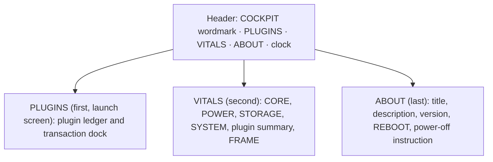
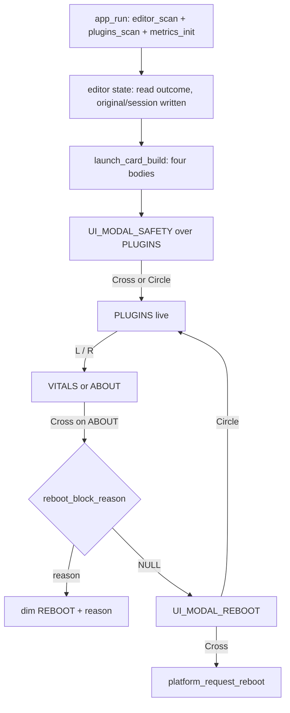
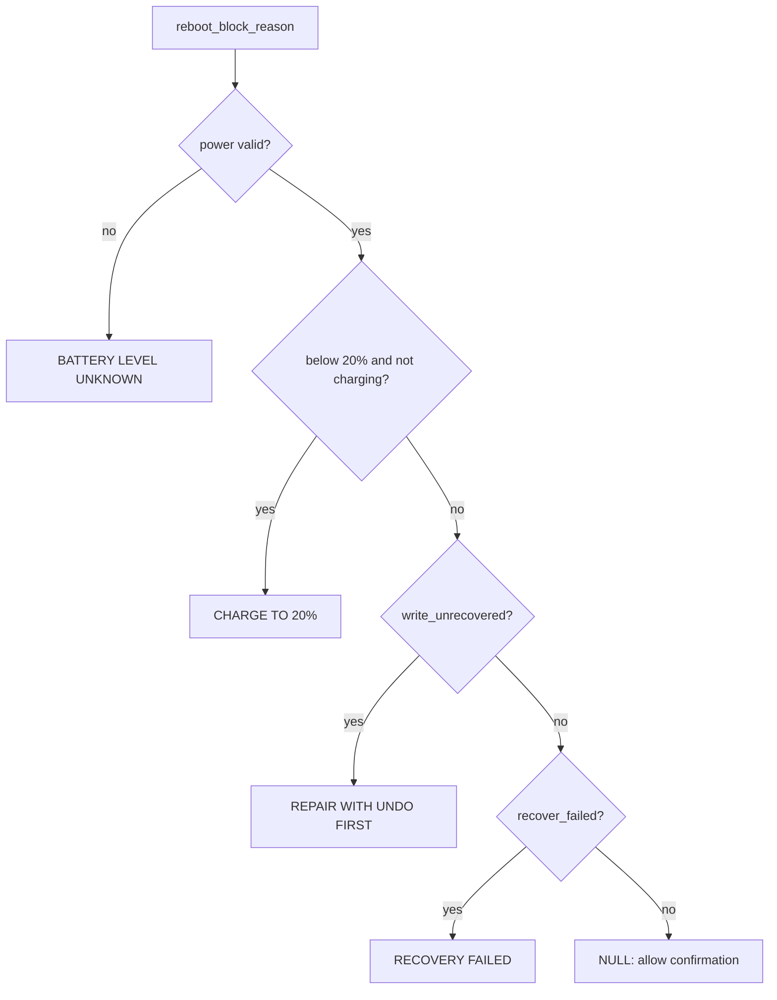

# Plugin-Manager-First COCKPIT with Vitals and About - Plan

## Goal Capsule

- **Objective:** A Vita owner opens COCKPIT and lands in a taiHEN `config.txt` plugin manager that can show, enable, and disable plugins safely, with VITALS as a secondary system-information screen and an ABOUT page that identifies the build and offers a guarded reboot.
- **Means:** reorder the tabs, add a launch safety card, add the ABOUT page, rename the dashboard to VITALS, and publish the result as v1.01.
- **Product authority:** this Product Contract and the user's positioning directive. The project's existing safety rules, including D99 and the config-manager write protocol, remain binding.
- **Open blockers:** none for planning. Hardware confirmation of the final build remains a post-release check.

## Product Contract

### Summary

COCKPIT becomes a plugin manager first: the app opens on PLUGINS, where the user can see every taiHEN entry and stage enables and disables without editing a file by hand. VITALS keeps the machine readouts as a secondary screen, and a new ABOUT page closes the set with the build identity, a guarded reboot, and the console's real power-off instruction.

### Problem Frame

The people who use COCKPIT install taiHEN plugins by editing `config.txt`, a file where one wrong line can leave a console that will not boot. COCKPIT already limits that risk: it snapshots the active file at launch, writes through a verified sibling swap, and keeps one-step undo. None of that is visible before a new user starts, and the plugin manager sits behind a dashboard that looks like the main event. The result is an app that protects the risky job while presenting a different job first.

The product direction is now explicit. The config manager is the reason to install COCKPIT. VITALS answers "what is this machine doing" for the user who is already inside the app; it is not the entry point. The documentation, the About copy, and the release all need to say the same thing.

### Key Decisions

- **The plugin manager is the product; VITALS is secondary.** (session-settled: user-directed — chosen over dashboard-first positioning: the config manager is the job users install COCKPIT for.) Governs R1, R3, R4.
- **Tab order is PLUGINS, VITALS, ABOUT, and the app launches on PLUGINS.** (session-settled: user-directed — chosen over keeping VITALS as the landing screen: the first tab should be the primary job.) Governs R1, R2.
- **ABOUT offers no power-off control and prints the console's real power-off instruction.** (session-settled: user-directed — chosen over a standby button or a mislabeled POWER OFF button: userland cannot request a true shutdown, so a button would claim a capability the app does not have.) Governs R14.
- **The safety card appears on every launch and stores no acknowledgement.** (session-settled: user-directed — chosen over a once-ever marker: no new persistent state, and the reminder repeats before every editing session.) Governs R8, R11.
- **A reboot from ABOUT warns about a staged batch and proceeds on confirm.** (session-settled: user-directed — chosen over refusing the reboot or silently applying the batch: reboot stays a reboot, and the loss of the draft is stated.) Governs R16.
- **The result ships as v1.01 in a new patch release.** (session-settled: user-directed — chosen over replacing the published v1.00 tag or jumping to v1.10: keeps release history honest while presenting the v1 production line.) Governs R19, R20.
- **ABOUT reuses the dock's battery floor for reboot.** A reboot request below 20% while discharging, with an invalid power read, or in the editor's repair state is blocked with the reason shown. Governs R15.

### Requirements

#### Product and navigation

- R1. COCKPIT opens on PLUGINS, with VITALS second and ABOUT last in the tab bar.
- R2. L and R move one tab in the pressed direction and wrap, so RIGHT from ABOUT reaches PLUGINS and LEFT from PLUGINS reaches ABOUT.
- R3. The app describes itself as a taiHEN `config.txt` plugin manager first and a system-information viewer second in the README, the About copy, and user-facing docs.
- R4. The dashboard tab and every current-state user-facing reference are renamed from HOME to VITALS; no visible or current-state documented HOME tab remains.

#### Plugin manager

- R5. PLUGINS keeps its current capabilities: list every active or commented path, group entries by load target, show the current load state and the next-boot state, stage toggles, save, confirm and reboot, restore the original or previous session, and undo the last write.
- R6. PLUGINS is the only surface that stages or writes `config.txt`; no other tab writes or stages config changes.
- R7. Every plugin state shown is derived from the active config and the launch set; an unknown state renders as absent (`--`, `N/A`, or `MISSING`) rather than a guess.

#### Launch safety card

- R8. Every launch shows a dismissible safety card before the user can act on the plugin list. The card explains that COCKPIT manages the active taiHEN `config.txt`, that manual edits are risky and hard to undo, that COCKPIT writes `.original` once and `.session` at the start of each session, and that enabling and disabling through COCKPIT is safer. The snapshot sentence appears only when the launch snapshot succeeded; when it failed or no config could be read, the card states that no session snapshot was written.
- R9. The card describes only behavior the app actually performs. It must not promise a general backup history or a guaranteed recovery.
- R10. The card appears after the launch scan and the session backup attempt complete, and its snapshot sentence is composed from that result, so the card never claims a backup the app did not write.
- R11. The card is a blocking modal over the whole app: the plugin list, the dock, L/R, and the D-pad are inert while it is up. Cross or Circle dismisses it. No acknowledgement file or other persistent state is written, so the card shows again on the next launch.

#### ABOUT

- R12. ABOUT shows the COCKPIT title, a short description of the plugin-manager-first product, and the running version with its build number.
- R13. ABOUT offers REBOOT as its only console action, and a confirmation step is required before any reboot request is sent.
- R14. ABOUT shows the true power-off instruction — hold the power button for two seconds, then choose Power Off — and offers no power-off button.
- R15. Reboot is blocked when the power reading is invalid, when the battery is below 20% and discharging, when `write_unrecovered` is set, or when `recover_failed` is set. Charging below 20% does not block. While blocked, ABOUT dims REBOOT in place, shows the matching reason (`BATTERY LEVEL UNKNOWN - CHARGE BEFORE REBOOTING`, `REBOOT BLOCKED - CHARGE TO 20%`, `REPAIR WITH UNDO FIRST`, or `RECOVERY FAILED`), and does not open the confirmation. Other read-only reasons, such as `NO CONFIG.TXT` or `CONFIG TOO LARGE`, do not block a reboot.
- R16. When a staged batch or a restore preview is pending, the reboot confirmation states in its own words that the pending work will be discarded, labels its confirm action `REBOOT AND DISCARD`, and points to the PLUGINS dock as the place that applies the batch or restore. When the config is already saved and waiting for boot, the confirmation says the reboot will apply it and labels its action `REBOOT`.
- R17. A failed reboot request is reported with the real recovery path: hold the power button for two seconds and choose Power Off; if the screen does not respond, hold for five seconds for a forced shutdown. The app never claims that a reboot happened when the request failed.
- R18. The version and build shown on ABOUT come from the build that produced the running VPK, not from a hardcoded string. ABOUT shows the release label `1.01` and the build number.

#### Release and documentation

- R19. `VITA_VERSION` becomes `01.01`, and the artifact is `cockpit-v01.01-b<build>.vpk`; the GitHub release tag stays `v1.01`.
- R20. A GitHub release `v1.01` is published from the final source tree with the VPK attached as the latest normal release (not a prerelease). The release body names the HOME-to-VITALS rename, the PLUGINS landing screen, the per-launch safety card, the absent power-off button, and the hardware checks still pending; it does not call the build verified.
- R21. The README, `docs/PROJECT.md`, `docs/ARCHITECTURE.md`, `docs/DESIGN.md`, `AGENTS.md`, `screenshots/README.md`, and `docs/reddit-post.md` are updated to the plugin-manager-first framing, the new tab order, the safety card, and the v1.01 release. `docs/DECISIONS.md` gets a new numbered entry; earlier entries, `docs/threads/`, and `docs/reviews/` are append-only and keep their original wording, with a new dated thread entry recording this work.
- R22. Preview scenes and the curated screenshots are regenerated so the tab bar, the VITALS name, and the ABOUT page match the shipped build.
- R23. The release asset's SHA-256 is recorded in `README.md`, `docs/PROJECT.md`, and `AGENTS.md`.
- R24. Decision-log history is preserved: new decisions receive new numbers, and no earlier entry is rewritten.

#### Constraints

- R25. Every displayed number stays real. A reading the platform cannot supply stays `--` or `N/A`.
- R26. No plugin, kernel module, system plugin, network, audio, camera, motion, or FTP work is introduced.
- R27. Config writes remain limited to the active `config.txt` and its `.original`, `.session`, and `.undo` snapshots. `boot_config.txt` is never opened.
- R28. The VPK contains only `eboot.bin` and `sce_sys/`.

### Key Flows

- F1. Launch and safety card.
  - **Trigger:** the user launches COCKPIT.
  - **Steps:** scan the active config, attempt the `.original` and `.session` snapshots, sample metrics, compose the safety card from the snapshot result, show it as a blocking modal over PLUGINS, then dismiss on Cross or Circle.
  - **Outcome:** the user starts in the manager and has seen why the app is safer than a manual edit.
  - **Covers:** R1, R5, R8, R9, R10, R11.
- F2. Tab navigation.
  - **Trigger:** L or R.
  - **Steps:** step one tab and wrap at either end. VITALS scrolls; ABOUT does not.
  - **Outcome:** every surface is reachable with one repeated input.
  - **Covers:** R1, R2, R4.
- F3. Enable or disable a plugin.
  - **Trigger:** Cross on a plugin row.
  - **Steps:** stage the toggle, review the dock, choose SAVE or CONFIRM & REBOOT, write once, read back.
  - **Outcome:** the next boot runs the intended set, or the failed write is named with its stage.
  - **Covers:** R5, R6, R7, R27.
- F4. Reboot from ABOUT.
  - **Trigger:** Cross on ABOUT.
  - **Steps:** evaluate the reboot gate first; when it returns a reason, dim REBOOT and show it without opening the confirmation. When it returns NULL, open the confirmation, then send the cold-reset request on confirm.
  - **Outcome:** the console reboots, or the user is told exactly what to do instead.
  - **Covers:** R13, R15, R16, R17.
- F5. Ship v1.01.
  - **Trigger:** implementation and host verification are complete.
  - **Steps:** build the safe variant first, then the default build last; run host tests, render previews, refresh screenshots, update docs, commit, tag, push, and publish the release with the default VPK and its hardware-status notes.
  - **Outcome:** the latest release carries the artifact from the final source tree.
  - **Covers:** R19, R20, R21, R22, R23, R24.

### Acceptance Examples

- AE1. **First launch.** The card appears after the scan and backup finish. L/R and the list are inert; Cross closes it, and the plugin list accepts input only afterward.
- AE2. **Second launch.** The card appears again, and no acknowledgement file exists on the console.
- AE3. **Tab wrap.** RIGHT on ABOUT reaches PLUGINS. LEFT on PLUGINS reaches ABOUT.
- AE4. **Reboot with no draft.** Cross on ABOUT opens the confirmation. Cross again sends the reboot request; Circle closes the confirmation with no request.
- AE5. **Reboot with a staged batch.** The confirmation says the batch will be discarded, labels its action `REBOOT AND DISCARD`, and points to the PLUGINS dock. Confirming reboots without changing `config.txt`; the file's bytes are unchanged.
- AE6. **Battery floor.** At 15% and discharging, REBOOT is dimmed with the reason and the confirmation does not open. At 15% and charging, it is allowed. With an invalid power read, it is blocked.
- AE7. **Version identity.** The version and build on ABOUT match the VPK's version segment and the release tag, ignoring the leading zero and the `v` prefix.
- AE8. **Power-off copy.** ABOUT has no power-off button, and its instruction matches the console's hold-power path.
- AE9. **Plugin round trip.** Disable a `*main` plugin, save, and reboot. The row shows `NEXT OFF` before the reboot and `NOT LOADED` after it.
- AE10. **Documentation consistency.** A search of current-state docs finds no HOME tab and no claim that COCKPIT is dashboard-first; earlier decision entries, historical threads, and review records are excluded.
- AE11. **Failed snapshot write.** When the config reads but a snapshot write fails, the card says no session snapshot was written and promises no restore point; editing stays available per D61.
- AE12. **Reboot with a restore preview over a draft.** The ABOUT confirmation says the preview and draft will be discarded, labels its action `REBOOT AND DISCARD`, and points to the PLUGINS dock; confirming does not restore or write anything.
- AE13. **Unreadable or oversized config.** When the config cannot be read or exceeds the editor's limits, the card says no session snapshot was written, states that editing is locked, and promises no restore point.

### Success Criteria

- A first-time user can say what COCKPIT manages and why the session backup makes editing safer after dismissing the card.
- A user can disable and re-enable a plugin entirely on the console without a file manager.
- The console boots after a saved change.
- ABOUT's version matches the release tag and the VPK name.
- No screen or current-state document calls the dashboard HOME or presents COCKPIT as dashboard-first; earlier decision entries, threads, and reviews keep their wording.
- The v1.01 release is the latest release, its asset digest matches the recorded value, and its notes state the hardware status.

### Scope Boundaries

- **Deferred for later:** a true power-off request, a once-ever notice with a persisted acknowledgement, plugin search or filtering, a backup browser beyond the three existing snapshots, and an in-app updater.
- **Outside this product's identity:** GPU load or applied clocks, a kernel or system plugin, FTP or network features, audio, camera, motion, and a Quick Menu panel.

### Dependencies / Assumptions

- The launch scan attempts `.original` once and `.session` every session before any edit is possible (`src/core/plugin_editor.c`, `platform_backup_config`). A failed snapshot sets `backup_warning` and leaves editing open (D61), so the card must branch on that state.
- `scePowerRequestColdReset` is the only reboot call (`src/platform/platform_psp2.c`). That a userland UNSAFE eboot may perform it on 3.65 Enso remains `[C]`.
- VitaSDK `psp2/power.h` exposes no power-off request. Standby is not shutdown.
- The build already carries `VITA_VERSION` and `COCKPIT_BUILD`; ABOUT needs those values exposed to the UI.
- The power-off instruction follows the official PS Vita user guide (hold the power button for two seconds, then choose Power Off). The target console has not been checked against it, so the post-release hardware checklist includes it.
- The existing plugin write, snapshot, and undo behavior is unchanged by this work.

### Sources / Research

- `src/core/plugin_editor.c` — launch scan, `.original`/`.session` snapshot, write path.
- `src/platform/platform_psp2.c` — `platform_request_reboot`, `platform_backup_config`.
- `src/app/app.c`, `src/ui/plugin_nav.c`, `src/ui/tabbar.c` — current launch tab and two-tab navigation.
- VitaSDK `psp2/power.h` — the available power requests and the absence of a shutdown call.
- `docs/DECISIONS.md` — D99 (userland-only scope) and D103 (real CPU readings).
- `screenshots/README.md`, `docs/reddit-post.md` — the current public framing that must change.

---

## Planning Contract

**Product Contract preservation:** changed in review. R15 now applies the existing repair-state block to ABOUT, R16 names ABOUT's own discard action instead of the dock's, R17 names the real recovery path, AE10 excludes earlier decision entries, AE11 and AE13 split the snapshot-write failure from the unreadable/oversized case, AE12 covers the discard label, and F4 gates before opening the confirmation. No other product decision changed.

### Key Technical Decisions

- KTD1. **The editor records the launch snapshot result; the card never infers it.** Add per-launch `original_snapshot_present` and `session_snapshot_written` plus the read outcome to the editor state, set from the existing `original_ok`/`session_ok` results in the scan. `original_ok` means the original exists or was written this launch, so the card says the original is present and never claims it was written this launch. `backup_warning` and the `*_available` probes answer different questions and would make the card lie when a write failed but an older snapshot exists. Governs R8, R9, R10, R27.
- KTD2. **The modal layer gains explicit choice kinds.** Add `UI_MODAL_SAFETY` (accept or cancel dismisses) and `UI_MODAL_REBOOT` (confirm or cancel), with matching navigation actions and a key hint per kind. The existing error modal treats Cross and Circle identically, so without this the confirmation would reboot on Circle. Governs R11, R13, R17, AE4.
- KTD3. **The safety-card copy lives in a host-linkable `ui/launch_card` module.** The module takes the editor's launch result and returns the title and body; it includes only core headers, no gfx or psp2. `app.c` is not host-linked, so copy composed there could not be tested or previewed. Governs R8, R9, R10, AE1, AE11.
- KTD4. **One reboot-block reason serves both the dock and ABOUT.** Extract a function returning the block reason or NULL in this order: invalid power, below 20% while discharging, `write_unrecovered`, `recover_failed`. Those four conditions are the whole gate; use `editor_readonly_reason()` only to source the `REPAIR WITH UNDO FIRST` and `RECOVERY FAILED` strings, not to add `NO CONFIG.TXT` or `CONFIG TOO LARGE`. The dock warning calls it, so the two surfaces cannot diverge. Governs R15, R16.
- KTD5. **ABOUT's reboot is blocked in the repair state.** The commit path already refuses to reboot after an unrecovered write; ABOUT must not bypass that rule. Use `editor_readonly_reason()` only to source the two repair strings; other read-only reasons do not block a reboot. Governs R15, R17.
- KTD6. **Build identity comes from one generator.** `tools/gen-build-id.sh` reads `VITA_VERSION` from `CMakeLists.txt` plus `BUILD_NUMBER` and writes `build/generated/cockpit_build.h`. CMake, `tools/test/run.sh`, and `tools/preview/run.sh` all invoke it and compile the same header. The VPK name, ABOUT, tests, and previews then cannot drift. Governs R18, R19, AE7.
- KTD7. **Tabs become an explicit three-value enum with direction-aware actions.** `UI_TAB_PLUGINS = 0`, `UI_TAB_VITALS`, `UI_TAB_ABOUT`; L and R move one step and wrap. Input and drawing gate on the actual tab, so ABOUT cannot inherit the PLUGINS selection walk or its scroll. Governs R1, R2, R4.
- KTD8. **The confirmation is ABOUT-only; the dock keeps its one-press actions.** The dock's actions already carry the consequence on their labels, and R5 preserves the dock. Adding confirmation there would double the primary transaction. Governs R5, R13.
- KTD9. **The confirmation copy branches on the editor state.** Draft and preview lose pending work; SAVED is the state where a reboot applies the written batch. ABOUT labels its own action `REBOOT AND DISCARD` or `REBOOT` and points to the PLUGINS dock; it does not echo the dock's `CONFIRM & REBOOT` or `DISCARD DRAFT & RESTORE` labels, because ABOUT writes nothing. Governs R16, AE5, AE12.

### High-Level Technical Design

Launch and modal path:

Reboot gate order:

### Assumptions

- No console is available during implementation; the hardware checklist is recorded and the release notes state it.
- The existing 20% battery predicate matches R15 exactly, including the boundary.
- The dock's one-press reboot stays acceptable; the confirmation was chosen for ABOUT, not for the existing transaction.
- `scePowerRequestColdReset` remains `[C]` until the console run.

### Risks and Dependencies

- The launch card is the first screen. Its copy must fit its own geometry; a truncated body could invert the safety claim.
- The new modal kind changes a documented architecture rule ("there are no choice modals"). ARCHITECTURE and DECISIONS must be updated in the same change.
- The HOME-to-VITALS rename reaches tests, preview scene names, screenshots, and docs. A missed current-state reference fails R4 and AE10.
- Build-identity drift between the VPK, ABOUT, tests, and previews is the failure KTD6 exists to prevent.
- The release is published before hardware confirmation; the notes must say so and the project remains `built`.

---

## Implementation Units

### U1. Three-tab navigation and the VITALS rename

- **Goal:** PLUGINS opens first, VITALS is the second tab, ABOUT is the third, and L/R move one tab with wrap. Each tab owns its own input and drawing behavior.
- **Requirements:** R1, R2, R4, R5, R6, R7, R25.
- **Dependencies:** none.
- **Files:** `src/ui/ui_state.h`, `src/ui/plugin_nav.c`, `src/ui/plugin_nav.h`, `src/ui/tabbar.c`, `src/app/app.c`, `src/app/screen.c`, `src/panels/registry.c`, `tools/test/test_ui.c`, `tools/test/test_editor.c`, `tools/preview/preview.c`.
- **Approach:** Replace the two-value tab enum with `UI_TAB_PLUGINS`, `UI_TAB_VITALS`, `UI_TAB_ABOUT`. Split `PLUGIN_NAV_TAB_TOGGLE` into left and right actions. Set the launch tab to PLUGINS. Gate the D-pad, the stick, and `screen_draw` on the actual tab so ABOUT has no selection walk and no scroll. Place PLUGINS at x 210, VITALS at 310, and ABOUT at 400, and move the `L/R` hint to x 480 so the third label does not overprint it. Keep the PLUGINS ledger and write path unchanged; no other tab gains a config write. Rename `home_scroll` and the HOME-facing helpers to VITALS terms, and update the test and preview references that use the old names.
- **Patterns to follow:** the existing `plugin_nav_action` switch and `plugin_flow_focus_list`; the panel registry's layout table.
- **Test scenarios:**
  - RIGHT from PLUGINS reaches VITALS, RIGHT again reaches ABOUT, RIGHT again returns to PLUGINS.
  - LEFT from PLUGINS reaches ABOUT; LEFT from ABOUT reaches VITALS.
  - A fresh app state has `tab == UI_TAB_PLUGINS`.
  - Up, Down, and the analog stick on ABOUT leave `selection` and `plugins_scroll` unchanged.
  - A PLUGINS selection and scroll position survive a round trip through VITALS and ABOUT.
- **Verification:** host tests pass; a preview scene shows three labels with the active underline on the correct tab and no collision with the hint.

### U2. Launch snapshot truth and safety-card copy

- **Goal:** The editor records what the launch snapshot actually wrote, and a pure module turns that result into the card's title and body.
- **Requirements:** R8, R9, R10, R27.
- **Dependencies:** none.
- **Files:** `src/core/plugin_editor.c`, `src/core/plugin_editor.h`, `src/ui/launch_card.c`, `src/ui/launch_card.h`, `tools/test/test_ui.c`, `tools/test/run.sh`, `tools/preview/preview.c`, `CMakeLists.txt`.
- **Approach:** Store `original_snapshot_present`, `session_snapshot_written`, and the read status on the editor state at scan time, sourced from the existing per-snapshot results. Reset them at the start of each scan. `launch_card_build` returns four bodies: snapshot written; read OK but a snapshot write failed (editing available); unreadable or oversized (editing locked, no restore); no config (editing locked, name restore only when the editor says it is available). A fifth locked modifier covers read-OK states that are still locked (`TOO MANY LINES`, `TOO MANY PLUGIN ROWS`, `RECOVERY FAILED`), so the card never invites editing the editor will refuse. The original sentence says the original is present, not that it was written this launch.
- **Patterns to follow:** `src/ui/core_text.c` as a pure formatter linked by the host tests; the `plugin_flow` policy module.
- **Test scenarios:**
  - Read OK, both snapshots written: the body states that a session snapshot was written.
  - `.session` write fails while an older `.session` file exists: the body says no session snapshot was written and does not claim one.
  - `.original` write fails: the body names the missing original and does not claim both snapshots.
  - Config too large or unreadable: the body says editing is locked and promises no restore.
  - No config on either mount, no readable snapshot: the body says no session snapshot and offers no restore.
  - No config but a readable snapshot: the body names the restore path without claiming a new snapshot.
  - Read OK but the editor is locked (`TOO MANY LINES`, `TOO MANY PLUGIN ROWS`, `RECOVERY FAILED`): the body says editing is locked and invites no edit.
  - Covers AE1, AE11, and AE13.
- **Verification:** the new host tests pass, and each card body renders without truncation in the preview.

### U3. Safety-card surface and the choice modal

- **Goal:** The launch card is a blocking surface over the whole app, and the modal layer can express confirm versus cancel.
- **Requirements:** R8, R11, R13, AE1, AE2, AE4.
- **Dependencies:** U1, U2.
- **Files:** `src/ui/ui_state.h`, `src/ui/modal.c`, `src/ui/modal.h`, `src/ui/plugin_nav.c`, `src/ui/plugin_nav.h`, `src/app/app.c`, `src/gfx/theme.c`, `src/gfx/theme.h`, `tools/test/test_ui.c`, `tools/preview/preview.c`, `tools/preview/run.sh`.
- **Approach:** Add `UI_MODAL_SAFETY` and `UI_MODAL_REBOOT` with confirm and cancel actions. Draw a scrim under the modal so the app behind it reads as unavailable, and draw the key hint per kind. Size the safety card for its body rather than reusing the 240 px error modal, and verify the composed body fits. Open the safety card once per launch, after the scan and snapshot attempt, before any list input is accepted.
- **Patterns to follow:** the existing `INPUT_CONTEXT_MODAL` routing and `modal_open_error_titled` call sites; the theme's panel chrome.
- **Test scenarios:**
  - Cross dismisses the safety card; Circle also dismisses it.
  - L/R, the D-pad, the stick, Cross on a row, and the dock are inert while the card is up.
  - Cross in the reboot confirmation returns confirm; Circle returns cancel and sends no request.
  - A second launch shows the card again; no acknowledgement file is created.
  - Covers AE1, AE2, and AE4.
- **Verification:** host tests pass; preview scenes show the card, the scrim, and both modal hints.

### U4. Reboot gate and the ABOUT action

- **Goal:** One gate decides whether a reboot is allowed, and ABOUT sends the request only after confirmation.
- **Requirements:** R13, R15, R16, R17, R5, AE4, AE5, AE6, AE12.
- **Dependencies:** U1, U3.
- **Files:** `src/ui/plugin_flow.c`, `src/ui/plugin_flow.h`, `src/app/app.c`, `src/ui/plugin_nav.c`, `src/ui/plugin_nav.h`, `tools/test/test_editor.c`, `tools/test/test_ui.c`.
- **Approach:** Extract `plugin_flow_reboot_block_reason()` in the KTD4 order and have the dock warning call it. ABOUT dims the action and prints that reason while blocked. The confirmation body branches on draft, preview over draft, preview over clean, and SAVED, and labels its own action `REBOOT AND DISCARD` or `REBOOT`. While the confirmation is open, re-run the gate every frame; if it turns non-NULL, close the confirmation with the reason. The request itself reuses the existing reboot helper, with the R17 recovery copy.
- **Patterns to follow:** `plugin_flow_battery_blocked`, `plugin_flow_action_label`, and `request_reboot` in `src/app/app.c`.
- **Test scenarios:**
  - At 15% and discharging, the gate returns the charge reason; at 15% and charging, it returns NULL.
  - An invalid power read returns the unknown-battery reason.
  - `write_unrecovered` returns `REPAIR WITH UNDO FIRST`; `recover_failed` returns `RECOVERY FAILED`.
  - A draft confirmation says the draft will be discarded and labels its action `REBOOT AND DISCARD`; a preview-over-draft confirmation names the preview and draft loss and the PLUGINS dock; a SAVED confirmation says the saved config applies at next boot and labels its action `REBOOT`.
  - Circle in the confirmation sends no request; Cross sends exactly one.
  - A confirmation opened with a valid reading and a power sample that turns blocking closes itself with the reason and sends no request.
  - Covers AE4, AE5, AE6, and AE12.
- **Verification:** host tests pass; the dock shows the same reason the gate returns.

### U5. ABOUT screen and build identity

- **Goal:** ABOUT identifies the build and the product, shows the real power-off path, and exposes the guarded REBOOT.
- **Requirements:** R12, R14, R18, R19, AE7, AE8.
- **Dependencies:** U1, U4.
- **Files:** `src/ui/about.c`, `src/ui/about.h`, `src/app/screen.c`, `CMakeLists.txt`, `tools/preview/preview.c`, `tools/preview/run.sh`, `tools/test/run.sh`, `tools/test/test_ui.c`.
- **Approach:** Generate one build-identity header from `VITA_VERSION` and `COCKPIT_BUILD`, and compile it into the app, tests, and previews. ABOUT is one CHROME_SATELLITE panel titled `ABOUT`: the product name at label scale with no glow, the plugin-manager-first description, the release label `1.01` and build number as value readouts, then the REBOOT action and the hold-power block. REBOOT is the tab's single focus target, drawn with the dock's 2 px white outline and a micro `CROSS` hint while ABOUT is active; it loses the outline and bright text when the gate blocks it. No power-off button.
- **Patterns to follow:** the panel chrome and readout hierarchy in `src/gfx/theme.h`; the build script's existing `VITA_VERSION` parsing.
- **Test scenarios:**
  - The release label formats `01.01` as `1.01`; the build number matches the VPK segment.
  - A blocked reboot shows the gate reason and no confirmation opens.
  - ABOUT has no power-off button and prints the hold-power instruction.
  - The REBOOT slab carries the focus outline and `CROSS` hint only while the gate allows it.
  - Covers AE7 and AE8.
- **Verification:** host tests and previews pass; the displayed identity matches the VPK name.

### U6. Preview matrix and curated screenshots

- **Goal:** The preview matrix covers every new state, the curated screenshots show the shipped tab order and ABOUT page, and no HOME scene name or image remains.
- **Requirements:** R22, AE1, AE6, AE11, AE12, AE13.
- **Dependencies:** U2, U3, U4, U5.
- **Files:** `tools/preview/preview.c`, `tools/preview/run.sh`, `screenshots/*.png`, `screenshots/README.md`, `README.md`, `docs/DESIGN.md`, `docs/preview-*.png`.
- **Approach:** Add scenes for the safety card (success, failed snapshot, unreadable/oversized, no config), ABOUT (valid, blocked, invalid power), the reboot confirmation (draft, preview over draft, preview over clean, saved), and the three-tab header. Rename `preview-home-*` scenes and images to `preview-vitals-*`; update the `docs/preview-*.png` copies and the DESIGN §9 table. Regenerate the curated images so the first screen is PLUGINS.
- **Patterns to follow:** the existing `reset_scene` and fake-platform hooks (`fake_fail_backup`, `fake_set_power`, `fake_set_power_absent`).
- **Test scenarios:**
  - The preview renders every new scene without truncation or overlap.
  - The curated screenshots show PLUGINS first and the ABOUT page.
  - No `preview-home-*` scene name or `docs/preview-home-*` image remains.
  - Covers AE1, AE6, AE11, AE12, and AE13 visually.
- **Verification:** `./tools/preview/run.sh` renders all scenes; the screenshot map names each new image.

### U7. Documentation, version bump, and the v1.01 release

- **Goal:** The docs describe the plugin-manager-first product, and the final source tree ships as v1.01 with the VPK on GitHub.
- **Requirements:** R3, R19, R20, R21, R23, R24, R26, R28, AE10.
- **Dependencies:** U1, U2, U3, U4, U5, U6.
- **Files:** `CMakeLists.txt`, `README.md`, `AGENTS.md`, `docs/PROJECT.md`, `docs/ARCHITECTURE.md`, `docs/DESIGN.md`, `docs/DECISIONS.md`, `docs/threads/2026-11-09-plugin-manager-first.md`, `docs/reddit-post.md`, `BUILD_NUMBER`.
- **Approach:** Set `VITA_VERSION` to `01.01`. Add a decision for the choice modal, the launch card, and the ABOUT reboot gate; amend the architecture note that said there are no choice modals. Rewrite current-state docs to the plugin-manager-first framing and the new tab order. Leave earlier decision entries, threads, and reviews intact; add the new thread record. Run the safe build first and the default `./build.sh` last, then record the digest, tag `v1.01`, push, and publish a normal release with notes that name the rename, the landing tab, the card, the absent power-off button, and the pending hardware checks.
- **Patterns to follow:** the existing release flow that produced v1.00; the docs table in `AGENTS.md`.
- **Test scenarios:**
  - `CMakeLists.txt` carries `01.01`; the default artifact is `cockpit-v01.01-b<build>.vpk`.
  - The default VPK is the one left in `build/` after the safe build runs first.
  - The VPK contains only `eboot.bin` and `sce_sys/`.
  - The release is public, not a prerelease, and its asset digest matches the recorded value.
  - A current-state doc search finds no HOME tab; earlier decision entries, historical threads, and reviews are excluded.
  - Covers AE10.
- **Verification:** default and safe builds are clean; the release is the latest normal release with the VPK attached.

---

## Verification Contract

| Gate | Command | Applies to |
|---|---|---|
| Safe build (first) | `./build.sh --safe` | U7 |
| Host policy and UI tests | `./tools/test/run.sh` | U1, U2, U3, U4, U5 |
| Preview render | `./tools/preview/run.sh` | U2, U3, U4, U5, U6 |
| Default build (last) | `./build.sh` | U5, U6, U7 |
| VPK contents | `unzip -l build/cockpit-v01.01-b*.vpk` | U7 |
| Artifact digest | `shasum -a 256 build/cockpit-v01.01-b*.vpk` | U7 |
| Docs links and fences | the check in `AGENTS.md` | U7 |
| Release state | `gh release view v1.01 --repo ghostmeson/vitacockpit` | U7 |
| Console checklist | flash the VPK; confirm PLUGINS launch, tab order, the card, ABOUT reboot, both hold-power paths, and a plugin disable/save/reboot round trip | post-release |

Run the safe build before the default build: `build.sh` keeps one VPK, so the default build must be the last artifact-producing step. The host suite and previews are the proof the implementer can run here. The console row is recorded for the hardware pass; it does not block the release, and the project stays `built` until it passes.

---

## Definition of Done

- U1 through U7 are complete, and every R-ID they cite is satisfied.
- The host suite passes with the new tab, card, modal, gate, and identity checks; all preview scenes render.
- Default and safe builds are clean with no compiler warnings.
- The default VPK is `cockpit-v01.01-b<build>.vpk`, is the last artifact produced, contains only `eboot.bin` and `sce_sys/`, and comes from the final source tree.
- The SHA-256 is recorded in `README.md`, `docs/PROJECT.md`, and `AGENTS.md`.
- The GitHub release `v1.01` is the latest normal release, carries the VPK, and states the pending hardware checks.
- The README, project docs, design doc, architecture, decision log, screenshot map, and announcement use the plugin-manager-first framing and the three-tab order.
- No current-state doc or screen calls the dashboard HOME; earlier decision entries, threads, and reviews keep their original wording.
- No `preview-home-*` scene name or preview image remains.
- No dead code, no unused link, and no second writer for `g_editor` or `g_metrics` remains.
- The console checklist is recorded; the project stays `built`, not `verified`.
