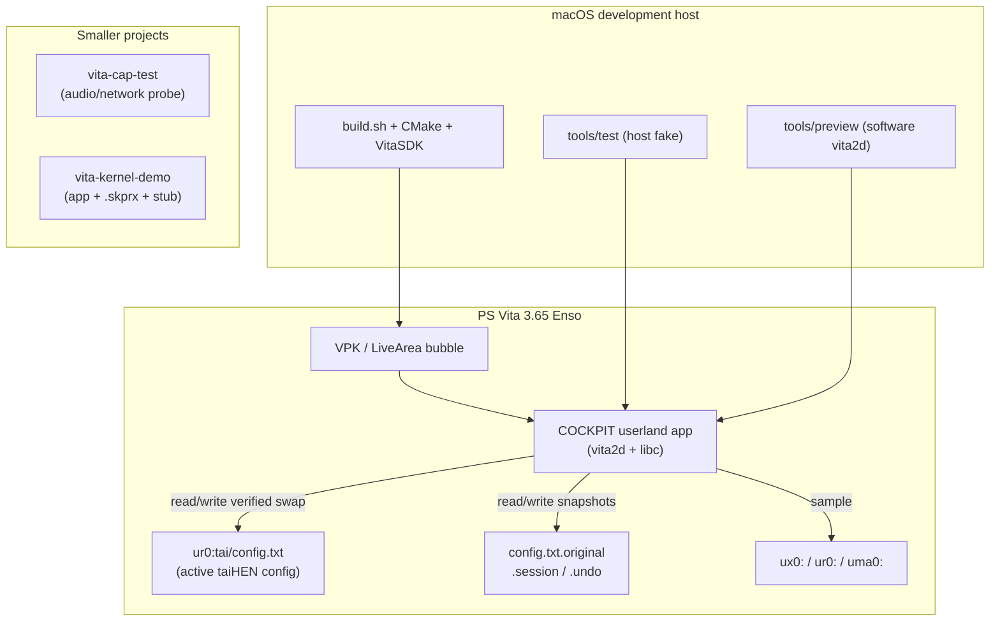
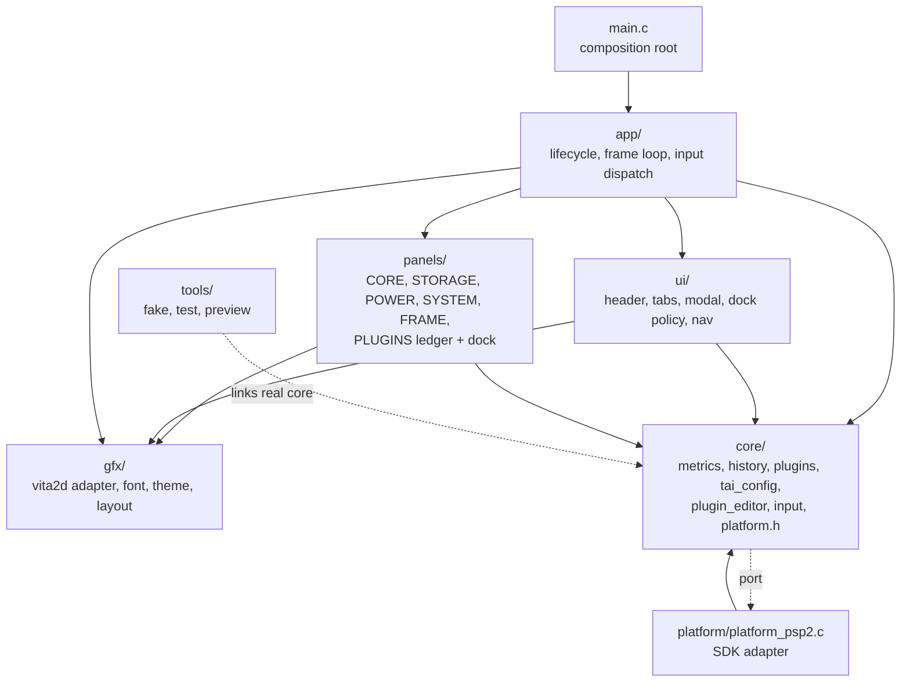
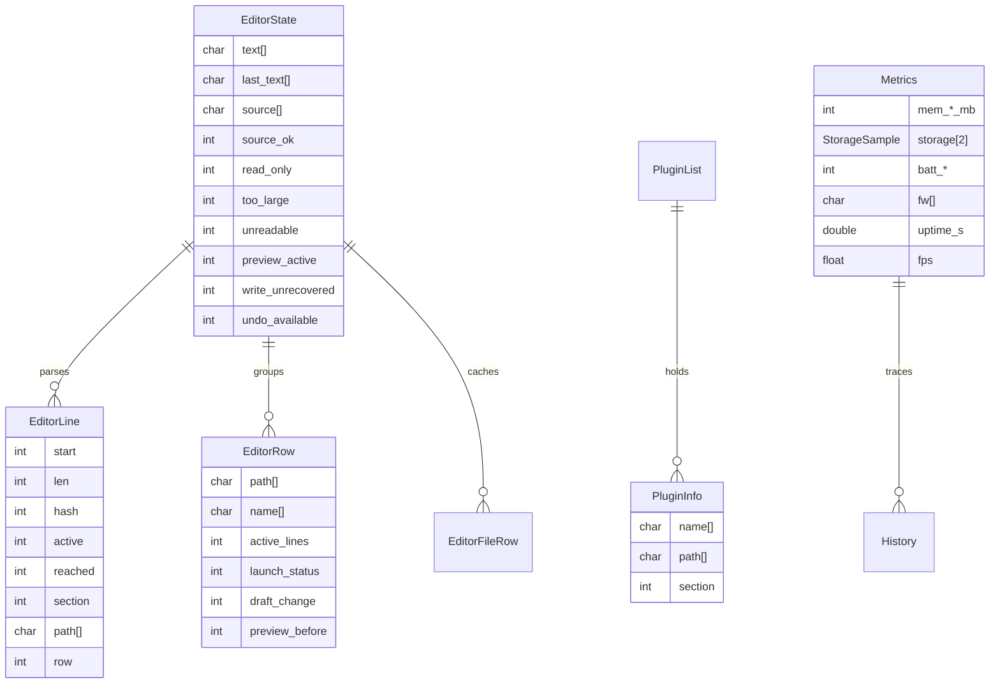
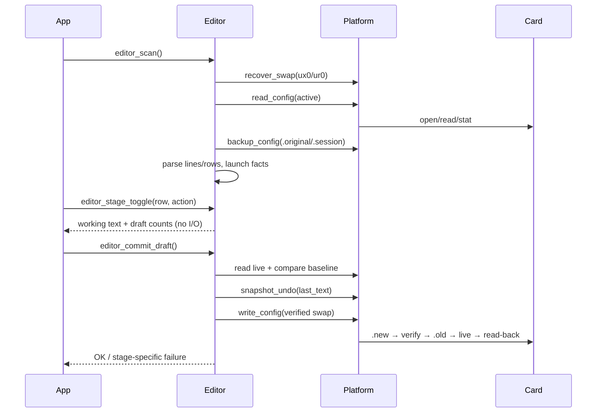

# Phase 1 — Discovery

Date: 2026-11-08
Scope: the whole workspace: `vita-cockpit`, `vita-cap-test`,
`vita-kernel-demo`, the workspace build/artifact rules, and the docs that
describe them.

## 1. System overview

| Project | What it is | Language / stack | Size |
|---|---|---|---|
| `vita-cockpit` | System dashboard + taiHEN `config.txt` transaction manager | C99, VitaSDK, libvita2d | 56 source files, 14,672 lines |
| `vita-cap-test` | I/O, PCM audio, WiFi/DNS/HTTP capability test | C99, VitaSDK | 1 source file, 344 lines |
| `vita-kernel-demo` | Userland app + on-demand taiHEN kernel plugin + generated stub | C99, VitaSDK, taiHEN | 2 source files, 196 lines |

Target: PS Vita 3.65 with permanent Enso. The console reports 3.74 because the
version string is spoofed; all NIDs, offsets, and APIs follow 3.65.

## 2. Container diagram



## 3. COCKPIT layers



The dependency rule holds: `core/` includes no `psp2/*`, no `vita2d.h`, and no
panel/UI header. The only `psp2/*` users are `app/app.c` (pad/process time) and
`platform/platform_psp2.c` (all device and file I/O); `gfx/draw.c` and `main.c`
use `vita2d.h`.

## 4. Data model



The config file is the source of truth; the editor keeps a byte-preserving
working copy plus a launch baseline. The only persistent writes are the active
config and its `.original` / `.session` / `.undo` siblings.

## 5. Key flows

### 5.1 Scan → stage → commit



### 5.2 Sampling → render

```mermaid
sequenceDiagram
  participant Loop
  participant Metrics
  participant Platform
  participant Screen
  Loop->>Metrics: metrics_sample_frame(dt)
  Loop->>Metrics: metrics_sample_slow() at 10 Hz
  Metrics->>Platform: read memory/storage/power/identity/rtc
  Platform-->>Metrics: values + ok flags
  Metrics->>Metrics: convert units, push history, set alert
  Loop->>Screen: screen_draw(t, &ui)
  Screen->>Screen: header, HOME panels or PLUGINS ledger+dock
```

## 6. External dependencies

| Dependency | Used by | Notes |
|---|---|---|
| VitaSDK 2026.08 | all | compiler, stubs, `vita-elf-create`, `vita-make-fself`, VPK tools |
| libvita2d | COCKPIT, cap-test, kernel-demo app | drawing, font/PGF |
| taiHEN | kernel-demo, console config | kernel plugin hooks and on-demand load |
| `ur0:tai/config.txt` | COCKPIT, console boot | read and byte-preserving edit only |
| `ur0:tai/boot_config.txt` | console only | COCKPIT never opens it |
| VitaShell FTP | all `send.sh` scripts | upload only; port 1337 |

## 7. Build and test structure

- `build.sh` owns the build number, hashes sources, invokes CMake, prunes old
  VPKs, and prints the artifact.
- CMake builds the VELF/SELF/VPK and packages `sce_sys/` plus (for kernel-demo)
  the `.skprx`.
- `tools/test/run.sh` links real `core/` against `tools/fake/fake_platform.c`.
- `tools/preview/run.sh` renders the real composition through a software
  vita2d shim.
- The two smaller projects have no host tests and no `docs/` tree.

## 8. Smells observed during discovery (undiagnosed)

1. `plugin_editor.c` is 2,100+ lines after the refactor and mixes parsing,
   model building, preview diffing, commit policy, and recovery.
2. `platform_write_config` removes `.old` before deciding whether the live file
   exists; the `.old` file is also the last-resort copy after a failed swap.
3. `tools/fake/fake_platform.c` has a 32 KiB file ceiling equal to the editor's
   read cap, so the "too large" branch cannot be reached in tests.
4. `build.sh` hashes sources but not `--safe`, `sce_sys/`, or `send.sh`; the
   safe/default variants can share one build number.
5. `vita-cockpit/build/` still contains `system-plugin/`, old `cockpit_clocks*`,
   `b141`/`b142`/`b143-safe` `.out` and `_param.sfo` files, and stale object
   files from deleted modules.
6. `vita-kernel-demo`'s app links the strong stub of the kernel plugin it loads
   at runtime, and that on-demand load is documented as shell-gated on this
   console.
7. `vita-cap-test` runs blocking DNS/TCP before its draw/input loop and has no
   socket timeouts.
8. Neither smaller project has a `docs/` directory, while the root README says
   every project does.
9. `docs/DESIGN.md` gives two different PLUGINS scroll formulas.
10. `docs/ARCHITECTURE.md`'s allowed-header table still names an SDK enum in
    `gfx/draw.c` that is no longer used.
